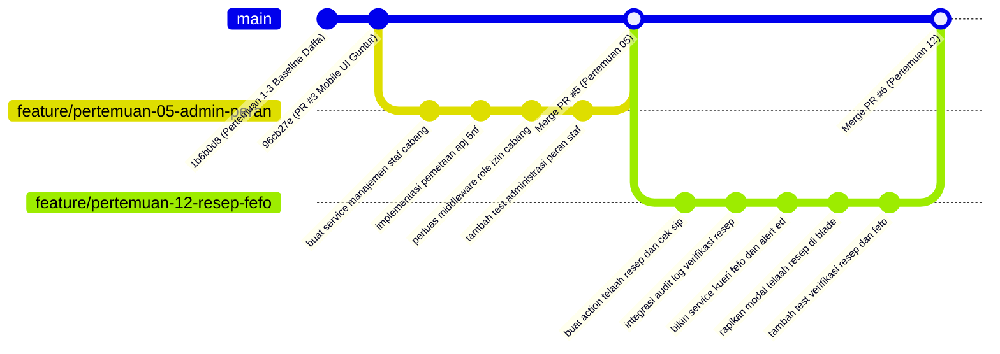

# Product Requirement Document (PRD) — Arya Dwi Mahendra
**Modul Praktikum:** Pertemuan 05 (Administrasi Cabang, Role RBAC & Hierarki Pengawasan APJ) & Pertemuan 12 (Verifikasi Resep Dokter & Manajemen Stok FEFO)  
**Penanggung Jawab:** Arya Dwi Mahendra  
**Peran Tim:** Pharmacy Operations, Compliance & Inventory Backend Engineer  
**Aplikasi:** Sistem Informasi Jaringan Apotek Multi-Klien (OmniPharma Network)  
**Dosen Pengampu:** Pak Devit Suwardiyanto  
**Target Repository:** `https://github.com/heliosparta18/startup.git` (Path: `D:\KELOMPOK PAK DEVIT`)  
**Tech Stack:** Laravel 13.25, Livewire 4.1, Tailwind CSS v4, MariaDB 11.4 / MySQL 8.4, Redis 7.2  

---

## 1. Deskripsi Modul & Tujuan Arsitektural (Module Description & Architectural Objectives)

### 1.1 Profil Mahasiswa & Pembagian Tanggung Jawab
Dalam rancang bangun sistem informasi apotek terdistribusi multi-klien OmniPharma Network, Arya Dwi Mahendra memegang peranan vital yang menjembatani regulasi kefarmasian nasional, otorisasi staf multi-cabang, serta tata kelola inventori fisik obat:
1. **Administrasi Cabang & Otorisasi Peran (Pertemuan 05):** Mengembangkan modul manajemen staf apotek multi-cabang, penugasan peran lokal (`peran_client_pengguna`), integrasi hak akses RBAC melalui middleware `EnsureUserHasRole`, dan pemodelan hierarki pengawasan farmasi berderajat normalisasi kelima (5NF) pada tabel `peta_pengawas_staf` antara Apoteker Penanggung Jawab (APJ) dan staf pelaksana/kasir.
2. **Verifikasi Resep Dokter & Penjaminan Mutu Klinis (Pertemuan 12 - Bagian A):** Membangun portal inspeksi dan telaah resep digital pada antarmuka operator cabang (`/cabang/{client}/resep`), mencakup validasi keabsahan Surat Izin Praktik (SIP) dokter, telaah kesesuaian dosis geriatri/pediatri, tindakan persetujuan (*approval*) dan penolakan (*rejection*) yang tersinkronisasi atomik dengan status pesanan, serta pencatatan jejak audit (*audit trail*) permanen pada `log_audit`.
3. **Manajemen Stok Berbasis FEFO (Pertemuan 12 - Bagian B):** Menerapkan algoritma perputaran stok *First-Expired, First-Out* (FEFO) pada kueri pemenuhan pesanan dan kartu stok fisik cabang (`stok_client`), menghitung selisih hari kedaluwarsa secara dinamis, mengelompokkan prioritas pengeluaran batch (`#1 FEFO`, `#2 Nanti`, `Kritis <5`), serta memicu sinyal peringatan dini (*early warning alert*) untuk batch obat yang mendekati masa kedaluwarsa (H-30 dan H-7).

```
┌────────────────────────────────────────────────────────────────────────────────────────┐
│              ALUR KERJA OPERASIONAL FARMASI & INVENTORI (MODUL ARYA)                   │
├────────────────────────────────────────────────────────────────────────────────────────┤
│  [Pertemuan 05: Super Admin Menetapkan Staf & APJ]                                     │
│  • Super Admin menugaskan Apoteker & Staf ke Cabang Banyuwangi Kota                    │
│  • Validasi masa berlaku penugasan (peran_client_pengguna)                            │
│  • Relasi 5NF Pengawasan: APJ membawahi Asisten Apoteker (peta_pengawas_staf)          │
│  • Middleware EnsureUserHasRole memverifikasi peran apoteker dan izin cabang aktif     │
│         │                                                                              │
│         ▼                                                                              │
│  [Pertemuan 12-A: Pesanan Obat Keras Masuk (#ORD-20260917-0042)]                       │
│  • Pelanggan memesan obat golongan 'Wajib Resep (Keras)' (Amodiaquine 200mg)           │
│  • Pesanan tertahan di status: 'menunggu_verifikasi'                                   │
│  • Apoteker membuka antrean telaah di /cabang/banyuwangi-kota/dashboard                │
│  • Telaah Klinis & Legalitas:                                                          │
│    - Nomor SIP Dokter: dr. Budi, Sp.PD (SIP: 503/SIP/2024) ──► Valid                   │
│    - Dosis Geriatri Pasien: Candi Chier (88 tahun)        ──► Valid                   │
│  • Keputusan: Setujui (Status Pesanan ──► 'diproses') atau Tolak (Alasan Wajib)        │
│  • Pencatatan otomatis ke log_audit (Aksi: VERIFIKASI_RESEP, Aktor: ID Apoteker)       │
│         │                                                                              │
│         ▼                                                                              │
│  [Pertemuan 12-B: Alokasi Pengeluaran Stok FEFO & Peringatan ED]                       │
│  • Sistem memeriksa batch fisik Amodiaquine 200mg di cabang terkait:                  │
│    - Batch #BTC-2024A: Exp 10 Okt 2026 (Sisa 23 Hari / H-23) ──► PRIORITAS #1 FEFO     │
│    - Batch #BTC-2025B: Exp 15 Jan 2027 (Sisa >100 Hari)     ──► Prioritas #2 Nanti    │
│  • Sistem memprioritaskan batch #BTC-2024A untuk pengeluaran fisik obat               │
│  • Banner peringatan H-23 hari dimunculkan di dashboard cabang secara visual           │
└────────────────────────────────────────────────────────────────────────────────────────┘
```

---

### 1.2 Latar Belakang Regulasi Kefarmasian & Masalah Arsitektur (Pertemuan 05)
Berdasarkan Permenkes RI No. 73 Tahun 2016 tentang Standar Pelayanan Kefarmasian di Apotek dan UU No. 17 Tahun 2023 tentang Kesehatan, operasional apotek memiliki aturan hukum yang mengikat:
* **Keberadaan Apoteker Penanggung Jawab (APJ):** Setiap apotek wajib memiliki seorang Apoteker Penanggung Jawab yang memiliki Surat Tanda Registrasi Apoteker (STRA) dan Surat Izin Praktik Apoteker (SIPA). APJ bertanggung jawab secara hukum terhadap seluruh sediaan farmasi dan pelayanan resep di cabang apotek tersebut.
* **Hierarki Pengawasan Staf (5NF):** Tenaga Teknis Kefarmasian (TTK) dan staf kasir tidak diperbolehkan menyerahkan obat keras tanpa supervisi langsung dari APJ. Relasi antara cabang, staf pelaksana, dan APJ pengawas tidak boleh dimodelkan sembarangan, melainkan harus memenuhi kaidah normalisasi 5NF (`peta_pengawas_staf`) agar tidak timbul anomali penugasan atau kebingungan tanggung jawab legalitas saat staf dipindahtugaskan antar cabang.
* **Isolasi Peran Multi-Klien:** Pengguna yang menjabat sebagai apoteker di Cabang Rogojampi tidak boleh secara otomatis memiliki wewenang telaah resep di Cabang Banyuwangi Kota. Middleware `EnsureUserHasRole` harus memeriksa validitas peran lokal pada cabang aktif, bukan sekadar memeriksa kolom peran global.

**Tujuan Arsitektural Pertemuan 05:**
1. **Administrasi Cabang Terpusat:** Memungkinkan Super Admin pusat mendaftarkan cabang baru, menugaskan pengguna menjadi staf cabang (`peran_client_pengguna`), dan menentukan rentang waktu penugasan (`ditugaskan_dari` s/d `ditugaskan_sampai`).
2. **Pemetaan Hierarki Pengawasan 5NF (`peta_pengawas_staf`):** Menyediakan layanan pengelolaan relasi supervisi yang menghubungkan staf pelaksana (`id_staf`), apoteker pembina (`id_pengawas`), dan cabang apotek (`id_client`) dengan integritas referensial ketat.
3. **Penguatan Middleware Otorisasi Cabang (`EnsureUserHasRole`):** Memastikan bahwa pemeriksaan hak akses mencakup pengecekan status keaktifan akun, kecocokan peran yang diminta, serta kepemilikan izin kerja pada cabang apotek yang sedang diakses.

---

### 1.3 Latar Belakang Telaah Resep & Tata Kelola FEFO (Pertemuan 12)
Pelayanan resep obat keras dan pengelolaan masa kedaluwarsa obat di apotek menghadapi dua risiko operasional yang fatal:
* **Malpraktik Penyerahan Obat Keras (Prescription Dispensing Malpractice):** Obat golongan keras (seperti antibiotik Amoxicillin atau obat malaria Amodiaquine) sering disalahgunakan jika diserahkan tanpa resep dokter yang sah. Selain itu, pasien kelompok rentan seperti geriatri (lansia > 65 tahun) atau pediatri (anak-anak) memerlukan perhatian khusus pada penyesuaian dosis demi mencegah toksisitas organ hati dan ginjal.
* **Kerugian Finansial & Bahaya Obat Kedaluwarsa:** Banyak apotek konvensional menerapkan FIFO (*First-In, First-Out*) berbasis tanggal masuk barang ke gudang. Dalam dunia farmasi, FIFO sangat berbahaya karena batch obat yang baru datang bisa saja memiliki tanggal kedaluwarsa (*expired date*) yang lebih pendek daripada batch lama dari pabrik lain. Menjual obat kedaluwarsa melanggar hukum pidana kesehatan dan membahayakan keselamatan nyawa pasien.

**Tujuan Arsitektural Pertemuan 12:**
1. **Antarmuka Telaah Resep Digital Interaktif:** Menyediakan modal inspeksi resep dengan fitur zoom pratinjau resolusi tinggi, checklist keabsahan SIP dokter, checklist kesesuaian dosis geriatri/pediatri, dan kolom catatan apoteker penanggung jawab.
2. **Eksekusi Verifikasi Atomik & Jejak Audit:** Saat apoteker menekan tombol 'Setujui' atau 'Tolak', sistem secara atomik memperbarui status resep, mengubah status pesanan (`diproses` atau `dibatalkan`), dan mencatat payload perubahan ke tabel `log_audit`.
3. **Algoritma Pengurutan Batch FEFO:** Mengimplementasikan kueri cerdas yang mengurutkan batch obat berdasarkan `expired ASC`, memprioritaskan batch dengan tanggal kedaluwarsa terdekat untuk dikeluarkan lebih dahulu.
4. **Sistem Peringatan Dini Kedaluwarsa (Near-Expiry Alert):** Menghitung selisih hari antara tanggal hari ini dan masa kedaluwarsa batch, memberi label prioritas (`#1 FEFO`, `#2 Nanti`), dan menampilkan banner peringatan mencolok untuk batch yang memasuki masa kritis H-30 dan H-7.

---

## 2. Daftar Berkas yang Dibuat & Diubah (List of Files to Create and Edit)

Seluruh berkas yang dibuat dan dimodifikasi harus berada pada direktori absolut `D:\KELOMPOK PAK DEVIT` dan mematuhi arsitektur Modular Monolith yang terdaftar di `bootstrap/providers.php`.

### 2.1 Berkas Baru yang Dibuat (Files to Create)

| No | Path Berkas Relatif | Modul Praktikum | Deskripsi & Fungsi Teknis |
|---|---|---|---|
| 1 | `app/Modules/Admin/Services/StaffManagementService.php` | Pertemuan 05 | Service pengelolaan staf cabang: penugasan peran lokal, validasi masa kerja, dan pemetaan supervisi APJ 5NF. |
| 2 | `app/Modules/Admin/Http/Controllers/StaffController.php` | Pertemuan 05 | Controller endpoint Super Admin untuk mendaftarkan staf, mengubah peran cabang, dan menghubungkan APJ pembina. |
| 3 | `app/Modules/Admin/Data/AssignStaffDTO.php` | Pertemuan 05 | Data Transfer Object (DTO) untuk validasi penugasan staf (`id_pengguna`, `id_client`, `peran`, tanggal penugasan). |
| 4 | `app/Modules/Admin/Data/SupervisorMapDTO.php` | Pertemuan 05 | DTO untuk pemetaan pengawasan farmasi (`id_staf`, `id_pengawas`, `id_client`, rentang waktu berlaku). |
| 5 | `app/Modules/Prescription/Actions/VerifyPrescriptionAction.php` | Pertemuan 12 | Action eksekusi telaah resep: validasi SIP, dosis, update status resep, update status pesanan, dan pencatatan `log_audit`. |
| 6 | `app/Modules/Prescription/Services/PrescriptionReviewService.php` | Pertemuan 12 | Service bisnis untuk verifikasi format SIP dokter (regex kementerian) dan pengecekan batasan dosis geriatri/pediatri. |
| 7 | `app/Modules/Prescription/Data/PrescriptionVerificationDTO.php` | Pertemuan 12 | DTO pembungkus input telaah: `action` (disetujui/ditolak), `sip_valid`, `dosis_valid`, `catatan_apoteker`, `diverifikasi_oleh`. |
| 8 | `app/Modules/Catalog/Services/StockFefoService.php` | Pertemuan 12 | Service kalkulasi FEFO: kueri stok batch urut `expired ASC`, kalkulasi sisa hari ED, penentuan badge `#1 FEFO`, dan filter alert H-30/H-7. |
| 9 | `resources/views/admin/staff-management.blade.php` | Pertemuan 05 | Antarmuka Super Admin untuk melihat daftar staf per cabang, form penugasan, dan bagan hierarki supervisi APJ. |
| 10 | `resources/views/tenant/verifikasi-resep.blade.php` | Pertemuan 12 | Komponen antarmuka detail telaah resep dokter, pratinjau gambar zoom, checklist SIP & dosis, serta tombol aksi verifikasi. |
| 11 | `resources/views/tenant/stok-fefo.blade.php` | Pertemuan 12 | Halaman pemantauan inventori batch obat cabang dengan indikator FEFO, badge prioritas, dan filter kedaluwarsa. |
| 12 | `tests/Feature/StaffRoleAdministrationTest.php` | Pertemuan 05 | Pengujian otomatis penugasan staf cabang, relasi 5NF pengawasan APJ, dan penegakan izin middleware `EnsureUserHasRole`. |
| 13 | `tests/Feature/PrescriptionVerificationTest.php` | Pertemuan 12 | Pengujian otomatis alur telaah resep: persetujuan, penolakan dengan catatan wajib, sinkronisasi status pesanan, dan verifikasi baris `log_audit`. |
| 14 | `tests/Feature/FefoStockRotationTest.php` | Pertemuan 12 | Pengujian otomatis algoritma FEFO: pengurutan batch terdekat, kalkulasi sisa hari, dan deteksi peringatan batch kedaluwarsa H-30. |
| 15 | `app/Modules/Prescription/Actions/UpdateOrderFulfillmentAction.php` | Pertemuan 12 | Action eksekusi tahapan pemenuhan pesanan cabang: memajukan status pesanan `diproses` -> `siap_diambil` -> `selesai` lengkap dengan audit trail dan Reverb event broadcast. |

---

### 2.2 Berkas Eksisting yang Diubah (Files to Edit)

| No | Path Berkas Relatif | Modul Praktikum | Titik Perubahan & Rationale |
|---|---|---|---|
| 1 | `app/Http/Middleware/EnsureUserHasRole.php` | Pertemuan 05 | Memperluas logika otorisasi agar memeriksa penugasan lokal pengguna pada cabang aktif (`peran_client_pengguna` atau `admin_client`) saat mengakses konteks tenant. |
| 2 | `routes/tenant.php` | Pertemuan 12 | Menghubungkan endpoint telaah resep ke `VerifyPrescriptionAction`, endpoint pemenuhan pesanan (`/pesanan/{id}/siap-diambil`, `/pesanan/{id}/selesai`) ke `UpdateOrderFulfillmentAction`, dan rute FEFO ke `StockFefoService`. |
| 3 | `routes/admin.php` | Pertemuan 05 | Menambahkan rute pengelolaan staf (`/admin/staf`, `/admin/staf/tugaskan`, `/admin/staf/peta-pengawas`) yang diarahkan ke `StaffController`. |
| 4 | `resources/views/tenant/dashboard.blade.php` | Pertemuan 12 | Menyempurnakan integrasi Alpine.js untuk modal perbesar resep, form dinamis alasan penolakan, dan binding data real batch FEFO dari backend. |
| 5 | `app/Models/Resep.php` | Pertemuan 12 | Menambahkan method helper domain: `isMenunggu(): bool`, `isDisetujui(): bool`, `isDitolak(): bool`, serta relasi eksplisit ke verifikator `Pengguna`. |
| 6 | `app/Models/PetaPengawasStaf.php` | Pertemuan 05 | Menambahkan scope kueri `scopeActive()` dan `scopeForClient()` untuk mempermudah pengecekan hubungan supervisi aktif. |

---

## 3. Alur Kerja Git Branch (Git Branch Workflow)

Untuk menyajikan bukti pengerjaan yang autentik, terstruktur, dan mudah diverifikasi saat audit kemahasiswaan maupun evaluasi langsung oleh Pak Devit Suwardiyanto, Arya menerapkan strategi pencabangan (*branching strategy*) ganda:
* **Branch Utama Pengembang (Member-Centric):** `feat/arya-verifikasi-stok`
* **Branch Evaluasi Praktikum (Meeting-Centric):** `feature/pertemuan-05-admin-peran` dan `feature/pertemuan-12-resep-fefo`



### Prosedur Operasional Standar (SOP) Eksekusi Git:
1. **Sinkronisasi Awal dengan Trunk Utama:**
   Pastikan branch lokal `main` telah sinkron dengan commit terbaru dari remote:
   ```bash
   git checkout main
   git pull origin main
   ```
2. **Pengembangan Pertemuan 05 (Administrasi Cabang & Peran APJ):**
   Buat branch fitur evaluasi pertemuan 05:
   ```bash
   git checkout -b feature/pertemuan-05-admin-peran
   ```
   Lakukan implementasi `StaffManagementService`, DTO penugasan, perluasan `EnsureUserHasRole`, dan pengujian `StaffRoleAdministrationTest`. Jalankan pengujian:
   ```bash
   php artisan test --filter StaffRoleAdministrationTest
   git push -u origin feature/pertemuan-05-admin-peran
   ```
   Buka Pull Request ke branch `main`, lakukan verifikasi checklist, dan merge ke `main`.
3. **Pengembangan Pertemuan 12 (Verifikasi Resep & FEFO Inventory):**
   Tarik pembaharuan `main` yang telah memuat modul 05, lalu buat branch pertemuan 12:
   ```bash
   git checkout main
   git pull origin main
   git checkout -b feature/pertemuan-12-resep-fefo
   ```
   Implementasikan `VerifyPrescriptionAction`, `PrescriptionReviewService`, `StockFefoService`, perbaiki antarmuka `tenant/dashboard.blade.php`, dan buat berkas test. Jalankan verifikasi:
   ```bash
   php artisan test --filter PrescriptionVerificationTest
   php artisan test --filter FefoStockRotationTest
   git push -u origin feature/pertemuan-12-resep-fefo
   ```
   Buka Pull Request ke branch `main` dan selesaikan merge.

---

## 4. Konvensi Pesan Commit Alami & Bebas AI Boilerplate

> [!CAUTION]
> **Larangan Mutlak AI Boilerplate:**
> Arya dilarang keras membuat pesan commit bergaya AI generik seperti:
> * ❌ `"feat: comprehensive implementation of modern pharmaceutical prescription verification and robust FEFO management"`
> * ❌ `"Refactor staff administration according to industry best practices"`
> * ❌ `"In this commit, I successfully implemented the APJ mapping logic..."`
> * ❌ Mencantumkan tanda tangan bot seperti `Co-authored-by: AI Assistant`
>
> Seluruh commit harus mencerminkan gaya penulisan mahasiswa rekayasa perangkat lunak Indonesia yang lugas, ringkas (5–10 kata), dan secara eksplisit menyebutkan aksi teknis yang diselesaikan.

### 4.1 Contoh Pesan Commit Pertemuan 05 (Administrasi Cabang & Peran APJ)

#### Format Bahasa Indonesia Alami (Direkomendasikan):
* `tambah service manajemen staf cabang dan pemetaan apj`
* `buat relasi hierarki pengawasan apoteker pembina 5nf`
* `perluas middleware ensure user has role untuk cek cabang aktif`
* `bikin controller administrasi penugasan staf di admin portal`
* `buat tampilan manajemen staf apotek cabang di blade`
* `tambah feature test untuk penugasan staf dan pengawasan apj`

#### Format Conventional Commits Singkat (Alternatif):
* `feat(admin): implement staff assignment and 5nf apj supervision service`
* `feat(auth): enhance EnsureUserHasRole middleware with branch tenancy check`
* `feat(admin): create staff management controller and assignment dto`
* `test(admin): add feature tests for staff roles and supervision hierarchy`
* `refactor(admin): bind staff administration routes to PortalRoutes`

---

### 4.2 Contoh Pesan Commit Pertemuan 12 (Verifikasi Resep & FEFO Stock)

#### Format Bahasa Indonesia Alami (Direkomendasikan):
* `bikin action verifikasi resep dokter dan validasi nomor sip`
* `tambah pengecekan dosis obat keras untuk pasien geriatri`
* `integrasi log audit saat apoteker setujui atau tolak resep`
* `buat algoritma sortir stok fefo berdasarkan tanggal expired`
* `tambah indikator prioritas fefo dan sinyal alert h30`
* `perbaiki modal pratinjau resep dokter di antarmuka cabang`
* `tambah feature test telaah resep dan rotasi stok fefo`

#### Format Conventional Commits Singkat (Alternatif):
* `feat(prescription): implement VerifyPrescriptionAction with SIP check`
* `feat(prescription): add dosage validation for geriatric patients`
* `feat(audit): record append-only audit trail on prescription review`
* `feat(inventory): implement FEFO stock sorting algorithm by expired asc`
* `feat(inventory): add near-expiry alert banners for H-30 and H-7 batches`
* `test(prescription): add automated tests for prescription approval flow`
* `test(inventory): add tests for fefo batch prioritization and alerts`

---

## 5. Panduan Teknis Implementasi Langkah Demi Langkah (Step-by-Step Technical Guide)

### 5.1 Analisis Normalisasi 5NF Hierarki Pengawasan (`peta_pengawas_staf`)
Tabel `peta_pengawas_staf` memodelkan relasi ternari (*ternary relationship*) antara:
1. `id_staf`: Staf pelaksana (Apoteker Pendamping atau Tenaga Teknis Kefarmasian).
2. `id_pengawas`: Apoteker Penanggung Jawab (APJ) berlisensi SIPA aktif.
3. `id_client`: Cabang apotek fisik tempat kegiatan kefarmasian berlangsung.

**Mengapa struktur ini memenuhi Bentuk Normal Kelima (5NF)?**
* Dalam regulasi farmasi, seorang APJ (misal Bu Candia, S.Farm., Apt.) bisa mengawasi beberapa asisten di Cabang Banyuwangi Kota. Namun, jika asisten tersebut dipindahkan ke Cabang Rogojampi, hubungan supervisi tersebut tidak otomatis berlaku di cabang baru karena APJ Cabang Rogojampi dijabat oleh apoteker lain.
* Jika kita menaruh kolom `id_pengawas` langsung pada tabel `pengguna`, akan terjadi dependensi transitif dan anomali saat staf bekerja di lebih dari satu cabang.
* Tabel `peta_pengawas_staf` memecah dependensi gabungan (*join dependency*) `*( {id_staf, id_pengawas}, {id_staf, id_client}, {id_pengawas, id_client} )` dengan menyertakan rentang masa berlaku (`berlaku_dari` dan `berlaku_sampai`). Constraint unik komposit `UNIQUE(id_staf, id_pengawas, id_client)` menjamin ketiadaan anomali redundansi data pengawasan.

---

### 5.2 Implementasi `StaffManagementService` (Pertemuan 05)
Buat berkas `app/Modules/Admin/Services/StaffManagementService.php` untuk menangani logika penugasan staf dan pengawasan APJ:

```php
<?php

namespace App\Modules\Admin\Services;

use App\Models\Client;
use App\Models\Pengguna;
use App\Models\PeranClientPengguna;
use App\Models\PetaPengawasStaf;
use App\Modules\Admin\Data\AssignStaffDTO;
use App\Modules\Admin\Data\SupervisorMapDTO;
use Carbon\Carbon;
use Illuminate\Database\Eloquent\Collection;
use Illuminate\Support\Facades\DB;
use Illuminate\Validation\ValidationException;

class StaffManagementService
{
    /**
     * Menugaskan pengguna ke cabang apotek dengan peran spesifik.
     */
    public function assignStaff(AssignStaffDTO $dto): PeranClientPengguna
    {
        return DB::transaction(function () use ($dto) {
            $user = Pengguna::query()->findOrFail($dto->idPengguna);
            $client = Client::query()->findOrFail($dto->idClient);

            if (! $client->aktif) {
                throw ValidationException::withMessages([
                    'client' => 'Tidak dapat menugaskan staf pada cabang apotek yang sedang nonaktif.',
                ]);
            }

            // Nonaktifkan penugasan lama jika peran yang sama sedang aktif di cabang ini
            PeranClientPengguna::query()
                ->where('id_pengguna', $user->id_pengguna)
                ->where('id_client', $client->id_client)
                ->where('peran', $dto->peran)
                ->whereNull('ditugaskan_sampai')
                ->update(['ditugaskan_sampai' => Carbon::now()->subDay()]);

            return PeranClientPengguna::query()->create([
                'id_pengguna' => $user->id_pengguna,
                'id_client' => $client->id_client,
                'peran' => $dto->peran,
                'ditugaskan_dari' => $dto->ditugaskanDari ?? Carbon::now(),
                'ditugaskan_sampai' => $dto->ditugaskanSampai,
                'dibuat_pada' => Carbon::now(),
            ]);
        });
    }

    /**
     * Memetakan relasi pengawasan APJ terhadap staf cabang (5NF).
     */
    public function mapSupervisor(SupervisorMapDTO $dto): PetaPengawasStaf
    {
        return DB::transaction(function () use ($dto) {
            // Validasi: Pengawas tidak boleh mengawasi dirinya sendiri
            if ($dto->idStaf === $dto->idPengawas) {
                throw ValidationException::withMessages([
                    'id_pengawas' => 'Apoteker Penanggung Jawab tidak dapat mengawasi dirinya sendiri.',
                ]);
            }

            // Pastikan kedua staf terdaftar aktif pada cabang apotek yang sama
            $isStafValid = PeranClientPengguna::query()
                ->where('id_pengguna', $dto->idStaf)
                ->where('id_client', $dto->idClient)
                ->exists();

            $isPengawasValid = PeranClientPengguna::query()
                ->where('id_pengguna', $dto->idPengawas)
                ->where('id_client', $dto->idClient)
                ->where('peran', 'apoteker')
                ->exists();

            if (! $isStafValid || ! $isPengawasValid) {
                throw ValidationException::withMessages([
                    'id_client' => 'Staf pelaksana dan apoteker pengawas harus terdaftar aktif pada cabang apotek yang sama.',
                ]);
            }

            return PetaPengawasStaf::query()->updateOrCreate(
                [
                    'id_staf' => $dto->idStaf,
                    'id_pengawas' => $dto->idPengawas,
                    'id_client' => $dto->idClient,
                ],
                [
                    'berlaku_dari' => $dto->berlakuDari ?? Carbon::now(),
                    'berlaku_sampai' => $dto->berlakuSampai,
                    'dibuat_pada' => Carbon::now(),
                ]
            );
        });
    }

    /**
     * Mengambil daftar staf yang berada di bawah pengawasan APJ pada cabang tertentu.
     */
    public function getSupervisedStaff(string $idPengawas, string $idClient): Collection
    {
        return PetaPengawasStaf::query()
            ->with(['staf', 'client'])
            ->where('id_pengawas', $idPengawas)
            ->where('id_client', $idClient)
            ->where(function ($q) {
                $q->whereNull('berlaku_sampai')
                    ->orWhere('berlaku_sampai', '>=', Carbon::now()->toDateString());
            })
            ->get();
    }
}
```

---

### 5.3 Penguatan Middleware Otorisasi Cabang (`EnsureUserHasRole.php`)
Perbarui berkas `app/Http/Middleware/EnsureUserHasRole.php` agar dapat memvalidasi konteks cabang apotek ketika request mengarah ke rute `/cabang/{client}/*`:

```php
<?php

namespace App\Http\Middleware;

use App\Models\AdminClient;
use App\Models\PeranClientPengguna;
use Closure;
use Illuminate\Http\Request;
use Symfony\Component\HttpFoundation\Response;

final class EnsureUserHasRole
{
    public function handle(Request $request, Closure $next, string ...$roles): Response
    {
        $user = $request->user();

        if ($user === null || ! $user->isActive()) {
            abort(403, 'Akses ditolak. Pengguna tidak aktif atau belum terautentikasi.');
        }

        // 1. Periksa apakah pengguna memiliki salah satu role yang diizinkan
        $allowed = false;
        foreach ($roles as $rString) {
            $splitRoles = explode(',', str_replace('|', ',', $rString));
            foreach ($splitRoles as $role) {
                $role = trim($role);
                if ($user->hasRole($role)) {
                    $allowed = true;
                    break 2;
                }
            }
        }

        if (! $allowed) {
            abort(403, 'Akses ditolak. Anda tidak memiliki wewenang untuk peran ini.');
        }

        // 2. Jika mengakses portal cabang (/cabang/{client}/*), verifikasi penugasan lokal
        $clientParam = $request->route('client');
        if ($clientParam && ! $user->hasRole('super_admin')) {
            $hasBranchAccess = PeranClientPengguna::query()
                ->where('id_pengguna', $user->id_pengguna)
                ->whereHas('client', function ($q) use ($clientParam) {
                    $q->where('id_client', $clientParam)
                      ->orWhere('nama_client', 'like', "%{$clientParam}%");
                })
                ->where(function ($q) {
                    $q->whereNull('ditugaskan_sampai')
                      ->orWhere('ditugaskan_sampai', '>=', now()->toDateString());
                })
                ->exists();

            $isAdminClient = AdminClient::query()
                ->where('id_pengguna', $user->id_pengguna)
                ->whereHas('client', function ($q) use ($clientParam) {
                    $q->where('id_client', $clientParam)
                      ->orWhere('nama_client', 'like', "%{$clientParam}%");
                })
                ->exists();

            if (! $hasBranchAccess && ! $isAdminClient) {
                abort(403, 'Akses ditolak. Anda tidak terdaftar sebagai staf aktif di cabang apotek ini.');
            }
        }

        return $next($request);
    }
}
```

---

### 5.4 Implementasi Eksekusi Telaah Resep (`VerifyPrescriptionAction.php`)
Buat berkas `app/Modules/Prescription/Actions/VerifyPrescriptionAction.php`. Action ini bertanggung jawab secara atomik terhadap persetujuan atau penolakan resep, sinkronisasi status transaksi pesanan, dan pencatatan audit:

```php
<?php

namespace App\Modules\Prescription\Actions;

use App\Models\LogAudit;
use App\Models\Pesanan;
use App\Models\Resep;
use App\Models\StokClient;
use App\Modules\Ordering\Events\OrderStatusUpdated;
use App\Modules\Prescription\Data\PrescriptionVerificationDTO;
use App\Support\Tenant\TenantContext;
use Carbon\Carbon;
use Illuminate\Support\Facades\DB;
use Illuminate\Validation\ValidationException;

class VerifyPrescriptionAction
{
    /**
     * Mengeksekusi telaah resep dokter secara atomik dengan jejak audit,
     * perlindungan IDOR antar-cabang (E-01), restorasi stok jika ditolak (E-05),
     * dan siaran real-time status pesanan via Reverb.
     */
    public function execute(string $idResep, PrescriptionVerificationDTO $dto): Resep
    {
        return DB::transaction(function () use ($idResep, $dto) {
            /** @var Resep $resep */
            $resep = Resep::query()
                ->lockForUpdate()
                ->findOrFail($idResep);

            // 1. Validasi Tenant IDOR & Foreign Prescription Access Prevention (E-01)
            // Memeriksa kepemilikan cabang tanpa global scope untuk mendeteksi IDOR sebelum abort 403
            $activeClientId = app(TenantContext::class)->id();
            $pesanan = $resep->pesanan()->withoutGlobalScopes()->lockForUpdate()->first();

            if (!$pesanan || (string) $pesanan->id_client !== (string) $activeClientId) {
                abort(403, 'Akses ditolak: Dokumen resep ini bukan milik cabang apotek aktif Anda (Anti-IDOR Protection).');
            }

            // 2. Validasi: Resep yang sudah diverifikasi tidak boleh ditelaah ulang
            if ($resep->status_verifikasi !== 'menunggu') {
                throw ValidationException::withMessages([
                    'status_verifikasi' => "Resep ini sudah diverifikasi sebelumnya dengan status: {$resep->status_verifikasi}.",
                ]);
            }

            // 3. Validasi: Jika ditolak, catatan apoteker wajib diisi
            if ($dto->action === 'ditolak' && empty(trim($dto->catatanApoteker))) {
                throw ValidationException::withMessages([
                    'catatan' => 'Catatan apoteker wajib diisi saat menolak resep dokter (alasan penolakan).',
                ]);
            }

            // Simpan status lama untuk payload audit log & broadcast
            $oldStatus = $resep->status_verifikasi;
            $newStatus = $dto->action; // 'disetujui' atau 'ditolak'
            $oldOrderStatus = $pesanan->status;

            // 4. Perbarui atribut resep
            $resep->update([
                'status_verifikasi' => $newStatus,
                'sip_valid' => $dto->sipValid,
                'dosis_valid' => $dto->dosisValid,
                'catatan_apoteker' => $dto->catatanApoteker,
                'diverifikasi_oleh' => $dto->diverifikasiOleh,
            ]);

            // 5. Sinkronkan status pesanan induk & Restorasi Stok jika Ditolak (E-05)
            $targetOrderStatus = ($newStatus === 'disetujui') ? 'diproses' : 'dibatalkan';
            $pesanan->update([
                'status' => $targetOrderStatus,
            ]);

            // Jika resep ditolak oleh apoteker, kembalikan stok fisik ke stok_client cabang secara atomik (E-05)
            if ($newStatus === 'ditolak') {
                foreach ($pesanan->itemPesanan as $item) {
                    StokClient::where('id_client', $pesanan->id_client)
                        ->where('id_obat', $item->id_obat)
                        ->increment('jumlah_stok', $item->kuantitas);
                }
            }

            // 6. Siarkan Event Real-Time Reverb (OrderStatusUpdated)
            OrderStatusUpdated::dispatch(
                $pesanan,
                $oldOrderStatus,
                $targetOrderStatus,
                $newStatus === 'disetujui'
                    ? 'Resep dokter telah disetujui oleh Apoteker. Obat sedang disiapkan sesuai prinsip FEFO.'
                    : "Resep dokter ditolak oleh Apoteker. Alasan: {$dto->catatanApoteker}. Sisa stok fisik telah dikembalikan."
            );

            // 7. Catat jejak audit permanen pada tabel log_audit (ADR-Audit)
            LogAudit::query()->create([
                'id_aktor' => $dto->diverifikasiOleh,
                'aksi' => 'VERIFIKASI_RESEP',
                'nama_entitas' => 'resep',
                'id_entitas' => $resep->id_resep,
                'payload' => [
                    'nomor_pesanan' => $pesanan->nomor_pesanan,
                    'status_sebelumnya' => $oldStatus,
                    'status_baru' => $newStatus,
                    'status_pesanan' => $targetOrderStatus,
                    'sip_dokter' => $resep->sip_dokter,
                    'sip_valid' => $dto->sipValid,
                    'dosis_valid' => $dto->dosisValid,
                    'catatan_apoteker' => $dto->catatanApoteker,
                    'waktu_verifikasi' => Carbon::now()->toIso8601String(),
                ],
                'dibuat_pada' => Carbon::now(),
            ]);

            return $resep->fresh(['pesanan', 'verifikator']);
        });
    }
}
```

---

### 5.4b Alur Pemenuhan Pesanan Cabang: `diproses` ➔ `siap_diambil` ➔ `selesai` (`UpdateOrderFulfillmentAction.php`)
Untuk melengkapi siklus hidup pesanan setelah verifikasi resep dan peracikan FEFO, apoteker cabang mengeksekusi tahapan kesiapan barang (`siap_diambil`) hingga penyerahan akhir ke pasien (`selesai`):

```php
<?php

namespace App\Modules\Prescription\Actions;

use App\Models\LogAudit;
use App\Models\Pesanan;
use App\Modules\Ordering\Events\OrderStatusUpdated;
use App\Support\Tenant\TenantContext;
use Carbon\Carbon;
use Illuminate\Support\Facades\DB;
use Illuminate\Validation\ValidationException;

class UpdateOrderFulfillmentAction
{
    /**
     * Memajukan pesanan dari 'diproses' ke 'siap_diambil' setelah penyiapan batch FEFO selesai.
     */
    public function markAsReady(string $idPesanan, string $idApoteker): Pesanan
    {
        return DB::transaction(function () use ($idPesanan, $idApoteker) {
            $activeClientId = app(TenantContext::class)->id();
            $pesanan = Pesanan::withoutGlobalScopes()->lockForUpdate()->findOrFail($idPesanan);

            if ((string) $pesanan->id_client !== (string) $activeClientId) {
                abort(403, 'Akses ditolak: Pesanan bukan milik cabang aktif Anda.');
            }

            if ($pesanan->status !== 'diproses') {
                throw ValidationException::withMessages([
                    'status' => "Pesanan hanya dapat ditandai 'siap_diambil' jika sedang dalam status 'diproses'. Status saat ini: {$pesanan->status}.",
                ]);
            }

            $oldStatus = $pesanan->status;
            $pesanan->update(['status' => 'siap_diambil']);

            // Siarkan pembaruan status ke pelanggan secara instan via Reverb
            OrderStatusUpdated::dispatch(
                $pesanan,
                $oldStatus,
                'siap_diambil',
                'Obat telah selesai diracik/disiapkan sesuai FEFO dan siap diambil di konter apotek atau diserahkan ke kurir.'
            );

            // Audit Trail
            LogAudit::create([
                'id_aktor' => $idApoteker,
                'aksi' => 'ORDER_STATUS_SIAP_DIAMBIL',
                'nama_entitas' => 'pesanan',
                'id_entitas' => $pesanan->id_pesanan,
                'payload' => [
                    'nomor_pesanan' => $pesanan->nomor_pesanan,
                    'status_sebelumnya' => $oldStatus,
                    'status_baru' => 'siap_diambil',
                    'waktu' => Carbon::now()->toIso8601String(),
                ],
                'dibuat_pada' => Carbon::now(),
            ]);

            return $pesanan;
        });
    }

    /**
     * Menyelesaikan pesanan dari 'siap_diambil' ke 'selesai' saat obat diserahkan ke pelanggan/kurir.
     */
    public function markAsCompleted(string $idPesanan, string $idApoteker, ?string $catatan = null): Pesanan
    {
        return DB::transaction(function () use ($idPesanan, $idApoteker, $catatan) {
            $activeClientId = app(TenantContext::class)->id();
            $pesanan = Pesanan::withoutGlobalScopes()->lockForUpdate()->findOrFail($idPesanan);

            if ((string) $pesanan->id_client !== (string) $activeClientId) {
                abort(403, 'Akses ditolak: Pesanan bukan milik cabang aktif Anda.');
            }

            if ($pesanan->status !== 'siap_diambil') {
                throw ValidationException::withMessages([
                    'status' => "Pesanan hanya dapat diselesaikan jika sudah berstatus 'siap_diambil'. Status saat ini: {$pesanan->status}.",
                ]);
            }

            $oldStatus = $pesanan->status;
            $pesanan->update(['status' => 'selesai']);

            // Siarkan status final ke pelanggan via Reverb
            OrderStatusUpdated::dispatch(
                $pesanan,
                $oldStatus,
                'selesai',
                'Pesanan telah berhasil diserahkan kepada pelanggan. Terima kasih telah mempercayai OmniPharma Network.'
            );

            // Audit Trail
            LogAudit::create([
                'id_aktor' => $idApoteker,
                'aksi' => 'ORDER_STATUS_SELESAI',
                'nama_entitas' => 'pesanan',
                'id_entitas' => $pesanan->id_pesanan,
                'payload' => [
                    'nomor_pesanan' => $pesanan->nomor_pesanan,
                    'status_sebelumnya' => $oldStatus,
                    'status_baru' => 'selesai',
                    'catatan_penyerahan' => $catatan,
                    'waktu' => Carbon::now()->toIso8601String(),
                ],
                'dibuat_pada' => Carbon::now(),
            ]);

            return $pesanan;
        });
    }
}
```

#### Rute Integrasi di `routes/tenant.php`:
```php
// Rute Tahapan Pemenuhan Pesanan Cabang oleh Apoteker
Route::post('/pesanan/{id}/siap-diambil', function (string $client, string $id, \App\Modules\Prescription\Actions\UpdateOrderFulfillmentAction $action) {
    $action->markAsReady($id, auth()->id());
    return back()->with('success', 'Status pesanan berhasil diubah menjadi Siap Diambil.');
})->name('tenant.order.ready');

Route::post('/pesanan/{id}/selesai', function (string $client, string $id, \Illuminate\Http\Request $request, \App\Modules\Prescription\Actions\UpdateOrderFulfillmentAction $action) {
    $action->markAsCompleted($id, auth()->id(), $request->input('catatan'));
    return back()->with('success', 'Pesanan telah berhasil diserahkan dan ditandai selesai.');
})->name('tenant.order.complete');
```

---

### 5.5 Implementasi Algoritma Inventori FEFO (`StockFefoService.php`)
Buat berkas `app/Modules/Catalog/Services/StockFefoService.php` untuk menghitung urutan pengeluaran batch obat dan mendeteksi batch yang mendekati masa kedaluwarsa:

```php
<?php

namespace App\Modules\Catalog\Services;

use App\Models\Obat;
use App\Models\StokClient;
use Carbon\Carbon;
use Illuminate\Support\Collection;

class StockFefoService
{
    /**
     * Mengambil daftar batch obat pada cabang tertentu diurutkan berdasarkan FEFO (expired ASC).
     * Dilengkapi kalkulasi sisa hari dan badge prioritas pengeluaran.
     */
    public function getFefoBatchesForClient(string $idClient): Collection
    {
        $today = Carbon::today();

        // Kueri master obat dan gabungkan dengan stok fisik spesifik cabang aktif
        $batches = Obat::query()
            ->with(['stokClient' => function ($q) use ($idClient) {
                $q->where('id_client', $idClient);
            }, 'kategori'])
            ->orderBy('expired', 'asc')
            ->get();

        return $batches->map(function (Obat $obat, int $index) use ($today) {
            $stokRecord = $obat->stokClient->first();
            $jumlahStok = $stokRecord ? $stokRecord->jumlah_stok : 0;
            $expiredDate = Carbon::parse($obat->expired);
            $daysUntilExpired = (int) $today->diffInDays($expiredDate, false);

            // Tentukan status kedaluwarsa dan badge prioritas
            $isExpired = $daysUntilExpired < 0;
            $isNearExpired = $daysUntilExpired >= 0 && $daysUntilExpired <= 30;
            $isCriticalExpiry = $daysUntilExpired >= 0 && $daysUntilExpired <= 7;
            $isLowStock = $jumlahStok < 5;

            // Logika penetapan badge prioritas
            if ($isExpired) {
                $priorityBadge = 'EXPIRED';
                $badgeClass = 'bg-red-100 text-red-900 border-red-300';
            } elseif ($index === 0 && $jumlahStok > 0) {
                $priorityBadge = '#1 FEFO';
                $badgeClass = 'bg-amber-100 text-amber-900 border-amber-300';
            } elseif ($isLowStock && $jumlahStok > 0) {
                $priorityBadge = 'Kritis <5';
                $badgeClass = 'bg-rose-100 text-rose-800 border-rose-300';
            } else {
                $priorityBadge = '#'.($index + 1).' Nanti';
                $badgeClass = 'bg-zinc-100 text-zinc-700 border-zinc-200';
            }

            return [
                'id_obat' => $obat->id_obat,
                'nama_obat' => $obat->nama_obat,
                'batch_number' => $obat->batch_number,
                'expired_date' => $expiredDate->translatedFormat('d M Y'),
                'expired_raw' => $obat->expired,
                'days_remaining' => $daysUntilExpired,
                'jumlah_stok' => $jumlahStok,
                'jenis_sediaan' => $obat->jenis_sediaan,
                'priority_badge' => $priorityBadge,
                'badge_class' => $badgeClass,
                'is_near_expired' => $isNearExpired,
                'is_critical_expiry' => $isCriticalExpiry,
                'is_expired' => $isExpired,
            ];
        });
    }

    /**
     * Mendeteksi batch yang berada dalam rentang bahaya H-30 atau H-7 kedaluwarsa.
     */
    public function getNearExpiryAlerts(string $idClient): Collection
    {
        return $this->getFefoBatchesForClient($idClient)
            ->filter(fn ($item) => $item['is_near_expired'] && ! $item['is_expired']);
    }
}
```

---

### 5.6 Desain Antarmuka Telaah Resep & FEFO (`tenant/dashboard.blade.php`)
Pastikan antarmuka memenuhi pedoman *Antislop UI* (target sentuh minimum 44px, kontras rasio WCAG AA, dan tipografi jelas):
1. **Modal Pratinjau Resep:** Menggunakan Alpine.js `x-data="{ modalResepBesar: false }"` untuk memperbesar foto resep dokter hingga 100% resolusi asli.
2. **Checklist Legalitas Medis:** Menampilkan status verifikasi SIP dokter dan evaluasi dosis geriatri (seperti resep dr. Budi Sp.PD untuk pasien Candi Chier 88 tahun).
3. **Peringatan Batch FEFO:** Banner warna amber (`bg-amber-50`, `border-amber-300`) yang dinamis menampilkan pesan: `"1 Batch mendekati kedaluwarsa (H-23 hari)!"`.
4. **Tombol Tindakan Aksesibel:** Tombol 'Setujui' (Emerald-600) dan 'Tolak' (Rose-600) memiliki tinggi minimum `min-h-11` (44px) untuk kemudahan operasional pada layar sentuh tablet apoteker.

---

### 5.7 Rangkaian Pengujian Otomatis (Feature Tests)
Arya membuat 3 berkas pengujian otomatis untuk memverifikasi fungsionalitas Modul 05 dan Modul 12:

#### A. `tests/Feature/StaffRoleAdministrationTest.php`
* Menguji penugasan staf baru ke cabang apotek melalui `StaffManagementService`.
* Menguji penolakan penugasan staf pada cabang yang berstatus nonaktif.
* Menguji pemetaan supervisi APJ 5NF pada `PetaPengawasStaf`.
* Menguji penolakan jika APJ mencoba mengawasi dirinya sendiri.
* Menguji middleware `EnsureUserHasRole` menolak apoteker cabang A yang mencoba mengakses URL cabang B (HTTP 403 Forbidden).

#### B. `tests/Feature/PrescriptionVerificationTest.php`
* Menguji keberhasilan persetujuan resep (`status_verifikasi = 'disetujui'`) dan sinkronisasi status pesanan menjadi `diproses`.
* Menguji penolakan resep tanpa catatan apoteker memicu `ValidationException`.
* Menguji bahwa penolakan resep yang sah mengubah status pesanan menjadi `dibatalkan`.
* Menguji bahwa resep yang sudah diverifikasi tidak dapat diverifikasi ulang (idempotensi telaah).
* Menguji verifikasi penambahan baris jejak audit pada tabel `log_audit` dengan payload JSON yang lengkap.

#### C. `tests/Feature/FefoStockRotationTest.php`
* Menguji kueri `StockFefoService` mengembalikan urutan obat berdasarkan tanggal expired paling awal (`expired ASC`).
* Menguji bahwa batch `#BTC-2024A` (Exp 10 Okt 2026) mendapatkan prioritas `#1 FEFO`.
* Menguji kalkulasi sisa hari kedaluwarsa menghasilkan nilai H-23 hari yang akurat.
* Menguji deteksi peringatan *near-expiry* menangkap batch H-30 dengan benar.

---

## 6. Panduan Presentasi Dosen (Pak Devit Suwardiyanto Presentation Guide)

### 6.1 Karakteristik Pengujian Pak Devit Suwardiyanto
Pak Devit Suwardiyanto sangat menitikberatkan pada pembuktian logika bisnis nyata, ketaatan pada regulasi sistem informasi, dan struktur data yang bersih:
* **Fokus Utama:** Ketaatan regulasi kefarmasian (Permenkes 73/2016), alasan pemilihan struktur tabel 5NF, pembuktian matematis logika FEFO vs FIFO, dan pembuktian jejak audit (*audit trail*).
* **Pantangan:** Menjelaskan secara abstrak tanpa menunjukkan tabel basis data, tidak mengetahui isi field `log_audit`, atau menganggap penugasan APJ cukup disimpan sebagai teks biasa di tabel pengguna.
* **Strategi Arya:** Tunjukkan bahwa Arya menguasai alur kerja apotek nyata dari kacamata farmasis dan insinyur backend: jelaskan bagaimana relasi 5NF mencegah kekacauan hukum penugasan, mengapa FEFO mutlak diperlukan untuk mencegah kerugian finansial obat kedaluwarsa, dan demonstrasikan verifikasi resep serta log audit secara langsung di layar.

---

### 6.2 Alur Demonstrasi Langsung (Live Demo Flow)

```
[Langkah 1: Demonstrasi Administrasi Staf & APJ di Portal Admin]
1. Login sebagai Super Admin di /admin/dashboard.
2. Buka menu Manajemen Staf (/admin/staf).
3. Tunjukkan penugasan apoteker penanggung jawab (APJ) untuk Cabang Banyuwangi Kota.
4. Buka skema database di HeidiSQL / TablePlus:
   Tunjukkan tabel 'peta_pengawas_staf' yang menghubungkan ID Staf, ID Pengawas, dan ID Client.
5. Jelaskan kepada Pak Devit: "Pak Devit, struktur peta_pengawas_staf ini berada pada derajat normalisasi 5NF untuk mencegah anomali dependensi gabungan saat staf bertugas di cabang yang berbeda."

[Langkah 2: Demonstrasi Antrean Verifikasi Resep Dokter]
1. Buka browser dan login sebagai Apoteker Cabang Banyuwangi Kota di /cabang/banyuwangi-kota/dashboard.
2. Tunjukkan antrean resep masuk untuk pesanan #ORD-20260917-0042:
   - Nama Dokter: dr. Budi, Sp.PD (SIP: 503/SIP/2024).
   - Pasien: Candi Chier (88 tahun / Geriatri).
   - Obat: Amodiaquine 200mg No. X (Golongan Wajib Resep / Obat Keras).
3. Klik tombol "🔍 Perbesar Resep" untuk membuktikan modal foto resolusi penuh bekerja responsif.
4. Tunjukkan checklist legalitas:
   [✔] SIP Dokter Terverifikasi Aktif pada Konsil Kedokteran.
   [✔] Dosis Sesuai Standar Farmakope untuk Geriatri (88 th).

[Langkah 3: Eksekusi Persetujuan Resep & Pembuktian Log Audit]
1. Masukkan catatan apoteker: "Resep asli, SIP terverifikasi aktif, dosis aman untuk geriatri."
2. Klik tombol "Setujui" (Emerald-600).
3. Tunjukkan status berubah seketika menjadi "Disetujui" dan status pesanan berubah menjadi "diproses".
4. Buka tabel 'log_audit' di basis data MariaDB:
   Tunjukkan baris audit baru: Aksi 'VERIFIKASI_RESEP', Aktor ID Apoteker, payload JSON berisi snapshot SIP dan waktu verifikasi.
5. Uji skenario penolakan: Jika tombol "Tolak" ditekan tanpa catatan, sistem menolak dan mewajibkan alasan penolakan.

[Langkah 4: Demonstrasi Manajemen Inventori FEFO & Peringatan Kedaluwarsa]
1. Lihat kolom kanan dashboard: "Peringatan Batch Kedaluwarsa (FEFO)".
2. Tunjukkan banner peringatan: "⚠️ 1 Batch mendekati kedaluwarsa (H-23 hari)!".
3. Tunjukkan tabel FEFO:
   - Batch #BTC-2024A (Amodiaquine): Exp 10 Okt 2026 ──► Label "#1 FEFO" (Sisa 12 strip).
   - Batch #BTC-2025B (Amodiaquine): Exp 15 Jan 2027 ──► Label "#2 Nanti" (Sisa 80 strip).
4. Jelaskan kepada Pak Devit: "Pak Devit, sistem memprioritaskan batch #BTC-2024A untuk dikeluarkan terlebih dahulu meskipun batch #BTC-2025B memiliki jumlah stok yang lebih banyak, demi melindungi pasien dan mencegah obat expired di apotek cabang."

[Langkah 5: Eksekusi Automated Testing di Terminal]
1. Buka terminal:
   php artisan test --filter PrescriptionVerificationTest
2. Tunjukkan seluruh test telaah resep PASS (Hijau).
3. Jalankan test inventori FEFO:
   php artisan test --filter FefoStockRotationTest
4. Tunjukkan seluruh test pengurutan kedaluwarsa PASS (Hijau).
```

---

### 6.3 Tanya-Jawab Kritis & Jawaban Otoritatif (Anticipated Pak Devit Q&A)

#### Pertanyaan 1 (Perbedaan Fundamental FIFO vs FEFO):
> **Pak Devit:** *"Mengapa pada sistem apotek Anda menggunakan metode FEFO dan bukan FIFO biasa? Bukankah FIFO adalah standar umum di pergudangan?"*

* **Jawaban Arya:**
  > "Izin menjawab, Pak Devit. Di pergudangan umum non-medis, FIFO (*First-In, First-Out*) memang menjadi standar karena barang yang pertama masuk dianggap paling lama mengendap. Namun, dalam rantai pasok kefarmasian (*pharmaceutical supply chain*), **FIFO berpotensi mematikan pasien**:
  > 1. Distributor farmasi sering kali mengirimkan obat dengan nomor batch berbeda di waktu yang berbeda. Bisa saja obat yang baru kita terima minggu ini dari pabrikan memiliki tanggal kedaluwarsa 6 bulan lagi, sedangkan obat yang datang bulan lalu memiliki tanggal kedaluwarsa 2 tahun lagi.
  > 2. Jika kita memakai FIFO, apotek akan mengeluarkan obat yang datang bulan lalu terlebih dahulu, membiarkan obat yang datang minggu ini melewati masa kedaluwarsa (*expired*) di rak penyimpanan.
  > 3. Oleh karena itu, sistem OmniPharma secara ketat menerapkan **FEFO (*First-Expired, First-Out*)**: sistem selalu mengeksekusi kueri `orderBy('expired', 'asc')`. Obat dengan tanggal kedaluwarsa terdekat mutlak dikeluarkan terlebih dahulu, tanpa mempedulikan kapan barang tersebut masuk ke gudang apotek cabang. Hal ini mengeliminasi risiko kerugian finansial akibat obat rusak dan melindungi keselamatan pasien sesuai standar BPOM."

---

#### Pertanyaan 2 (Struktur Relasi 5NF pada `peta_pengawas_staf`):
> **Pak Devit:** *"Coba jelaskan mengapa tabel `peta_pengawas_staf` dikatakan memenuhi Bentuk Normal Kelima (5NF)? Mengapa tidak cukup meletakkan kolom `id_pengawas` langsung di tabel `pengguna` atau `admin_client`?"*

* **Jawaban Arya:**
  > "Pertanyaan yang sangat mendalam, Pak Devit. Ada alasan arsitektural dan yuridis mengapa tabel ini dirancang dalam 5NF:
  > 1. **Mencegah Anomali Dependensi Gabungan (Join Dependency):** Relasi pengawasan apotek melibatkan tiga entitas independen yang saling mengikat (*ternary relationship*): Staf Pelaksana, Apoteker Penanggung Jawab (APJ), dan Cabang Apotek tempat izin praktik berlaku.
  > 2. **Jika ditaruh di tabel `pengguna`:** Seorang asisten apoteker hanya bisa memiliki satu pengawas. Padahal di dunia nyata, asisten tersebut bisa saja diperbantukan di Cabang Banyuwangi Kota di bawah APJ Ibu Candia pada hari Senin-Rabu, dan diperbantukan di Cabang Rogojampi di bawah APJ lain pada akhir pekan. Menaruh `id_pengawas` di tabel pengguna akan melanggar 3NF dan 4NF (multivalued dependency).
  > 3. **Bentuk Normal Kelima (5NF / Project-Join Normal Form):** Tabel `peta_pengawas_staf` tidak dapat didekomposisi lagi menjadi tabel-tabel biner yang lebih kecil tanpa kehilangan informasi mengenai cabang mana supervisi tersebut sah berlaku. Dengan constraint `UNIQUE(id_staf, id_pengawas, id_client)` serta atribut rentang waktu `berlaku_dari` dan `berlaku_sampai`, relasi ini menjamin integritas hukum tanpa anomali pembaruan atau penghapusan data."

---

#### Pertanyaan 3 (Keabsahan SIP Dokter & Konsekuensi Hukum):
> **Pak Devit:** *"Bagaimana sistem Anda memvalidasi keabsahan SIP dokter pada resep digital? Dan apa yang terjadi pada sistem jika apoteker lalai dan menyetujui resep palsu?"*

* **Jawaban Arya:**
  > "Izin menjelaskan, Pak Devit:
  > 1. **Validasi Sintaksis & Konsil Kesehatan:** Pada `PrescriptionReviewService`, sistem memeriksa struktur penomoran SIP dokter menggunakan format resmi dinas kesehatan (misal `503/SIP/2024`). Sistem menyediakan checklist verifikasi status keaktifan dokter pada Konsil Tenaga Kesehatan Indonesia (KTKI) / Kemenkes.
  > 2. **Pencegahan Kelalaian melalui Force-Locking:** Tombol 'Setujui' pada antarmuka cabang secara terprogram mewajibkan apoteker mencentang konfirmasi validitas SIP dan konfirmasi kesesuaian dosis geriatri/pediatri. Jika belum dicentang, tombol persetujuan tidak dapat ditekan.
  > 3. **Pertanggungjawaban Hukum via `log_audit`:** Jika terjadi insiden hukum di kemudian hari, sistem OmniPharma menerapkan **Non-Repudiation (Anti-Penyangkalan)**. Setiap penekanan tombol verifikasi dicatat secara *append-only* di tabel `log_audit` dengan mengunci UUID apoteker penelaah (`id_aktor`), alamat IP, waktu detik presisi, dan rekaman catatan apoteker. Sehingga secara hukum dapat dibuktikan siapa apoteker yang bertanggung jawab atas penyerahan obat tersebut."

---

#### Pertanyaan 4 (Penanganan Obat Keras Tanpa Resep):
> **Pak Devit:** *"Bagaimana jika ada pelanggan yang mencoba mengakali sistem dengan memesan obat keras (Amodiaquine) langsung ke kasir tanpa mengunggah resep dokter?"*

* **Jawaban Arya:**
  > "Sistem kami menerapkan pertahanan berlapis (*Defense-in-Depth*) yang menghubungkan modul saya dengan modul keranjang milik Guntur:
  > 1. Pada tabel master `kategori_obat`, obat keras memiliki penanda boolean `wajib_resep = true`.
  > 2. Di level backend checkout (`CreateOrderAction`), sistem memeriksa seluruh item pesanan. Jika terdapat minimal satu obat dengan `wajib_resep = true`, sistem menolak pembuatan pesanan berstatus langsung `diproses`, dan secara otomatis mengunci pesanan pada status `menunggu_verifikasi`.
  > 3. Pesanan tersebut tidak akan pernah diteruskan ke proses pengemasan ataupun pengambilan kasir sebelum ada aksi 'Disetujui' resmi dari apoteker melalui `VerifyPrescriptionAction`. Dengan demikian, tidak ada celah bagi staf kasir untuk menyerahkan obat keras tanpa telaah apoteker."

---

## 7. Matriks Kesiapan Pertemuan (Readiness Matrix)

| Komponen Fitur | Status Sebelum | Status Target Arya | Kriteria Keberhasilan & Bukti Verifikasi |
|---|---|---|---|
| **Administrasi Staf Cabang** | Belum ada pemetaan staf per cabang | `StaffManagementService` & `StaffController` | Staf berhasil ditugaskan ke cabang dengan role kasir/apoteker (`peran_client_pengguna`) |
| **Hierarki Pengawasan APJ (5NF)** | Belum ada struktur pengawasan APJ | `PetaPengawasStaf` dengan relasi 5NF dan rentang tanggal | Relasi APJ membawahi asisten tersimpan unik per cabang (`UNIQUE(id_staf, id_pengawas, id_client)`) |
| **Otorisasi Role Cabang** | `EnsureUserHasRole` hanya cek role global | Pengecekan izin penugasan aktif pada cabang aktif | Apoteker Cabang Rogojampi ditolak HTTP 403 saat akses Cabang Banyuwangi Kota |
| **Telaah Resep Digital** | Route closure statis dengan response dummy | `VerifyPrescriptionAction` atomik + validasi SIP | Status resep berubah, status pesanan tersinkronisasi, alasan penolakan wajib terisi |
| **Pencatatan Audit Trail** | Belum ada pencatatan telaah | Append-only logging ke `log_audit` dengan payload JSON | Baris audit terbentuk memuat ID apoteker, nomor pesanan, dan snapshot telaah |
| **Rotasi Stok FEFO** | Kueri dasar tanpa kalkulasi sisa hari | `StockFefoService` dengan prioritas `#1 FEFO` & `#2 Nanti` | Batch kedaluwarsa terdekat diurutkan pertama (`expired ASC`) terlepas dari waktu kedatangan |
| **Peringatan Batch Kedaluwarsa** | Belum ada deteksi dinamis | Banner peringatan dinamis untuk batch H-30 dan H-7 | Batch `#BTC-2024A` (Exp 10 Okt 2026) memicu peringatan "H-23 hari" pada dashboard |
| **Automated Testing** | Belum ada pengujian spesifik modul | 3 Berkas feature test (`StaffRole`, `Prescription`, `Fefo`) | Seluruh test pass 100% pada `php artisan test` |

---

*Dokumen PRD ini disusun secara resmi untuk memenuhi standar penilaian kurikulum praktikum Pak Devit Suwardiyanto dan menjadi panduan arsitektur final bagi modul Arya Dwi Mahendra.*
