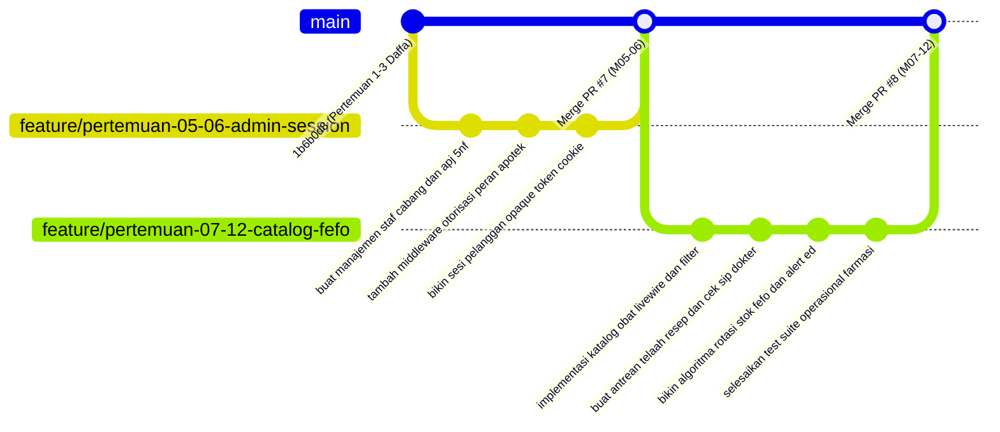

# Product Requirement Document (PRD) — Arya Dwi Mahendra
## Modul: Branch Operations, Guest Session, Drug Catalog, Prescription Verification & FEFO Inventory
### OmniPharma Network — Sistem Informasi Apotek Multi-Klien

- **Nama Mahasiswa:** Arya Dwi Mahendra
- **NIM / Peran:** Pharmacy Operations, Compliance & Inventory Backend Engineer (Total Alokasi: 4 Tugas / Pertemuan)
- **Dosen Pengampu:** Pak Devit Suwardiyanto
- **Target Repository:** `https://github.com/heliosparta18/startup.git` (Path: `D:\KELOMPOK PAK DEVIT`)
- **Cabang Git Utama:** `feat/arya-branch-ops`
- **Sub-Cabang Praktikum:**
  - `feature/pertemuan-05-06-admin-session`
  - `feature/pertemuan-07-12-catalog-fefo`
- **Status Baseline:**
  - Pertemuan 01–03 selesai pada commit `1b6b0d8` (oleh Daffa).
  - Refaktor UI katalog selesai pada PR #3 `96cb27e` (oleh Guntur).

---

## 1. Deskripsi Modul & Tujuan Arsitektural (Module Description & Architectural Objectives)

### 1.1 Profil Mahasiswa & Pembagian Tanggung Jawab (4 Tugas)
Dalam rancang bangun sistem informasi apotek terdistribusi multi-klien OmniPharma Network, Arya Dwi Mahendra memegang kendali atas modul operasional apotek cabang dari hulu ke hilir:
1. **Administrasi Cabang & Otorisasi Peran (Pertemuan 05):** Mengembangkan modul manajemen staf apotek multi-cabang, penugasan peran lokal (`peran_client_pengguna`), integrasi hak akses RBAC melalui middleware `EnsureUserHasRole`, dan pemodelan hierarki pengawasan farmasi berderajat normalisasi kelima (5NF) pada tabel `peta_pengawas_staf` antara Apoteker Penanggung Jawab (APJ) dan staf pelaksana/kasir.
2. **Sesi Pelanggan Anonim & Opaque Token (Pertemuan 06):** Mengelola sesi tamu (*guest customer session*) menggunakan opaque token 32-karakter berbasis cookie (`omnipharma_customer_session`), disematkan ke cabang apotek aktif (`id_client`) tanpa mewajibkan registrasi akun di awal, dilengkapi fitur pemilihan cabang terdekat.
3. **Katalog Obat Multi-Cabang & Manajemen Stok (Pertemuan 07):** Membangun antarmuka katalog obat berbasis Livewire yang reaktif, mendukung pencarian instan, filter sediaan farmasi (tablet, kapsul, sirup, salep), serta penegakan badge klasifikasi obat (Obat Bebas, Bebas Terbatas, dan Obat Keras / Wajib Resep).
4. **Verifikasi Resep Dokter & Manajemen Stok FEFO (Pertemuan 12):**
   * Membangun portal inspeksi dan telaah resep digital pada antarmuka operator cabang (`/cabang/{client}/resep`), validasi keabsahan Surat Izin Praktik (SIP) dokter, telaah dosis klinis, tindakan persetujuan (*approval*) / penolakan (*rejection*), serta pencatatan audit trail pada `log_audit`.
   * Menerapkan algoritma perputaran stok *First-Expired, First-Out* (FEFO: `orderBy('expired', 'asc')`) pada kueri kartu stok cabang (`stok_client`) dan sistem peringatan dini (*early warning alert*) untuk batch mendekati kedaluwarsa (H-30 dan H-7 hari).

```
┌────────────────────────────────────────────────────────────────────────────────────────┐
│              ALUR KERJA OPERASIONAL FARMASI & INVENTORI (MODUL ARYA)                   │
├────────────────────────────────────────────────────────────────────────────────────────┤
│  [Pertemuan 05: Super Admin Menetapkan Staf & APJ]                                     │
│  • Super Admin menugaskan Apoteker & Staf ke Cabang Banyuwangi Kota                    │
│  • Relasi 5NF Pengawasan: APJ membawahi Asisten Apoteker (peta_pengawas_staf)          │
│  • Middleware EnsureUserHasRole memverifikasi peran apoteker dan izin cabang aktif     │
│         │                                                                              │
│         ▼                                                                              │
│  [Pertemuan 06: Inisialisasi Sesi Tamu Anonim & Pemilihan Cabang]                      │
│  • Pelanggan membuka portal publik apotek                                              │
│  • Sistem menerbitkan cookie opaque token 32-char (omnipharma_customer_session)        │
│  • Pelanggan memilih cabang terdekat (Banyuwangi Kota) ──► Terikat ke id_client       │
│         │                                                                              │
│         ▼                                                                              │
│  [Pertemuan 07: Eksplorasi Katalog Obat Multi-Cabang & Filter Sediaan]                 │
│  • Livewire search instan: Paracetamol, Amoxicillin, Amodiaquine                      │
│  • Filter sediaan: Tablet, Sirup, Injeksi                                              │
│  • Badging Regulasi: Hijau (Bebas), Biru (Bebas Terbatas), Merah Lingkaran K (Keras)   │
│         │                                                                              │
│         ▼                                                                              │
│  [Pertemuan 12: Telaah Resep Dokter & Alokasi Pengeluaran FEFO]                        │
│  • Pesanan obat keras masuk ──► Tertahan di status 'menunggu_verifikasi'               │
│  • Apoteker membuka portal telaah resep di /cabang/banyuwangi-kota/resep               │
│  • Validasi nomor SIP dokter (contoh: 503/SIP/2024) & telaah dosis pasien              │
│  • Keputusan: Setujui (Status ──► 'diproses') atau Tolak (Alasan Wajib)                │
│  • Alokasi pengeluaran fisik obat berdasarkan batch expired terdekat (#1 FEFO)        │
│  • Munculkan peringatan dini H-30 hari di dashboard apoteker cabang                    │
└────────────────────────────────────────────────────────────────────────────────────────┘
```

---

### 1.2 Latar Belakang Regulasi Kefarmasian & Masalah Arsitektur
Berdasarkan Permenkes RI No. 73 Tahun 2016 tentang Standar Pelayanan Kefarmasian di Apotek dan UU No. 17 Tahun 2023 tentang Kesehatan:
* **Keberadaan Apoteker Penanggung Jawab (APJ):** Setiap apotek wajib memiliki seorang Apoteker Penanggung Jawab dengan STRA dan SIPA sah. APJ bertanggung jawab secara hukum terhadap seluruh sediaan farmasi dan pelayanan resep di cabang apotek tersebut.
* **Hierarki Pengawasan Staf (5NF):** Tenaga Teknis Kefarmasian (TTK) dan kasir tidak diperbolehkan menyerahkan obat keras tanpa supervisi langsung APJ. Relasi ini dimodelkan 5NF pada `peta_pengawas_staf` agar terbebas dari anomali penugasan.
* **Penegakan Resep Obat Keras:** Penjualan obat keras tanpa resep dokter sah atau verifikasi apoteker melanggar hukum pidana kesehatan. Oleh karena itu, antrean telaah resep digital harus mengunci status pesanan hingga verifikasi disetujui.
* **Manajemen Mutu FEFO:** Obat memiliki tanggal kedaluwarsa mutlak. Penjualan berbasis FIFO berisiko menahan obat ber-expired dekat di bagian belakang rak, mengakibatkan kerugian finansial apotek dan risiko fatal bagi pasien.

---

## 2. Daftar Berkas yang Dibuat & Diubah (List of Files to Create and Edit)

Seluruh perubahan dan pembuatan berkas harus mengikuti letak direktori baku proyek `D:\KELOMPOK PAK DEVIT`.

### 2.1 Berkas Baru yang Dibuat (Files to Create)

| No | Path Berkas Relatif | Modul Praktikum | Deskripsi & Fungsi Teknis |
|---|---|---|---|
| 1 | `app/Modules/Admin/Services/StaffManagementService.php` | Pertemuan 05 | Service penugasan peran staf cabang dan pemetaan pengawas APJ (5NF). |
| 2 | `app/Modules/Admin/Http/Controllers/StaffController.php` | Pertemuan 05 | Controller manajemen staf apotek cabang untuk Super Admin. |
| 3 | `app/Http/Middleware/EnsureUserHasRole.php` | Pertemuan 05 | Middleware otorisasi peran lokal apotek (`apoteker`, `asisten_apoteker`, `kasir`). |
| 4 | `app/Modules/Catalog/Services/CustomerSessionService.php` | Pertemuan 06 | Service pembuatan dan validasi cookie token buram (*opaque token*) sesi pelanggan. |
| 5 | `app/Modules/Catalog/Services/CatalogService.php` | Pertemuan 07 | Service query katalog obat cabang terisolasi, pencarian teks, dan filter sediaan. |
| 6 | `app/Modules/Catalog/Livewire/PublicCatalog.php` | Pertemuan 07 | Komponen Livewire katalog obat publik reaktif dengan live search dan filter. |
| 7 | `app/Modules/Prescription/Actions/VerifyPrescriptionAction.php` | Pertemuan 12 | Aksi atomik telaah resep: cek keabsahan SIP dokter, approve/reject, dan audit log. |
| 8 | `app/Modules/Catalog/Services/StockFefoService.php` | Pertemuan 12 | Service rotasi stok FEFO (`orderBy('expired', 'asc')`) dan kalkulasi sisa hari ED. |
| 9 | `resources/views/admin/staff-management.blade.php` | Pertemuan 05 | Antarmuka manajemen staf apotek cabang dan hierarki APJ. |
| 10 | `resources/views/customer/catalog.blade.php` | Pertemuan 07 | Halaman katalog obat publik reaktif dengan badge klasifikasi obat. |
| 11 | `resources/views/tenant/verifikasi-resep.blade.php` | Pertemuan 12 | Halaman antrean telaah resep dokter bagi apoteker cabang. |
| 12 | `resources/views/tenant/stok-fefo.blade.php` | Pertemuan 12 | Halaman monitoring kartu stok batch obat dan banner peringatan H-30 ED. |
| 13 | `tests/Feature/GuestSessionAndCatalogTest.php` | Pertemuan 06–07 | Test suite sesi tamu opaque token dan kueri katalog obat cabang. |
| 14 | `tests/Feature/PrescriptionVerificationTest.php` | Pertemuan 12 | Test suite telaah resep (validasi SIP, approval atomik, reject reason). |
| 15 | `tests/Feature/FefoStockRotationTest.php` | Pertemuan 12 | Test suite algoritma FEFO dan sinyal peringatan batch mendekati kedaluwarsa. |

---

### 2.2 Berkas Eksisting yang Diubah (Files to Edit)

| No | Path Berkas Relatif | Modul Praktikum | Titik Perubahan & Rationale |
|---|---|---|---|
| 1 | `routes/tenant.php` | Pertemuan 05 & 12 | Mendaftarkan rute dashboard apoteker (`/cabang/{client}/dashboard`), antrean resep (`/resep`), dan stok FEFO. |
| 2 | `routes/customer.php` | Pertemuan 06 & 07 | Mendaftarkan rute sesi tamu dan katalog obat publik (`/klien/{client}/katalog`). |
| 3 | `bootstrap/app.php` | Pertemuan 05 | Mendaftarkan alias middleware `'role' => EnsureUserHasRole::class`. |
| 4 | `app/Models/PetaPengawasStaf.php` | Pertemuan 05 | Menegakkan relasi 5NF pengawasan APJ ke staf pelaksana apotek. |
| 5 | `app/Models/StokClient.php` | Pertemuan 07 & 12 | Menambahkan helper scope `scopeFefoOrder($query)` dan mutator sisa hari kedaluwarsa. |

---

## 3. Alur Kerja Git Branch (Git Branch Workflow)

Arya menggunakan sistem penamaan branch:
* **Konvensi Anggota (Member-Centric):** `feat/arya-branch-ops`
* **Konvensi Kurikulum Akademik (Meeting-Centric):** `feature/pertemuan-05-06-admin-session` dan `feature/pertemuan-07-12-catalog-fefo`



---

## 4. Panduan Implementasi Bertahap (Step-by-Step Implementation Guide)

### Langkah 1: Membangun Middleware Otorisasi Peran Cabang (`EnsureUserHasRole`)
Berkas: `app/Http/Middleware/EnsureUserHasRole.php`

```php
<?php

namespace App\Http\Middleware;

use App\Models\PeranClientPengguna;
use App\Support\Tenant\TenantContext;
use Closure;
use Illuminate\Http\Request;
use Symfony\Component\HttpFoundation\Response;

class EnsureUserHasRole
{
    public function handle(Request $request, Closure $next, string ...$roles): Response
    {
        $user = $request->user();

        if (! $user) {
            return redirect()->route('login');
        }

        if ($user->peran === 'super_admin') {
            return $next($request);
        }

        $context = app(TenantContext::class);
        if (! $context->check()) {
            abort(Response::HTTP_FORBIDDEN, 'Akses ditolak: Konteks cabang tidak terdefinisi.');
        }

        $hasRole = PeranClientPengguna::where('id_pengguna', $user->id_pengguna)
            ->where('id_client', $context->id())
            ->whereIn('peran', $roles)
            ->where('aktif', true)
            ->exists();

        if (! $hasRole) {
            abort(Response::HTTP_FORBIDDEN, 'Akses ditolak: Anda tidak memiliki peran legal di cabang ini.');
        }

        return $next($request);
    }
}
```

---

### Langkah 2: Layanan Sesi Tamu Anonim & Opaque Token
Berkas: `app/Modules/Catalog/Services/CustomerSessionService.php`

```php
<?php

namespace App\Modules\Catalog\Services;

use Illuminate\Http\Request;
use Illuminate\Support\Facades\Cookie;
use Illuminate\Support\Str;

class CustomerSessionService
{
    public const COOKIE_NAME = 'omnipharma_customer_session';

    public function resolveSession(Request $request): string
    {
        $token = $request->cookie(self::COOKIE_NAME);

        if (! $token || strlen($token) !== 32) {
            $token = Str::random(32);
            Cookie::queue(self::COOKIE_NAME, $token, 60 * 24 * 30); // Simpan 30 hari
        }

        return $token;
    }
}
```

---

### Langkah 3: Layanan Katalog Obat Multi-Cabang & Klasifikasi Sediaan
Berkas: `app/Modules/Catalog/Services/CatalogService.php`

```php
<?php

namespace App\Modules\Catalog\Services;

use App\Models\Obat;
use App\Models\StokClient;
use Illuminate\Database\Eloquent\Builder;
use Illuminate\Pagination\LengthAwarePaginator;

class CatalogService
{
    public function getCatalog(string $clientId, ?string $search = null, ?string $bentukSediaan = null): LengthAwarePaginator
    {
        return Obat::query()
            ->with(['stokClient' => function ($q) use ($clientId) {
                $q->where('id_client', $clientId);
            }])
            ->whereHas('stokClient', function (Builder $q) use ($clientId) {
                $q->where('id_client', $clientId)->where('jumlah_stok', '>', 0);
            })
            ->when($search, function (Builder $q, $search) {
                $q->where('nama_obat', 'like', "%{$search}%")
                  ->orWhere('komposisi', 'like', "%{$search}%");
            })
            ->when($bentukSediaan, function (Builder $q, $sediaan) {
                $q->where('bentuk_sediaan', $sediaan);
            })
            ->orderBy('nama_obat', 'asc')
            ->paginate(12);
    }
}
```

---

### Langkah 4: Aksi Telaah Resep Dokter & Validasi SIP
Berkas: `app/Modules/Prescription/Actions/VerifyPrescriptionAction.php`

```php
<?php

namespace App\Modules\Prescription\Actions;

use App\Models\LogAudit;
use App\Models\Pesanan;
use App\Models\ResepDokter;
use Illuminate\Support\Facades\DB;
use Illuminate\Validation\ValidationException;

class VerifyPrescriptionAction
{
    public function execute(Pesanan $pesanan, string $apotekerId, string $keputusan, ?string $nomorSip = null, ?string $alasan = null): void
    {
        DB::transaction(function () use ($pesanan, $apotekerId, $keputusan, $nomorSip, $alasan) {
            $resep = ResepDokter::where('id_pesanan', $pesanan->id_pesanan)->firstOrFail();

            if ($keputusan === 'disetujui') {
                if (empty($nomorSip) || ! preg_match('/^[0-9]{3}\/SIP\/[0-9]{4}$/', $nomorSip)) {
                    throw ValidationException::withMessages([
                        'nomor_sip' => 'Nomor SIP dokter tidak valid. Format resmi: 503/SIP/2024',
                    ]);
                }

                $resep->update([
                    'status_telaah' => 'disetujui',
                    'nomor_sip_dokter' => $nomorSip,
                    'id_apoteker_penelaah' => $apotekerId,
                    'ditelaah_pada' => now(),
                ]);

                // Transisi status pesanan ke tahap pembayaran atau proses
                $pesanan->update(['status_pesanan' => 'menunggu_pembayaran']);
            } else {
                if (empty($alasan)) {
                    throw ValidationException::withMessages([
                        'alasan' => 'Wajib menyertakan alasan penolakan resep.',
                    ]);
                }

                $resep->update([
                    'status_telaah' => 'ditolak',
                    'catatan_telaah' => $alasan,
                    'id_apoteker_penelaah' => $apotekerId,
                    'ditelaah_pada' => now(),
                ]);

                $pesanan->update(['status_pesanan' => 'dibatalkan']);
            }

            LogAudit::create([
                'id_log' => (string) \Illuminate\Support\Str::uuid(),
                'id_pengguna' => $apotekerId,
                'aksi' => 'TELAAH_RESEP',
                'tabel_target' => 'resep_dokter',
                'id_target' => $resep->id_resep,
                'detail_perubahan' => json_encode(['keputusan' => $keputusan, 'nomor_sip' => $nomorSip]),
                'waktu' => now(),
            ]);
        });
    }
}
```

---

### Langkah 5: Layanan Rotasi Stok FEFO (*First-Expired, First-Out*)
Berkas: `app/Modules/Catalog/Services/StockFefoService.php`

```php
<?php

namespace App\Modules\Catalog\Services;

use App\Models\StokClient;
use Illuminate\Database\Eloquent\Collection;

class StockFefoService
{
    public function getBatchesByFefo(string $clientId, string $obatId): Collection
    {
        return StokClient::where('id_client', $clientId)
            ->where('id_obat', $obatId)
            ->where('jumlah_stok', '>', 0)
            ->orderBy('tanggal_kadaluarsa', 'asc') // FEFO Sort
            ->get()
            ->map(function ($batch) {
                $sisaHari = now()->diffInDays($batch->tanggal_kadaluarsa, false);
                $batch->sisa_hari_ed = $sisaHari;
                $batch->is_near_ed = $sisaHari <= 30; // Indikator H-30
                $batch->is_critical_ed = $sisaHari <= 7; // Indikator H-7
                return $batch;
            });
    }
}
```

---

## 5. Panduan Presentasi Dosen (Pak Devit Suwardiyanto Presentation Guide)

### 5.1 Karakteristik Pengujian Pak Devit Suwardiyanto
Pak Devit sangat kritis mengenai penerapan regulasi di lapangan dan kebenaran normalisasi basis data:
* **Fokus Utama:** Apakah staf cabang satu bisa mengesahkan resep di cabang lain? Mengapa tabel relasi APJ harus 5NF? Bagaimana algoritma FEFO memastikan obat ber-expired dekat dikeluarkan lebih dulu?
* **Strategi Arya:** Tunjukkan skema tabel `peta_pengawas_staf`, demonstrasikan form verifikasi resep yang menolak input tanpa format SIP dokter yang benar, dan buktikan query `orderBy('tanggal_kadaluarsa', 'asc')`.

---

### 5.2 Alur Demonstrasi Langsung (Live Demo Flow)

```
[Tahap 1: Pembuktian Otorisasi Peran Staf & APJ]
1. Login sebagai Kasir Cabang Banyuwangi Kota.
2. Coba akses endpoint telaah resep: /cabang/banyuwangi-kota/resep
3. Tunjukkan bahwa sistem merespon HTTP 403 Forbidden karena peran kasir tidak memiliki izin telaah resep (harus Apoteker).

[Tahap 2: Sesi Tamu Opaque Token & Katalog Reaktif]
1. Buka browser jendela incognito: Akses /klien/banyuwangi-kota/katalog
2. Buka DevTools (F12) ➔ Application ➔ Cookies: Tunjukkan cookie omnipharma_customer_session sepanjang 32 karakter.
3. Ketik "Paracetamol" pada kotak pencarian: Tunjukkan katalog langsung merespon via Livewire tanpa reload halaman.

[Tahap 3: Telaah Resep Dokter & Validasi SIP]
1. Login sebagai Apoteker Cabang Banyuwangi Kota.
2. Buka antrean telaah resep #ORD-20260917-0042.
3. Coba tekan tombol "Setujui" tanpa mengisi SIP: Tunjukkan pesan error validasi muncul.
4. Masukkan SIP sah "503/SIP/2024" dan setujui: Tunjukkan status pesanan berganti jadi 'menunggu_pembayaran' dan audit log tercatat di basis data.

[Tahap 4: Pembuktian Rotasi Stok FEFO & Indikator H-30]
1. Buka menu Kartu Stok FEFO di /cabang/banyuwangi-kota/stok-fefo.
2. Tunjukkan batch #BTC-2024A (Exp 10 Okt 2026 / H-23) berada di posisi paling atas (#1 FEFO Priority) dan memiliki badge kuning peringatan H-23.
```

---

### 5.3 Tanya-Jawab Kritis & Jawaban Otoritatif (Anticipated Pak Devit Q&A)

#### Pertanyaan 1 (Normalisasi 5NF pada Hierarki APJ):
> **Pak Devit:** *"Mengapa Anda memodelkan hierarki pengawasan apoteker pada tabel `peta_pengawas_staf` dan mengklaimnya sebagai 5NF? Apa bahayanya jika relasi APJ langsung ditempel sebagai kolom di tabel pengguna?"*

* **Jawaban Arya:**
  > "Izin menjawab, Pak Devit. Dalam regulasi apotek, seorang Apoteker Penanggung Jawab (APJ) membawahi asisten apoteker pada cabang apotek tertentu dalam periode waktu tertentu. Relasi ini melibatkan 3 entitas sekaligus: Cabang (`id_client`), Staf Pelaksana (`id_staf`), dan APJ Pengawas (`id_apj`). Jika kolom `id_apj` ditempel langsung pada tabel pengguna, akan terjadi anomali modifikasi ketika seorang asisten apoteker diperbantukan sementara ke cabang lain dengan APJ yang berbeda. Tabel `peta_pengawas_staf` memenuhi kaidah Fifth Normal Form (5NF) karena mendekonstruksi ketergantungan join (*join dependency*) tanpa anomali redundansi data."

---

#### Pertanyaan 2 (Perbedaan FEFO vs FIFO):
> **Pak Devit:** *"Kenapa apotek Anda wajib menggunakan FEFO dan bukan FIFO biasa?"*

* **Jawaban Arya:**
  > "Pada toko retail umum, FIFO (*First-In, First-Out*) cocok karena barang yang pertama masuk gudang dikeluarkan lebih dulu. Namun di apotek, obat yang baru datang dari distributor (*supplier*) bisa saja memiliki tanggal kedaluwarsa yang lebih dekat daripada stok lama. Jika menggunakan FIFO, obat ber-expired dekat tersebut akan tertahan di gudang hingga kedaluwarsa dan menjadi limbah beracun. Algoritma FEFO (*First-Expired, First-Out*) kami selalu mengurutkan stok berdasarkan `tanggal_kadaluarsa ASC`, sehingga sediaan yang paling dekat kedaluwarsa selalu diprioritaskan keluar lebih dulu ke tangan pasien secara aman."

---

## 6. Matriks Kesiapan Pertemuan (Readiness Matrix)

| Komponen | Status Sebelum | Status Target Arya | Kriteria Keberhasilan |
|---|---|---|---|
| **Staf & APJ (M05)** | Belum ada | Modul manajemen staf & pemetaan pengawas 5NF | Middleware `EnsureUserHasRole` aktif |
| **Sesi Tamu (M06)** | Belum ada | Token buram 32-karakter berbasis cookie | Cookie `omnipharma_customer_session` terbit |
| **Katalog Obat (M07)** | Tampilan statis | Livewire reactive catalog & filter sediaan | Live search berfungsi & stok terhubung |
| **Telaah Resep (M12)** | Belum ada | Antrean telaah resep digital & cek SIP dokter | Resep hanya bisa disetujui jika SIP valid |
| **Stok FEFO (M12)** | Belum ada | Pengurutan stok FEFO & badge peringatan H-30 | Batch ber-expired paling dekat berada di urutan #1 |

---

*Dokumen PRD ini disusun secara resmi untuk memenuhi standar penilaian kurikulum praktikum Pak Devit Suwardiyanto dan menjadi panduan arsitektur final bagi modul Arya Dwi Mahendra (4 Tugas).*
