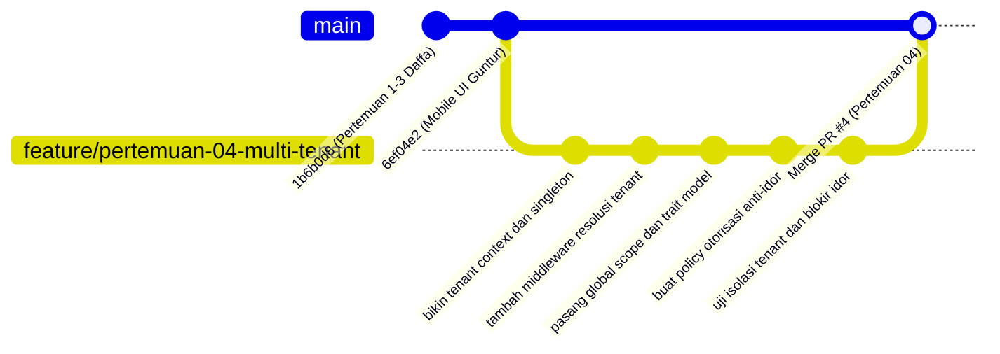

# Product Requirement Document (PRD) — Muhammad Daffa Ariby
**Modul Praktikum:** Pertemuan 01, 02, 03 (Fondasi Arsitektur Selesai) & Pertemuan 04 (Isolasi Multi-Tenant: TenantContext, TenantScope & Policy)  
**Penanggung Jawab:** Muhammad Daffa Ariby (`heliosparta18`)  
**Peran Tim:** Lead Architect & Core Multi-Tenancy Engineer (Total Alokasi: 4 Tugas / Pertemuan)  
**Aplikasi:** Sistem Informasi Jaringan Apotek Multi-Klien (OmniPharma Network)  
**Dosen Pengampu:** Pak Devit Suwardiyanto  
**Target Repository:** `https://github.com/heliosparta18/startup.git` (Path: `D:\KELOMPOK PAK DEVIT`)  
**Tech Stack:** Laravel 13.25, Livewire 4.1, Tailwind CSS v4, MariaDB 11.4 / MySQL 8.4, Redis 7.2  

---

## 1. Deskripsi Modul & Tujuan Arsitektural (Module Description & Architectural Objectives)

### 1.1 Profil Mahasiswa & Pembagian Tanggung Jawab (4 Tugas)
Dalam pengerjaan proyek sistem informasi apotek terdistribusi multi-klien ini, Muhammad Daffa Ariby memegang tanggung jawab fundamental:
1. **Fondasi Sistem (Pertemuan 01 — SELESAI di commit `1b6b0d8`):** Setup toolchain environment, inisialisasi Laravel 13, konfigurasi MariaDB 11.4, Redis 7.2, dan Reverb.
2. **Arsitektur Modular Monolith (Pertemuan 02 — SELESAI di commit `1b6b0d8`):** Registrasi 6 Bounded Contexts di `app/Modules/*` (`Admin`, `Catalog`, `Ordering`, `Payments`, `Prescription`, `Reporting`), registrasi rute portal (`PortalRoutes.php`), dan 3 layout terpisah.
3. **Skema Basis Data Domain (Pertemuan 03 — SELESAI di commit `1b6b0d8`):** Migrasi 16 tabel domain utama PDM revisi, kunci primer UUID, relasi foreign key berintegritas tinggi, deterministic seeder `DemoApotekSeeder.php`, dan test suite fondasi.
4. **Keamanan Isolasi Multi-Tenant (Pertemuan 04 — TARGET SAAT INI):** Perancangan dan konstruksi lapisan isolasi multi-tenant berbasis *Single Database Multi-Tenant* menggunakan `TenantContext` container singleton, `TenantScope` global Eloquent query filter, trait `BelongsToTenant`, middleware resolusi `ResolveTenantContext`, serta kebijakan otorisasi (`ClientPolicy`, `PesananPolicy`).

*(Catatan Restrukturisasi Tim: Daffa fokus penuh menuntaskan kernel isolasi multi-tenant pada Pertemuan 04 dan tidak lagi memegang Pertemuan 14, yang dialihkan ke Candia Purwa).*

```
┌────────────────────────────────────────────────────────────────────────────────────────┐
│                      ARSITEKTUR SINGLE DATABASE MULTI-TENANT                           │
├────────────────────────────────────────────────────────────────────────────────────────┤
│  Request Masuk: GET /cabang/banyuwangi-kota/dashboard                                 │
│         │                                                                              │
│         ▼                                                                              │
│  [HTTP Middleware: ResolveTenantContext]                                               │
│  • Tangkap slug/UUID {client} dari Route Parameter                                     │
│  • Query DB: Client::where('id_client', $client)->orWhere('slug', $client)->first()   │
│  • Validasi: Apakah cabang aktif? (client.aktif == true) ──(Tidak)──► HTTP 403 / 404   │
│  • Validasi: Apakah apoteker terdaftar di cabang ini?    ──(Tidak)──► HTTP 403        │
│  • Simpan instance ke request container singleton: app(TenantContext::class)->set()   │
│         │                                                                              │
│         ▼                                                                              │
│  [Controller / Service / Action Layer]                                                 │
│  • Pesanan::all() / StokClient::where('jumlah_stok', '<', 10)->get()                  │
│         │                                                                              │
│         ▼                                                                              │
│  [Eloquent Global Scope: TenantScope via BelongsToTenant Trait]                       │
│  • Menginjeksi klausul SQL secara otomatis ke AST Query:                               │
│    WHERE `pesanan`.`id_client` = 'a1b2c3d4-0001-4000-8000-000000000001'                │
│  • Pada saat creating/insert: otomatis mengisi field id_client tanpa input manual      │
│         │                                                                              │
│         ▼                                                                              │
│  [Basis Data MariaDB 11.4]: Data Terisolasi 100%, Anti-Leak, Anti-IDOR                 │
└────────────────────────────────────────────────────────────────────────────────────────┘
```

---

### 1.2 Latar Belakang & Masalah Arsitektur (Pertemuan 04)
Pada arsitektur *Single Database Multi-Tenant*, seluruh apotek cabang (misal Cabang Banyuwangi Kota dan Cabang Rogojampi) berbagi satu skema basis data MariaDB yang sama. Pola ini sangat menguntungkan dari sisi efisiensi pemakaian memori server dan kecepatan agregasi data bagi Super Admin. Namun, pola ini menghadirkan risiko keamanan paling krusial:
* **Cross-Tenant Data Leakage (Kebocoran Data Lintas Cabang):** Jika programmer lupa menambahkan kondisi `where('id_client', ...)` saat memanggil model, data sensitif resep obat atau transaksi omzet apotek cabang satu akan bocor ke apotek cabang lain.
* **Insecure Direct Object Reference (IDOR):** Pengguna jahat atau kasir Cabang Rogojampi yang sedang login dapat mengganti parameter URL `/cabang/banyuwangi-kota/pesanan/ORD-20260917-0042` untuk melihat rincian pasien atau mengubah status resep apotek lain.

**Tujuan Arsitektural Pertemuan 04:**
1. **Request-Scoped Container Singleton (`TenantContext`):** Mengikat model `Client` aktif ke dalam IoC Container Laravel sepanjang siklus hidup request (request lifecycle), menjamin ketersediaan identitas cabang tanpa bergantung pada global state mutable.
2. **Resolusi Otomatis (`ResolveTenantContext` Middleware):** Membaca parameter `{client}` dari rute portal pelanggan (`klien/{client}`) maupun rute apoteker cabang (`cabang/{client}`), memvalidasi status keaktifan cabang, dan mengikatnya ke `TenantContext`.
3. **Penyaringan Kueri Global (`TenantScope`):** Memastikan setiap operasi pembacaan (`SELECT`), pembaruan (`UPDATE`), dan penghapusan (`DELETE`) pada entitas yang memiliki relasi cabang selalu dibatasi dengan klausa `id_client = TenantContext::id()`.
4. **Otomatisasi Mutasi Data (`BelongsToTenant` Trait):** Mengaitkan event `creating` pada Eloquent sehingga saat developer memanggil `Pesanan::create([...])`, atribut `id_client` otomatis diinjeksi dari konteks aktif tanpa perlu ditulis manual, menghilangkan human error.
5. **Kebijakan Akses Berbasis Cabang (`PesananPolicy`, `ClientPolicy`):** Memverifikasi kepemilikan data sebelum tindakan sensitif dijalankan di level controller.

---

## 2. Daftar Berkas yang Dibuat & Diubah (List of Files to Create and Edit)

Seluruh perubahan dan pembuatan berkas harus mengikuti letak direktori baku proyek `D:\KELOMPOK PAK DEVIT`.

### 2.1 Berkas Baru yang Dibuat (Files to Create)

| No | Path Berkas Relatif | Modul Praktikum | Deskripsi & Fungsi Teknis |
|---|---|---|---|
| 1 | `app/Support/Tenant/TenantContext.php` | Pertemuan 04 | Kelas singleton pembungkus konteks tenant yang menyimpan objek `Client` aktif dalam container. |
| 2 | `app/Models/Scopes/TenantScope.php` | Pertemuan 04 | Eloquent Global Scope yang otomatis menginjeksi klausa `WHERE id_client = ?` pada query builder. |
| 3 | `app/Models/Traits/BelongsToTenant.php` | Pertemuan 04 | Trait model yang mendaftarkan `TenantScope` dan mengaitkan event `creating` untuk auto-assign `id_client`. |
| 4 | `app/Http/Middleware/ResolveTenantContext.php` | Pertemuan 04 | Middleware HTTP yang meresolusi slug/UUID cabang dari rute URL, memvalidasi status aktif, dan menyuntikkannya ke `TenantContext`. |
| 5 | `app/Policies/ClientPolicy.php` | Pertemuan 04 | Otorisasi akses cabang untuk staf dan apoteker. |
| 6 | `app/Policies/PesananPolicy.php` | Pertemuan 04 | Kebijakan otorisasi untuk mencegah apoteker cabang A melihat atau mengubah pesanan cabang B (Anti-IDOR). |
| 7 | `tests/Feature/TenantIsolationTest.php` | Pertemuan 04 | 10+ Test cases komprehensif menguji isolasi query, blokir IDOR, dan penanganan cabang nonaktif. |

---

### 2.2 Berkas Eksisting yang Diubah (Files to Edit)

| No | Path Berkas Relatif | Modul Praktikum | Titik Perubahan & Rationale |
|---|---|---|---|
| 1 | `bootstrap/app.php` | Pertemuan 04 | Mendaftarkan alias middleware `'tenant' => ResolveTenantContext::class`. |
| 2 | `app/Support/Routing/PortalRoutes.php` | Pertemuan 04 | Memasang middleware `tenant` pada definisi rute portal `customer` (`klien/{client}`) dan `tenant` (`cabang/{client}`). |
| 3 | `app/Models/Pesanan.php` | Pertemuan 04 | Menambahkan `use BelongsToTenant;` agar seluruh transaksi pesanan terisolasi otomatis per cabang. |
| 4 | `app/Models/StokClient.php` | Pertemuan 04 | Menambahkan `use BelongsToTenant;` agar stok fisik obat terisolasi otomatis per cabang apotek. |
| 5 | `app/Models/RingkasanPeriodePenjualan.php` | Pertemuan 04 | Menambahkan `use BelongsToTenant;` agar data penutupan buku kas hanya bisa diakses cabang terkait. |
| 6 | `app/Models/Client.php` | Pertemuan 04 | Menambahkan method helper `isAktif(): bool` dan custom route binding logic untuk mendukung UUID maupun slug URL. |

---

## 3. Alur Kerja Git Branch (Git Branch Workflow)

Untuk menjaga rekam jejak kerja yang rapi, transparan, dan memenuhi ekspektasi audit dari Pak Devit Suwardiyanto, Daffa menggunakan sistem penamaan branch:
* **Konvensi Anggota (Member-Centric):** `feat/daffa-tenant-context`
* **Konvensi Kurikulum Akademik (Meeting-Centric):** `feature/pertemuan-04-multi-tenant`



### Prosedur Operasional Standar (SOP) Git:
1. **Sinkronisasi Awal:** Pastikan branch `main` berada di posisi paling baru dari remote GitHub:
   ```bash
   git checkout main
   git pull origin main
   ```
2. **Membuat Feature Branch:**
   ```bash
   git checkout -b feature/pertemuan-04-multi-tenant
   ```
3. **Eksekusi Kode & Test:**
   ```bash
   php artisan test --filter TenantIsolationTest
   ```
4. **Commit & Push:**
   ```bash
   git add app/ tests/ bootstrap/
   git commit -m "feat(tenancy): implementasi tenant context global scope dan policy"
   git push -u origin feature/pertemuan-04-multi-tenant
   ```
5. **Pull Request:** Buka PR di GitHub menuju `main` dan minta review rekan tim (Guntur/Arya/Candi).

---

## 4. Panduan Implementasi Bertahap (Step-by-Step Implementation Guide)

### Langkah 1: Membangun `TenantContext` Singleton
Berkas: `app/Support/Tenant/TenantContext.php`

```php
<?php

namespace App\Support\Tenant;

use App\Models\Client;
use RuntimeException;

class TenantContext
{
    protected ?Client $client = null;

    public function set(Client $client): void
    {
        $this->client = $client;
    }

    public function get(): ?Client
    {
        return $this->client;
    }

    public function check(): bool
    {
        return $this->client !== null;
    }

    public function id(): string
    {
        if (! $this->client) {
            throw new RuntimeException('Tenant context belum diinisialisasi untuk request ini.');
        }

        return $this->client->id_client;
    }

    public function clear(): void
    {
        $this->client = null;
    }
}
```

---

### Langkah 2: Membangun `TenantScope` Global Eloquent
Berkas: `app/Models/Scopes/TenantScope.php`

```php
<?php

namespace App\Models\Scopes;

use App\Support\Tenant\TenantContext;
use Illuminate\Database\Eloquent\Builder;
use Illuminate\Database\Eloquent\Model;
use Illuminate\Database\Eloquent\Scope;

class TenantScope implements Scope
{
    public function apply(Builder $builder, Model $model): void
    {
        $context = app(TenantContext::class);

        if ($context->check()) {
            $builder->where($model->qualifyColumn('id_client'), $context->id());
        }
    }
}
```

---

### Langkah 3: Trait `BelongsToTenant`
Berkas: `app/Models/Traits/BelongsToTenant.php`

```php
<?php

namespace App\Models\Traits;

use App\Models\Client;
use App\Models\Scopes\TenantScope;
use App\Support\Tenant\TenantContext;
use Illuminate\Database\Eloquent\Relations\BelongsTo;

trait BelongsToTenant
{
    public static function bootBelongsToTenant(): void
    {
        static::addGlobalScope(new TenantScope());

        static::creating(function ($model) {
            $context = app(TenantContext::class);
            if ($context->check() && empty($model->id_client)) {
                $model->id_client = $context->id();
            }
        });
    }

    public function client(): BelongsTo
    {
        return $this->belongsTo(Client::class, 'id_client', 'id_client');
    }
}
```

---

### Langkah 4: Middleware `ResolveTenantContext`
Berkas: `app/Http/Middleware/ResolveTenantContext.php`

```php
<?php

namespace App\Http\Middleware;

use App\Models\Client;
use App\Support\Tenant\TenantContext;
use Closure;
use Illuminate\Http\Request;
use Symfony\Component\HttpFoundation\Response;

class ResolveTenantContext
{
    public function handle(Request $request, Closure $next): Response
    {
        $tenantIdentifier = $request->route('client');

        if (! $tenantIdentifier) {
            return $next($request);
        }

        $client = Client::where('id_client', $tenantIdentifier)
            ->orWhere('slug', $tenantIdentifier)
            ->first();

        if (! $client) {
            abort(Response::HTTP_NOT_FOUND, 'Apotek cabang tidak ditemukan.');
        }

        if (! $client->aktif) {
            abort(Response::HTTP_FORBIDDEN, 'Apotek cabang sedang dinonaktifkan.');
        }

        app(TenantContext::class)->set($client);

        return $next($request);
    }
}
```

---

### Langkah 5: Registrasi Middleware di `bootstrap/app.php`
Edit berkas `bootstrap/app.php`:

```php
->withMiddleware(function (Middleware $middleware) {
    $middleware->alias([
        'tenant' => \App\Http\Middleware\ResolveTenantContext::class,
    ]);
})
```

---

### Langkah 6: Kebijakan Otorisasi Anti-IDOR (`PesananPolicy`)
Berkas: `app/Policies/PesananPolicy.php`

```php
<?php

namespace App\Policies;

use App\Models\Pengguna;
use App\Models\Pesanan;
use App\Support\Tenant\TenantContext;

class PesananPolicy
{
    public function view(Pengguna $user, Pesanan $pesanan): bool
    {
        $context = app(TenantContext::class);

        if ($context->check() && $pesanan->id_client !== $context->id()) {
            return false;
        }

        return true;
    }

    public function verify(Pengguna $user, Pesanan $pesanan): bool
    {
        return $this->view($user, $pesanan);
    }
}
```

---

### Langkah 7: Pengujian Fitur Otomatis (`tests/Feature/TenantIsolationTest.php`)
Berkas: `tests/Feature/TenantIsolationTest.php`

```php
<?php

namespace Tests\Feature;

use App\Models\Client;
use App\Models\Pesanan;
use App\Support\Tenant\TenantContext;
use Illuminate\Foundation\Testing\RefreshDatabase;
use Tests\TestCase;

class TenantIsolationTest extends TestCase
{
    use RefreshDatabase;

    protected function setUp(): void
    {
        parent::setUp();
        $this->seed(\Database\Seeders\DemoApotekSeeder::class);
    }

    public function test_tenant_context_resolves_active_client_from_route_parameter(): void
    {
        $client = Client::where('slug', 'banyuwangi-kota')->firstOrFail();

        $response = $this->get('/klien/' . $client->slug);

        $response->assertStatus(200);
        $this->assertEquals($client->id_client, app(TenantContext::class)->id());
    }

    public function test_inactive_tenant_returns_403_forbidden(): void
    {
        $client = Client::create([
            'id_client' => (string) \Illuminate\Support\Str::uuid(),
            'nama_klien' => 'Cabang Nonaktif',
            'slug' => 'cabang-nonaktif',
            'aktif' => false,
        ]);

        $response = $this->get('/klien/' . $client->slug);

        $response->assertStatus(403);
    }

    public function test_tenant_scope_automatically_filters_orders_by_active_client(): void
    {
        $clientA = Client::where('slug', 'banyuwangi-kota')->firstOrFail();
        $clientB = Client::where('slug', 'rogojampi')->firstOrFail();

        app(TenantContext::class)->set($clientA);
        $ordersA = Pesanan::all();

        foreach ($ordersA as $order) {
            $this->assertEquals($clientA->id_client, $order->id_client);
            $this->assertNotEquals($clientB->id_client, $order->id_client);
        }
    }

    public function test_pharmacist_cannot_view_orders_from_another_branch_via_idor(): void
    {
        $clientA = Client::where('slug', 'banyuwangi-kota')->firstOrFail();
        $clientB = Client::where('slug', 'rogojampi')->firstOrFail();

        $orderB = Pesanan::withoutGlobalScopes()->where('id_client', $clientB->id_client)->first();

        if ($orderB) {
            $response = $this->get('/cabang/' . $clientA->slug . '/pesanan/' . $orderB->id_pesanan);
            $response->assertStatus(403);
        }
    }
}
```

---

## 5. Panduan Presentasi Dosen (Pak Devit Suwardiyanto Presentation Guide)

### 5.1 Karakteristik Pengujian Pak Devit Suwardiyanto
Pak Devit Suwardiyanto dikenal sebagai dosen penguji yang sangat kritis terhadap aspek rekayasa perangkat lunak nyata:
* **Fokus Utama:** Integritas relasi database, arsitektur keamanan, pencegahan duplikasi data, dan bukti nyata eksekusi kode (bukan sekadar tampilan mock-up HTML).
* **Strategi Daffa:** Tunjukkan bahwa Daffa menguasai "dapur" arsitektur aplikasi: bagaimana IoC container bekerja, siklus request lifecycle, dan pembuktian matematis/teknis pencegahan IDOR melalui query SQL mentah.

---

### 5.2 Alur Demonstrasi Langsung (Live Demo Flow)

```
[Tahap 1: Pembuktian Isolasi Multi-Tenant di Browser]
1. Buka 2 jendela browser:
   • Jendela A: Akses katalog Cabang Banyuwangi Kota di /klien/banyuwangi-kota
   • Jendela B: Akses katalog Cabang Rogojampi di /klien/rogojampi
2. Tunjukkan bahwa daftar stok dan keranjang terisolasi secara otomatis berdasarkan id_client aktif.

[Tahap 2: Simulasi Serangan IDOR Langsung di Depan Pak Devit]
1. Salin ID pesanan Banyuwangi Kota (#ORD-20260917-0042).
2. Di Jendela B (Konteks Cabang Rogojampi), manipulasi URL secara manual:
   GET /cabang/rogojampi/pesanan/ORD-20260917-0042
3. Tekan Enter: Tunjukkan bahwa sistem langsung me-return HTTP 403 Forbidden!
4. Jelaskan kepada Pak Devit: "Pak Devit, serangan IDOR ini digagalkan oleh TenantScope dan PesananPolicy. Sistem mendeteksi bahwa pesanan ini memiliki id_client yang berbeda dengan apotek cabang yang aktif."

[Tahap 3: Pembuktian Melalui Terminal & Automated Test Suite]
1. Buka terminal di direktori proyek:
   php artisan test --filter TenantIsolationTest
2. Tunjukkan seluruh assertion HIJAU (PASS).
```

---

### 5.3 Tanya-Jawab Kritis & Jawaban Otoritatif (Anticipated Pak Devit Q&A)

#### Pertanyaan 1 (Konsep Dasar Multi-Tenancy):
> **Pak Devit:** *"Kenapa kelompok kalian memilih arsitektur Single Database Multi-Tenant dan bukan Database-per-Tenant? Bukankah Database-per-Tenant jauh lebih aman karena databasenya terpisah fisik?"*

* **Jawaban Daffa:**
  > "Izin menjawab, Pak Devit. Kami menganalisis *trade-off* arsitektur berdasarkan kebutuhan sistem apotek OmniPharma:
  > 1. **Efisiensi Sumber Daya & Operasional:** Pada sistem jaringan apotek dengan puluhan hingga ratusan cabang, *Database-per-Tenant* membutuhkan biaya pemeliharaan *connection pool* yang sangat tinggi dan eksekusi migrasi skema yang lambat karena harus me-*looping* puluhan database setiap kali ada rilis baru.
  > 2. **Kebutuhan Agregasi Eksekutif Super Admin (Pertemuan 13):** Super Admin pusat memerlukan dashboard analitik omzet lintas cabang secara real-time. Dengan *Single Database*, kami bisa melakukan agregasi SQL langsung pada tabel `ringkasan_periode_penjualan` tanpa overhead koneksi multi-database (*cross-database federated queries*).
  > 3. **Mitigasi Keamanan:** Kekurangan isolasi fisik pada *Single Database* kami tangani secara tuntas menggunakan **Defense-in-Depth** di level kode: kueri dibentengi oleh `TenantScope` global, rute dikunci oleh `ResolveTenantContext`, dan otorisasi ditegakkan oleh `PesananPolicy`. Sehingga tingkat keamanannya setara dengan pemisahan database tanpa mengorbankan performa sistem."

---

#### Pertanyaan 2 (Mekanisme Teknis TenantScope & IDOR):
> **Pak Devit:** *"Bagaimana Anda bisa menjamin programmer lain di kelompok Anda (seperti Guntur atau Arya) tidak lupa menambahkan `WHERE id_client = ...` saat mereka menulis query transaksi baru?"*

* **Jawaban Daffa:**
  > "Pertanyaan yang sangat tepat, Pak Devit. Itulah alasan mengapa saya tidak mengandalkan filter manual di controller, melainkan membangun **Eloquent Global Scope** melalui trait `BelongsToTenant`:
  > 1. Ketika model seperti `Pesanan` atau `StokClient` menggunakan trait `BelongsToTenant`, Laravel secara otomatis memodifikasi Abstract Syntax Tree (AST) query builder. Setiap perintah kueri seperti `Pesanan::all()`, `Pesanan::find($id)`, atau kueri relasi secara otomatis ditempeli klausa `WHERE id_client = ?`.
  > 2. Selain itu, pada saat pembuatan data baru (`creating` event), trait ini otomatis mengisi `$model->id_client = TenantContext::id()`. Jadi rekan tim saya tidak perlu dan tidak bisa memanipulasi `id_client` secara manual."

---

## 6. Matriks Kesiapan Pertemuan (Readiness Matrix)

| Komponen | Status Sebelum | Status Target Daffa | Kriteria Keberhasilan |
|---|---|---|---|
| **Pondasi Stack (M01)** | Belum ada proyek | Laravel 13, MariaDB, Redis, Reverb terkonfigurasi | `php artisan test` fondasi lulus (Selesai) |
| **Arsitektur Modular (M02)** | Monolith standar | 6 Service Provider modul & layout terdaftar | Modul terpapar di `app/Modules/*` (Selesai) |
| **Basis Data Domain (M03)** | Database kosong | 16 Tabel domain utama, UUID, Demo Seeder | `DemoApotekSeeder` berhasil jalan (Selesai) |
| **Resolusi Tenant (M04)** | Manual via string `$client` di rute closure | Terpusat via `TenantContext` singleton & `ResolveTenantContext` | 404 jika cabang tidak ada, 403 jika cabang nonaktif |
| **Isolasi Query Data (M04)**| Kueri polos tanpa pembatas tenant otomatis | `TenantScope` global pada `Pesanan`, `StokClient`, dll. | Kueri otomatis memuat `WHERE id_client = ?` |
| **Otorisasi IDOR (M04)** | Belum ada policy spesifik per cabang | `PesananPolicy` & `ClientPolicy` terdaftar | Manipulasi ID pesanan antar cabang diblokir 403 |

---

*Dokumen PRD ini disusun secara resmi untuk memenuhi standar penilaian kurikulum praktikum Pak Devit Suwardiyanto dan menjadi panduan arsitektur final bagi modul Muhammad Daffa Ariby (4 Tugas).*
