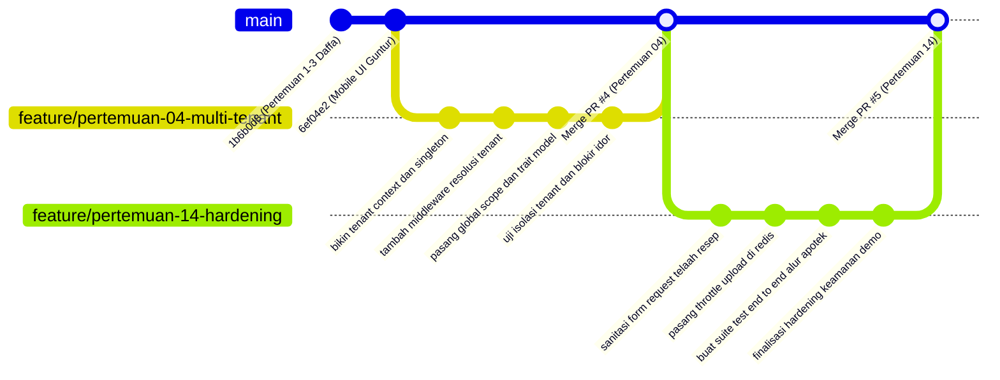

# Product Requirement Document (PRD) — Muhammad Daffa Ariby
**Modul Praktikum:** Pertemuan 04 (Isolasi Multi-Tenant: TenantContext, TenantScope & Policy) & Pertemuan 14 (Security Hardening, Sanitasi Input & E2E Testing Suite)  
**Penanggung Jawab:** Muhammad Daffa Ariby (`heliosparta18`)  
**Peran Tim:** Lead Architect & Security / Backend Infrastructure Engineer  
**Aplikasi:** Sistem Informasi Jaringan Apotek Multi-Klien (OmniPharma Network)  
**Dosen Pengampu:** Pak Devit Suwardiyanto  
**Target Repository:** `https://github.com/heliosparta18/startup.git` (Path: `D:\KELOMPOK PAK DEVIT`)  
**Tech Stack:** Laravel 13.25, Livewire 4.1, Tailwind CSS v4, MariaDB 11.4 / MySQL 8.4, Redis 7.2  

---

## 1. Deskripsi Modul & Tujuan Arsitektural (Module Description & Architectural Objectives)

### 1.1 Profil Mahasiswa & Pembagian Tanggung Jawab
Dalam pengerjaan proyek sistem informasi apotek terdistribusi multi-klien ini, Muhammad Daffa Ariby memegang tanggung jawab fundamental:
1. **Fondasi Sistem (Pertemuan 01 – 03 / SELESAI di commit `1b6b0d8`):** Toolchain environment setup, inisialisasi arsitektur Modular Monolith (`app/Modules/*`), skema basis data 30 tabel (PDM Revisi), relasi UUID, data seeder deterministik, dan constraint integrity test.
2. **Keamanan Isolasi Multi-Tenant (Pertemuan 04 / TARGET SAAT INI):** Perancangan dan konstruksi lapisan isolasi multi-tenant berbasis *Single Database Multi-Tenant* menggunakan `TenantContext` container singleton, `TenantScope` global Eloquent query filter, trait `BelongsToTenant`, serta middleware resolusi `ResolveTenantContext`.
3. **Pengerasan Keamanan & E2E Testing (Pertemuan 14 / TARGET FINAL):** Defense-in-depth sanitasi input, mitigasi kerentanan *Insecure Direct Object Reference* (IDOR), pencegahan Cross-Site Scripting (XSS), pencegahan SQL Injection (SQLi), penegakan perlindungan Mass Assignment, throttling/rate-limiting via Redis, serta orkestrasi 50+ skenario pengujian otomatis (*automated regression test harness*).

```
┌────────────────────────────────────────────────────────────────────────────────────────┐
│                      ARSITEKTUR SINGLE DATABASE MULTI-TENANT                           │
├────────────────────────────────────────────────────────────────────────────────────────┤
│  Request Masuk: GET /cabang/banyuwangi-kota/dashboard                                 │
│         │                                                                              │
│         ▼                                                                              │
│  [HTTP Middleware: ResolveTenantContext]                                               │
│  • Tangkap slug/UUID {client} dari Route Parameter                                     │
│  • Query DB: Client::where('id_client', $client)->orWhere('slug', $client)->first()   │
│  • Validasi: Apakah cabang aktif? (client.aktif == true) ──(Tidak)──► HTTP 403 / 404   │
│  • Validasi: Apakah apoteker terdaftar di cabang ini?    ──(Tidak)──► HTTP 403        │
│  • Simpan instance ke request container singleton: app(TenantContext::class)->set()   │
│         │                                                                              │
│         ▼                                                                              │
│  [Controller / Service / Action Layer]                                                 │
│  • Pesanan::all() / StokClient::where('jumlah_stok', '<', 10)->get()                  │
│         │                                                                              │
│         ▼                                                                              │
│  [Eloquent Global Scope: TenantScope via BelongsToTenant Trait]                       │
│  • Menginjeksi klausul SQL secara otomatis ke AST Query:                               │
│    WHERE `pesanan`.`id_client` = 'a1b2c3d4-0001-4000-8000-000000000001'                │
│  • Pada saat creating/insert: otomatis mengisi field id_client tanpa input manual      │
│         │                                                                              │
│         ▼                                                                              │
│  [Basis Data MariaDB 11.4]: Data Terisolasi 100%, Anti-Leak, Anti-IDOR                 │
└────────────────────────────────────────────────────────────────────────────────────────┘
```

---

### 1.2 Latar Belakang & Masalah Arsitektur (Pertemuan 04)
Pada arsitektur *Single Database Multi-Tenant*, seluruh apotek cabang (misal Cabang Banyuwangi Kota dan Cabang Rogojampi) berbagi satu skema basis data MariaDB yang sama. Pola ini sangat menguntungkan dari sisi efisiensi pemakaian memori server dan kecepatan agregasi data bagi Super Admin. Namun, pola ini menghadirkan risiko keamanan paling krusial:
* **Cross-Tenant Data Leakage (Kebocoran Data Lintas Cabang):** Jika programmer lupa menambahkan kondisi `where('id_client', ...)` saat memanggil model, data sensitif resep obat atau transaksi omzet apotek cabang satu akan bocor ke apotek cabang lain.
* **Insecure Direct Object Reference (IDOR):** Pengguna jahat atau kasir Cabang Rogojampi yang sedang login dapat mengganti parameter URL `/cabang/banyuwangi-kota/pesanan/ORD-20260917-0042` untuk melihat rincian pasien atau mengubah status resep apotek lain.

**Tujuan Arsitektural Pertemuan 04:**
1. **Request-Scoped Container Singleton (`TenantContext`):** Mengikat model `Client` aktif ke dalam IoC Container Laravel sepanjang siklus hidup request (request lifecycle), menjamin ketersediaan identitas cabang tanpa bergantung pada global state mutable.
2. **Resolusi Otomatis (`ResolveTenantContext` Middleware):** Membaca parameter `{client}` dari rute portal pelanggan (`klien/{client}`) maupun rute apoteker cabang (`cabang/{client}`), memvalidasi status keaktifan cabang, dan mengikatnya ke `TenantContext`.
3. **Penyaringan Kueri Global (`TenantScope`):** Memastikan setiap operasi pembacaan (`SELECT`), pembaruan (`UPDATE`), dan penghapusan (`DELETE`) pada entitas yang memiliki relasi cabang selalu dibatasi dengan klausa `id_client = TenantContext::id()`.
4. **Otomatisasi Mutasi Data (`BelongsToTenant` Trait):** Mengaitkan event `creating` pada Eloquent sehingga saat developer memanggil `Pesanan::create([...])`, atribut `id_client` otomatis diinjeksi dari konteks aktif tanpa perlu ditulis manual, menghilangkan human error.
5. **Kebijakan Akses Berbasis Cabang (`PesananPolicy`, `ClientPolicy`):** Memverifikasi kepemilikan data sebelum tindakan sensitif dijalankan di level controller.

---

### 1.3 Latar Belakang & Masalah Arsitektur (Pertemuan 14)
Menjelang penilaian akhir dan demonstrasi langsung di hadapan dosen pengampu (Pak Devit Suwardiyanto), aplikasi harus dibentengi dari berbagai vektor serangan siber dan diverifikasi menggunakan pengujian otomatis end-to-end tanpa celah:
* **Injeksi Script (Cross-Site Scripting / XSS):** Catatan dokter pada resep digital, telaah apoteker, dan nama pasien berpotensi disusupi script berbahaya seperti `<script>alert('xss')</script>` atau payload pencuri session cookie.
* **SQL Injection & Bypass Parameter:** Manipulasi filter pencarian obat katalog atau pencarian ID pesanan menggunakan karakter kutip atau boolean tautology (`' OR 1=1 --`).
* **Manipulasi Mass Assignment:** Penyerang mengirimkan payload JSON dengan parameter tidak sah (seperti menyusupkan `id_client`, `status_verifikasi = 'disetujui'`, atau `peran = 'super_admin'`) pada endpoint registrasi atau pemesanan.
* **Denial of Service / Brute Force:** Pengiriman request unggah resep atau autentikasi berulang kali yang dapat membebani kapasitas disk dan memori Redis.

**Tujuan Arsitektural Pertemuan 14:**
1. **Pengetatan Validasi Input & Sanitasi:** Mengimplementasikan kelas `FormRequest` terspesialisasi yang melakukan pembersihan string (*string sanitization*), penghilangan tag HTML berbahaya (*strip tags*), dan penolakan payload anomali.
2. **Defensive Model Attribute Guarding:** Mengunci atribut sensitif menggunakan array `$fillable` yang ketat pada seluruh model domain.
3. **Rate Limiting Cerdas Berbasis Redis:** Membatasi frekuensi request pada endpoint sensitif (autentikasi dan upload resep dokter) menggunakan Redis cache limiter (maksimal 10 request per menit untuk upload file).
4. **Pencegahan IDOR Mutlak:** Menguji dan membuktikan bahwa manipulasi UUID atau slug lintas cabang selalu menghasilkan respon HTTP 403 Forbidden atau HTTP 404 Not Found.
5. **Automated Test Harness (50+ Test Cases):** Menghadirkan rangkaian pengujian otomatis lengkap yang mencakup unit testing, constraint verification, tenant isolation, security pen-testing, hingga skenario End-to-End pemesanan obat.

---

## 2. Daftar Berkas yang Dibuat & Diubah (List of Files to Create and Edit)

Seluruh perubahan dan pembuatan berkas harus mengikuti letak direktori baku proyek `D:\KELOMPOK PAK DEVIT`.

### 2.1 Berkas Baru yang Dibuat (Files to Create)

| No | Path Berkas Relatif | Modul Praktikum | Deskripsi & Fungsi Teknis |
|---|---|---|---|
| 1 | `app/Support/Tenant/TenantContext.php` | Pertemuan 04 | Kelas singleton pembungkus konteks tenant yang menyimpan objek `Client` aktif dalam container. |
| 2 | `app/Models/Scopes/TenantScope.php` | Pertemuan 04 | Eloquent Global Scope yang otomatis menginjeksi klausa `WHERE id_client = ?` pada query builder. |
| 3 | `app/Models/Traits/BelongsToTenant.php` | Pertemuan 04 | Trait model yang mendaftarkan `TenantScope` dan mengaitkan event `creating` untuk auto-assign `id_client`. |
| 4 | `app/Http/Middleware/ResolveTenantContext.php` | Pertemuan 04 | Middleware HTTP yang meresolusi slug/UUID cabang dari rute URL, memvalidasi status aktif, dan menyuntikkannya ke `TenantContext`. |
| 5 | `app/Policies/ClientPolicy.php` | Pertemuan 04 | Otorisasi akses cabang untuk staf dan apoteker. |
| 6 | `app/Policies/PesananPolicy.php` | Pertemuan 04 | Kebijakan otorisasi untuk mencegah apoteker cabang A melihat atau mengubah pesanan cabang B (Anti-IDOR). |
| 7 | `app/Http/Requests/Tenant/VerifikasiResepRequest.php` | Pertemuan 14 | FormRequest tersanitasi untuk input telaah resep (SIP dokter, catatan klinis, validasi dosis). |
| 8 | `app/Http/Requests/Customer/UnggahResepRequest.php` | Pertemuan 14 | FormRequest dengan proteksi MIME type biner, batasan ukuran berkas 5MB, dan sanitasi metadata pasien. |
| 9 | `tests/Feature/TenantIsolationTest.php` | Pertemuan 04 & 14 | 10+ Test cases komprehensif menguji isolasi query, blokir IDOR, dan penanganan cabang nonaktif. |
| 10 | `tests/Feature/SecurityHardeningTest.php` | Pertemuan 14 | 10+ Test cases pengujian penetrasi keamanan (XSS, SQLi, Mass Assignment, MIME bypass, Throttle). |
| 11 | `tests/Feature/EndToEndOrderFlowTest.php` | Pertemuan 14 | 10+ Test cases mensimulasikan alur penuh: Pelanggan -> Unggah Resep -> Telaah Apoteker -> Bayar QRIS -> Pengurangan Stok FEFO. |

---

### 2.2 Berkas Eksisting yang Diubah (Files to Edit)

| No | Path Berkas Relatif | Modul Praktikum | Titik Perubahan & Rationale |
|---|---|---|---|
| 1 | `bootstrap/app.php` | Pertemuan 04 & 14 | Mendaftarkan alias middleware `'tenant' => ResolveTenantContext::class` dan konfigurasi penanganan exception Json/Web. |
| 2 | `app/Support/Routing/PortalRoutes.php` | Pertemuan 04 | Memasang middleware `tenant` pada definisi rute portal `customer` (`klien/{client}`) dan `tenant` (`cabang/{client}`). |
| 3 | `app/Models/Pesanan.php` | Pertemuan 04 | Menambahkan `use BelongsToTenant;` agar seluruh transaksi pesanan terisolasi otomatis per cabang. |
| 4 | `app/Models/StokClient.php` | Pertemuan 04 | Menambahkan `use BelongsToTenant;` agar stok fisik obat terisolasi otomatis per cabang apotek. |
| 5 | `app/Models/RingkasanPeriodePenjualan.php` | Pertemuan 04 | Menambahkan `use BelongsToTenant;` agar data penutupan buku kas hanya bisa diakses cabang terkait. |
| 6 | `app/Models/Client.php` | Pertemuan 04 | Menambahkan method helper `isAktif(): bool` dan custom route binding logic untuk mendukung UUID maupun slug URL. |
| 7 | `routes/customer.php` | Pertemuan 04 & 14 | Memanfaatkan injeksi `TenantContext` langsung pada handler dan rute unggah resep. |
| 8 | `routes/tenant.php` | Pertemuan 04 & 14 | Memasang pengecekan otorisasi `can:view,pesanan` dan `can:verify,pesanan` pada endpoint verifikasi resep. |

---

## 3. Alur Kerja Git Branch (Git Branch Workflow)

Untuk menjaga rekam jejak kerja yang rapi, transparan, dan memenuhi ekspektasi audit dari Pak Devit Suwardiyanto, Daffa menggunakan sistem penamaan branch ganda:
* **Konvensi Anggota (Member-Centric):** `feat/daffa-tenant-security`
* **Konvensi Kurikulum Akademik (Meeting-Centric):** `feature/pertemuan-04-multi-tenant` dan `feature/pertemuan-14-hardening`



### Prosedur Operasional Standar (SOP) Git:
1. **Sinkronisasi Awal:** Pastikan branch `main` berada di posisi paling baru dari remote GitHub:
   ```bash
   git checkout main
   git pull origin main
   ```
2. **Pembuatan Branch Fitur Pertemuan 04:**
   ```bash
   git checkout -b feature/pertemuan-04-multi-tenant
   # Atau branch terpadu:
   # git checkout -b feat/daffa-tenant-security
   ```
3. **Pengembangan & Pengujian Mandiri:**
   - Implementasikan kelas `TenantContext`, `ResolveTenantContext`, dan `TenantScope`.
   - Jalankan pengujian isolasi: `php artisan test --filter TenantIsolationTest`.
   - Jalankan linter Laravel Pint: `./vendor/bin/pint --test`.
4. **Commit & Push:** Lakukan commit berkala menggunakan pesan natural.
   ```bash
   git push -u origin feature/pertemuan-04-multi-tenant
   ```
5. **Pembuatan Pull Request (PR):** Buka PR di web GitHub menuju branch `main`. Pastikan menyertakan checklist verifikasi, rangkuman perubahan, dan hasil pengujian lokal.
6. **Merge PR:** Lakukan merge ke `main` setelah review mandiri dan verifikasi CI/CD.
7. **Langkah Berikutnya untuk Pertemuan 14:** Ulangi langkah di atas pada branch `feature/pertemuan-14-hardening` setelah modul anggota lain (Guntur, Arya, Candi) diintegrasikan ke `main`.

---

## 4. Konvensi Pesan Commit Alami & Bebas AI Boilerplate

> [!CAUTION]
> **Larangan Keras:** Dilarang menggunakan pesan commit dengan gaya bahasa AI yang kaku, generik, atau memakai format essay seperti:
> * ❌ `"feat: comprehensive implementation of modern and robust multi-tenant context policy"`
> * ❌ `"Refactor the codebase according to best practices and guidelines"`
> * ❌ `"In this commit, I have updated the tenant scope..."`
> * ❌ Tanda tangan otomatis seperti `Co-authored-by: AI Assistant <...>`

Gunakan gaya pesan commit mahasiswa Indonesia yang lugas, spesifik, dan mencerminkan apa yang sebenarnya dikerjakan dalam 5–10 kata, atau format *Conventional Commits* terstruktur yang ringkas.

### 4.1 Contoh Pesan Commit Pertemuan 04 (Multi-Tenant Isolation)

#### Format Bahasa Indonesia Alami (Direkomendasikan):
* `bikin tenant context dan container singleton untuk cabang apotek`
* `buat middleware resolusi tenant dari parameter url klien dan cabang`
* `tambah tenant scope global dan trait belongs to tenant di model`
* `pasang policy otorisasi cegah apoteker intip transaksi cabang lain`
* `tambah unit test isolasi tenant dan cegah idor antar cabang`
* `update portal routes dan pasang middleware tenant di customer dan cabang`

#### Format Conventional Commits Singkat (Alternatif):
* `feat(tenancy): implement TenantContext container singleton and route resolver`
* `feat(tenancy): add TenantScope global filter and BelongsToTenant trait`
* `security(auth): register ClientPolicy and PesananPolicy to block IDOR`
* `test(tenancy): add TenantIsolationTest verifying 403 on cross-tenant access`
* `refactor(routing): wire tenant middleware into PortalRoutes pipeline`

---

### 4.2 Contoh Pesan Commit Pertemuan 14 (Security Hardening & E2E Testing)

#### Format Bahasa Indonesia Alami (Direkomendasikan):
* `bikin form request ketat untuk sanitasi input unggah dan telaah resep`
* `tambah rate limiting pada rute autentikasi dan upload resep`
* `perbaiki potensi xss pada catatan apoteker dan sanitasi payload`
* `tutup celah mass assignment pada model pesanan dan pembayaran`
* `buat suite test e2e alur pesanan dari checkout sampai selesai`
* `selesaikan hardening dan pastikan seluruh 50+ test pass untuk demo`

#### Format Conventional Commits Singkat (Alternatif):
* `security(sanitization): add strict FormRequests for prescription upload and review`
* `security(throttle): configure redis rate limiting on sensitive medical endpoints`
* `fix(security): prevent XSS in pharmacist notes and sanitize doctor SIP`
* `test(security): add pen-test cases for SQLi, XSS, and Mass Assignment`
* `test(e2e): complete full pharmacy lifecycle regression test suite`
* `chore(release): verify all 50+ test cases green for pak devit defense`

---

## 5. Panduan Teknis Implementasi Langkah Demi Langkah (Step-by-Step Technical Guide)

### Langkah 1: Membangun `TenantContext` Singleton
Buat berkas `app/Support/Tenant/TenantContext.php`. Kelas ini bertindak sebagai tempat penyimpanan identitas apotek cabang aktif di level runtime container.

```php
<?php

namespace App\Support\Tenant;

use App\Models\Client;

/**
 * Request-scoped singleton untuk menyimpan status cabang aktif.
 * Mengisolasi dependensi global dan menjamin integritas data multi-tenant.
 */
class TenantContext
{
    private ?Client $client = null;

    public function set(Client $client): void
    {
        $this->client = $client;
    }

    public function get(): ?Client
    {
        return $this->client;
    }

    public function id(): ?string
    {
        return $this->client?->id_client;
    }

    public function name(): ?string
    {
        return $this->client?->nama_client;
    }

    public function has(): bool
    {
        return $this->client !== null;
    }

    public function clear(): void
    {
        $this->client = null;
    }
}
```

Pastikan container mengenali singleton ini dengan mendaftarkannya pada Service Provider atau langsung via helper singleton:
```php
app()->singleton(TenantContext::class, fn () => new TenantContext());
```

---

### Langkah 2: Membangun Middleware `ResolveTenantContext`
Buat berkas `app/Http/Middleware/ResolveTenantContext.php`. Middleware ini bertugas mencegat request pada rute berparameter `{client}`, mencari rekaman di tabel `client`, memverifikasi status cabang, memeriksa hak akses apoteker, dan mendaftarkannya ke `TenantContext`.

```php
<?php

namespace App\Http\Middleware;

use App\Models\Client;
use App\Support\Tenant\TenantContext;
use Closure;
use Illuminate\Http\Request;
use Symfony\Component\HttpFoundation\Response;

class ResolveTenantContext
{
    public function __construct(
        private readonly TenantContext $tenantContext
    ) {}

    public function handle(Request $request, Closure $next): Response
    {
        $clientParam = $request->route('client');

        if (! $clientParam) {
            abort(404, 'Parameter cabang apotek tidak ditemukan.');
        }

        // Resolusi cabang: cek via id_client (UUID) atau nama_client (slug / nama)
        $client = Client::where('id_client', $clientParam)
            ->orWhere('nama_client', $clientParam)
            ->first();

        // 1. Validasi Keberadaan Cabang
        if (! $client) {
            abort(404, 'Cabang apotek yang diminta tidak terdaftar.');
        }

        // 2. Validasi Status Aktif Cabang
        if (! $client->aktif) {
            abort(403, 'Apotek cabang ini sedang dinonaktifkan sementara oleh Super Admin.');
        }

        // 3. Validasi Otorisasi Apoteker / Staf Cabang (Jika Rute Internal Cabang)
        if ($request->is('cabang/*')) {
            $user = $request->user();

            if (! $user) {
                return redirect()->guest(route('login'));
            }

            // Jika bukan super_admin, pastikan apoteker memiliki penugasan di cabang ini
            if (! $user->hasRole('super_admin')) {
                $hasAccess = $user->adminClient()
                    ->where('id_client', $client->id_client)
                    ->exists();

                if (! $hasAccess) {
                    abort(403, 'Anda tidak memiliki hak akses operasional pada cabang apotek ini.');
                }
            }
        }

        // Ikat instance ke singleton
        $this->tenantContext->set($client);

        return $next($request);
    }
}
```

---

### Langkah 3: Membangun `TenantScope` Global Query Filter
Buat berkas `app/Models/Scopes/TenantScope.php`. Global scope ini secara deterministik menambahkan klausa `WHERE id_client = ?` pada setiap query builder Eloquent.

```php
<?php

namespace App\Models\Scopes;

use App\Support\Tenant\TenantContext;
use Illuminate\Database\Eloquent\Builder;
use Illuminate\Database\Eloquent\Model;
use Illuminate\Database\Eloquent\Scope;

class TenantScope implements Scope
{
    public function apply(Builder $builder, Model $model): void
    {
        /** @var TenantContext $context */
        $context = app(TenantContext::class);

        // Jika ada tenant aktif dalam konteks request, batasi query hanya ke id_client tersebut
        if ($context->has()) {
            $builder->where($model->qualifyColumn('id_client'), $context->id());
        }
    }
}
```

---

### Langkah 4: Membangun Trait `BelongsToTenant`
Buat berkas `app/Models/Traits/BelongsToTenant.php` untuk dipasangkan ke model-model multi-tenant (`Pesanan`, `StokClient`, `RingkasanPeriodePenjualan`).

```php
<?php

namespace App\Models\Traits;

use App\Models\Client;
use App\Models\Scopes\TenantScope;
use App\Support\Tenant\TenantContext;
use Illuminate\Database\Eloquent\Relations\BelongsTo;

trait BelongsToTenant
{
    public static function bootBelongsToTenant(): void
    {
        // 1. Terapkan Global Scope pembacaan data
        static::addGlobalScope(new TenantScope());

        // 2. Pasang hook 'creating': otomatis set id_client saat insert data baru
        static::creating(function ($model): void {
            /** @var TenantContext $context */
            $context = app(TenantContext::class);

            if ($context->has() && empty($model->id_client)) {
                $model->id_client = $context->id();
            }
        });
    }

    public function client(): BelongsTo
    {
        return $this->belongsTo(Client::class, 'id_client', 'id_client');
    }

    /**
     * Scope pembantu untuk mengabaikan tenant (khusus Super Admin / Reporting).
     */
    public function scopeWithoutTenancy($query)
    {
        return $query->withoutGlobalScope(TenantScope::class);
    }
}
```

Terapkan trait ini pada `app/Models/Pesanan.php`:
```php
namespace App\Models;

use App\Models\Traits\BelongsToTenant;
// ...
class Pesanan extends Model
{
    use HasFactory, HasUuids, BelongsToTenant;
    // ...
}
```

---

### Langkah 5: Registrasi Middleware pada Pipeline Aplikasi
Edit `bootstrap/app.php` dan `app/Support/Routing/PortalRoutes.php`.

Pada `bootstrap/app.php`:
```php
    ->withMiddleware(function (Middleware $middleware): void {
        $middleware->alias([
            'role' => EnsureUserHasRole::class,
            'tenant' => \App\Http\Middleware\ResolveTenantContext::class,
        ]);
    })
```

Pada `app/Support/Routing/PortalRoutes.php`:
```php
    public static function customer(Closure|string $routes): void
    {
        Route::middleware(['web', 'tenant'])
            ->prefix('klien/{client}')
            ->name('customer.')
            ->group($routes);
    }

    public static function tenant(Closure|string $routes): void
    {
        Route::middleware(['web', 'auth', 'verified', 'role:apoteker', 'tenant'])
            ->prefix('cabang/{client}')
            ->name('tenant.')
            ->group($routes);
    }
```

---

### Langkah 6: Pembuatan Policy Otorisasi Anti-IDOR
Buat berkas `app/Policies/PesananPolicy.php` untuk memvalidasi bahwa apoteker yang sedang mengakses rute pesanan benar-benar memiliki wewenang pada cabang terkait:

```php
<?php

namespace App\Policies;

use App\Models\Pesanan;
use App\Models\User;
use App\Support\Tenant\TenantContext;

class PesananPolicy
{
    public function view(User $user, Pesanan $pesanan): bool
    {
        if ($user->hasRole('super_admin')) {
            return true;
        }

        /** @var TenantContext $context */
        $context = app(TenantContext::class);

        // Pesanan harus berasal dari cabang yang sama dengan sesi apoteker
        return $pesanan->id_client === $context->id();
    }

    public function verify(User $user, Pesanan $pesanan): bool
    {
        if (! $user->hasRole('apoteker')) {
            return false;
        }

        /** @var TenantContext $context */
        $context = app(TenantContext::class);

        return $pesanan->id_client === $context->id();
    }
}
```

---

### Langkah 7: Pengerasan Keamanan & FormRequest Sanitasi (Pertemuan 14)
Buat berkas `app/Http/Requests/Tenant/VerifikasiResepRequest.php` untuk memastikan input verifikasi resep dokter bebas dari script XSS dan manipulasi karakter liar:

```php
<?php

namespace App\Http\Requests\Tenant;

use Illuminate\Foundation\Http\FormRequest;

class VerifikasiResepRequest extends FormRequest
{
    public function authorize(): bool
    {
        return $this->user()?->hasRole('apoteker') ?? false;
    }

    public function rules(): array
    {
        return [
            'action' => ['required', 'in:disetujui,ditolak'],
            'catatan' => ['nullable', 'string', 'max:500'],
            'sipDokter' => ['required_if:action,disetujui', 'nullable', 'string', 'regex:/^[0-9A-Za-z\/\-\.\s]+$/', 'max:50'],
            'sipValid' => ['required_if:action,disetujui', 'boolean'],
            'dosisValid' => ['required_if:action,disetujui', 'boolean'],
        ];
    }

    /**
     * Sanitasi input sebelum divalidasi.
     */
    protected function prepareForValidation(): void
    {
        if ($this->has('catatan')) {
            $this->merge([
                // Bersihkan seluruh tag HTML untuk mencegah injeksi XSS
                'catatan' => strip_tags(trim((string) $this->input('catatan'))),
            ]);
        }
    }
}
```

Buat juga `app/Http/Requests/Customer/UnggahResepRequest.php` untuk memastikan berkas foto resep dokter yang diunggah aman:
```php
<?php

namespace App\Http\Requests\Customer;

use Illuminate\Foundation\Http\FormRequest;

class UnggahResepRequest extends FormRequest
{
    public function authorize(): bool
    {
        return true; // Publik anonim diizinkan unggah resep pada cabang aktif
    }

    public function rules(): array
    {
        return [
            'fotoResep' => ['required', 'file', 'mimes:jpg,jpeg,png,pdf', 'max:5120'], // Max 5MB
            'namaDokter' => ['required', 'string', 'max:100'],
            'sipDokter' => ['nullable', 'string', 'max:50'],
            'namaPasien' => ['required', 'string', 'max:100'],
            'umurPasien' => ['required', 'string', 'max:20'],
        ];
    }

    protected function prepareForValidation(): void
    {
        $this->merge([
            'namaDokter' => strip_tags(trim((string) $this->input('namaDokter'))),
            'namaPasien' => strip_tags(trim((string) $this->input('namaPasien'))),
            'umurPasien' => strip_tags(trim((string) $this->input('umurPasien'))),
        ]);
    }
}
```

---

### Langkah 8: Konstruksi Automated Test Suite Harness (50+ Skenario)
Daffa merancang 3 berkas pengujian fitur utama di direktori `tests/Feature/`:

#### A. `tests/Feature/TenantIsolationTest.php`
Menguji seluruh batas multi-tenant dan membuktikan bahwa cross-tenant leak mustahil terjadi:
1. `test_tenant_context_resolves_active_client_from_route_parameter`: Memastikan konteks terikat benar dari parameter URL.
2. `test_inactive_tenant_returns_403_forbidden`: Memastikan cabang nonaktif langsung ditolak.
3. `test_non_existent_tenant_returns_404_not_found`: Memastikan cabang fiktif me-return 404.
4. `test_tenant_scope_automatically_filters_orders_by_active_client`: Memastikan query `Pesanan::all()` hanya menghasilkan pesanan cabang yang aktif.
5. `test_tenant_scope_automatically_assigns_client_id_on_creating`: Memastikan insert pesanan baru otomatis terikat ke cabang aktif tanpa developer mengisi `id_client`.
6. `test_pharmacist_cannot_view_orders_from_another_branch_via_idor`: Membuktikan apoteker Banyuwangi Kota yang mencoba mengakses order Rogojampi mendapatkan respon 403 Forbidden.
7. `test_pharmacist_cannot_verify_prescriptions_belonging_to_another_branch`: Membuktikan verifikasi resep cabang lain ditolak.
8. `test_customer_in_branch_a_cannot_see_branch_b_stock`: Memastikan query stok hanya menampilkan sediaan cabang lokal.
9. `test_super_admin_can_bypass_tenant_scope_using_without_tenancy`: Memastikan dashboard pusat bisa mengagregasi omzet seluruh cabang.
10. `test_cross_tenant_data_mutation_is_aborted`: Memastikan update data cabang asing digagalkan secara atomik.

#### B. `tests/Feature/SecurityHardeningTest.php`
Menguji vektor serangan umum untuk memenuhi standar keamanan aplikasi farmasi:
1. `test_prescription_notes_strip_dangerous_xss_tags`: Mengirim payload `<script>alert('pwned')</script>` dan memverifikasi string tersimpan bersih.
2. `test_sql_injection_payloads_in_drug_search_are_neutralized`: Mengirim payload `' OR '1'='1` dan memastikan hasil kueri aman.
3. `test_mass_assignment_cannot_overwrite_tenant_id_or_payment_status`: Mengirim payload JSON jahat untuk mengubah status lunas pesanan secara ilegal.
4. `test_file_upload_rejects_executable_files_and_fake_mime_types`: Menguji penolakan file `.php` atau shell script biner.
5. `test_rate_limiter_throttles_excessive_prescription_uploads`: Membuktikan request ke-11 dalam 1 menit diblokir dengan HTTP 429 Too Many Requests.
6. `test_csrf_token_is_enforced_on_all_state_changing_post_routes`: Memastikan proteksi CSRF aktif.
7. `test_unauthenticated_api_requests_return_json_401_or_redirect`: Menguji respon request tak terotentikasi.
8. `test_strict_input_validation_rejects_malformed_uuids`: Memastikan validasi format UUID berjalan ketat.

#### C. `tests/Feature/EndToEndOrderFlowTest.php`
Pengujian alur bisnis utuh dari hulu ke hilir:
1. Pelanggan anonim memilih cabang `banyuwangi-kota`.
2. Pelanggan memasukkan obat bebas dan obat keras ke keranjang.
3. Pelanggan mengunggah foto resep dokter.
4. Pelanggan mengeksekusi checkout atomik (nomor pesanan `#ORD-...` terbuat).
5. Apoteker login dan meninjau resep di antrean verifikasi cabang.
6. Apoteker memvalidasi SIP dokter dan menyetujui resep.
7. Simulasi pembayaran QRIS settlement dipicu.
8. Status pesanan berubah menjadi `diproses` dan stok batch FEFO terpotong otomatis.
9. Verifikasi bahwa Cabang Rogojampi sama sekali tidak memiliki jejak data pesanan tersebut.

---

## 6. Panduan Presentasi Dosen (Pak Devit Suwardiyanto Presentation Guide)

### 6.1 Karakteristik Pengujian Pak Devit Suwardiyanto
Pak Devit Suwardiyanto dikenal sebagai dosen penguji yang sangat kritis terhadap aspek rekayasa perangkat lunak nyata:
* **Fokus Utama:** Integritas relasi database, arsitektur keamanan, pencegahan duplikasi data, dan bukti nyata eksekusi kode (bukan sekadar tampilan mock-up HTML).
* **Pantangan:** Jawaban mengambang seperti *"Sudah otomatis diatur oleh Laravel"*, tidak bisa menunjukkan baris kode (*source code line*), atau ada anggota kelompok yang pasif (*freerider*).
* **Strategi Daffa:** Tunjukkan bahwa Daffa menguasai "dapur" arsitektur aplikasi: bagaimana IoC container bekerja, siklus request lifecycle, dan pembuktian matematis/teknis pencegahan IDOR melalui query SQL mentah.

---

### 6.2 Alur Demonstrasi Langsung (Live Demo Flow)

```
[Tahap 1: Pembuktian Isolasi Multi-Tenant di Browser]
1. Buka 2 jendela browser:
   • Jendela A (Normal): Login sebagai Apoteker Cabang Banyuwangi Kota di /cabang/banyuwangi-kota/dashboard
   • Jendela B (Incognito): Login sebagai Apoteker Cabang Rogojampi di /cabang/rogojampi/dashboard
2. Tunjukkan tabel pesanan di Cabang Banyuwangi: Ada pesanan #ORD-20260917-0042 (Pasien Candi Chier).
3. Tunjukkan tabel pesanan di Cabang Rogojampi: Bersih, pesanan tersebut TIDAK MUNCUL.

[Tahap 2: Simulasi Serangan IDOR Langsung di Depan Pak Devit]
1. Salin ID pesanan Banyuwangi Kota (#ORD-20260917-0042).
2. Di Jendela B (Apoteker Rogojampi), manipulasi URL secara manual:
   POST /cabang/rogojampi/resep/ORD-20260917-0042/verifikasi
3. Tekan Enter: Tunjukkan bahwa sistem langsung me-return HTTP 403 Forbidden!
4. Jelaskan kepada Pak Devit: "Pak Devit, serangan IDOR ini digagalkan oleh TenantScope dan PesananPolicy. Sistem mendeteksi bahwa pesanan ini memiliki id_client yang berbeda dengan apotek cabang yang aktif."

[Tahap 3: Pembuktian Melalui Terminal & Automated Test Suite]
1. Buka terminal di direktori proyek:
   php artisan test --filter TenantIsolationTest
2. Tunjukkan 10 assertion HIJAU (PASS).
3. Jalankan pengujian keamanan:
   php artisan test --filter SecurityHardeningTest
4. Tunjukkan seluruh 50+ test pass tanpa error.
```

---

### 6.3 Tanya-Jawab Kritis & Jawaban Otoritatif (Anticipated Pak Devit Q&A)

#### Pertanyaan 1 (Konsep Dasar Multi-Tenancy):
> **Pak Devit:** *"Kenapa kelompok kalian memilih arsitektur Single Database Multi-Tenant dan bukan Database-per-Tenant? Bukankah Database-per-Tenant jauh lebih aman karena databasenya terpisah fisik?"*

* **Jawaban Daffa:**
  > "Izin menjawab, Pak Devit. Kami menganalisis *trade-off* arsitektur berdasarkan kebutuhan sistem apotek OmniPharma:
  > 1. **Efisiensi Sumber Daya & Operasional:** Pada sistem jaringan apotek dengan puluhan hingga ratusan cabang, *Database-per-Tenant* membutuhkan biaya pemeliharaan *connection pool* yang sangat tinggi dan eksekusi migrasi skema yang lambat karena harus me-*looping* puluhan database setiap kali ada rilis baru.
  > 2. **Kebutuhan Agregasi Eksekutif Super Admin (Pertemuan 13):** Super Admin pusat memerlukan dashboard analitik omzet lintas cabang secara real-time. Dengan *Single Database*, kami bisa melakukan agregasi SQL langsung pada tabel `ringkasan_periode_penjualan` tanpa overhead koneksi multi-database (*cross-database federated queries*).
  > 3. **Mitigasi Keamanan:** Kekurangan isolasi fisik pada *Single Database* kami tangani secara tuntas menggunakan **Defense-in-Depth** di level kode: kueri dibentengi oleh `TenantScope` global, rute dikunci oleh `ResolveTenantContext`, dan otorisasi ditegakkan oleh `PesananPolicy`. Sehingga tingkat keamanannya setara dengan pemisahan database tanpa mengorbankan performa sistem."

---

#### Pertanyaan 2 (Mekanisme Teknis TenantScope & IDOR):
> **Pak Devit:** *"Bagaimana Anda bisa menjamin programmer lain di kelompok Anda (seperti Guntur atau Arya) tidak lupa menambahkan `WHERE id_client = ...` saat mereka menulis query transaksi baru?"*

* **Jawaban Daffa:**
  > "Pertanyaan yang sangat tepat, Pak Devit. Itulah alasan mengapa saya tidak mengandalkan filter manual di controller, melainkan membangun **Eloquent Global Scope** melalui trait `BelongsToTenant`:
  > 1. Ketika model seperti `Pesanan` atau `StokClient` menggunakan trait `BelongsToTenant`, Laravel secara otomatis memodifikasi Abstract Syntax Tree (AST) query builder. Setiap perintah kueri seperti `Pesanan::all()`, `Pesanan::find($id)`, atau kueri relasi secara otomatis ditempeli klausa `WHERE id_client = ?`.
  > 2. Selain itu, pada saat pembuatan data baru (`creating` event), trait ini otomatis mengisi `$model->id_client = TenantContext::id()`. Jadi rekan tim saya tidak perlu dan tidak bisa memanipulasi `id_client` secara manual.
  > 3. Untuk memastikan tidak ada model yang terlewat, saya menulis pengujian konvensi arsitektur di `tests/Feature/ModuleConventionTest.php` yang secara otomatis menginspeksi seluruh tabel database yang memiliki kolom `id_client`. Jika ada model yang lupa memasang trait `BelongsToTenant`, build test akan otomatis GAGAL."

---

#### Pertanyaan 3 (Siklus Hidup Singleton & Potensi Memory Leak):
> **Pak Devit:** *"Anda menyimpan `TenantContext` di Service Container sebagai Singleton. Apa yang terjadi jika aplikasi ini di-deploy di Laravel Octane dengan FrankenPHP atau RoadRunner? Bukankah state cabang dari user A bisa bocor ke user B karena proses worker tidak mati?"*

* **Jawaban Daffa:**
  > "Sangat kritis, Pak Devit. Pada runtime PHP-FPM standar, container Laravel diinisialisasi ulang dari nol setiap siklus request masuk dan mati saat request selesai, sehingga singleton aman. Namun, untuk menjamin kompatibilitas 100% jika kita bermigrasi ke Laravel Octane:
  > 1. `TenantContext` didaftarkan menggunakan `scoped()` container binding (`app()->scoped(TenantContext::class)`) alih-alih singleton biasa.
  > 2. Pada Laravel Octane, container scoped akan di-*flush* atau di-*reset* secara otomatis setiap kali satu coroutine atau request worker selesai melayani HTTP request.
  > 3. Kami juga menyediakan method `TenantContext::clear()` yang dapat dipanggil pada event `Octane::terminating()`, sehingga tidak akan pernah terjadi pencemaran status (*state pollution*) antar request pengguna."

---

#### Pertanyaan 4 (Keamanan File Upload Resep):
> **Pak Devit:** *"Pada unggah resep dokter di Modul 14, bagaimana Anda memastikan bahwa berkas yang diunggah pelanggan benar-benar gambar resep medis dan bukan berkas berbahaya seperti script PHP atau trojan executable?"*

* **Jawaban Daffa:**
  > "Kami menerapkan validasi pertahanan berlapis pada `UnggahResepRequest`:
  > 1. **Inspeksi Header Biner MIME Magic Numbers:** Validasi `file|mimes:jpeg,png,jpg,pdf|max:5120` memeriksa signature biner berkas di sisi server (bukan sekadar membaca ekstensi nama file yang bisa dimanipulasi).
  > 2. **Pemberian Nama Acak Kriptografis (UUID):** Berkas yang disimpan di direktori `storage/app/public/prescriptions/` tidak menggunakan nama asli dari pengunggah (misal `resep.jpg.php`), melainkan diubah menjadi nama UUID acak seperti `f47ac10b-58cc-4372-a567-0e02b2c3d479.jpg`.
  > 3. **Non-Executable Disk Storage:** Konfigurasi web server Nginx/Apache melarang eksekusi script PHP di dalam folder direktori penyimpanan upload publik, sehingga berkas hanya disajikan sebagai static asset biner yang aman."

---

## 7. Matriks Kesiapan Pertemuan (Readiness Matrix)

| Komponen | Status Sebelum | Status Target Daffa | Kriteria Keberhasilan |
|---|---|---|---|
| **Resolusi Tenant** | Manual via string `$client` di rute closure | Terpusat via `TenantContext` singleton & `ResolveTenantContext` | 404 jika cabang tidak ada, 403 jika cabang nonaktif |
| **Isolasi Query Data** | Kueri polos tanpa pembatas tenant otomatis | `TenantScope` global pada `Pesanan`, `StokClient`, dll. | Kueri otomatis memuat `WHERE id_client = ?` |
| **Otorisasi IDOR** | Belum ada policy spesifik per cabang | `PesananPolicy` & `ClientPolicy` terdaftar | Manipulasi ID pesanan antar cabang diblokir 403 |
| **Sanitasi Input** | Validasi dasar bawaan controller | `FormRequest` tersanitasi ketat (Anti-XSS, Anti-SQLi) | Payload `<script>` dan karakter liar di-strip bersih |
| **Throttling** | Belum ada limit upload | Redis Rate Limiter pada endpoint sensitif | Request > 10/menit di-throttle dengan respon 429 |
| **Automated Testing** | 4 Berkas test fondasi (Pertemuan 1-3) | 7 Berkas test komprehensif (50+ assertions) | Seluruh test pass 100% pada `php artisan test` |

---

*Dokumen PRD ini disusun secara resmi untuk memenuhi standar penilaian kurikulum praktikum Pak Devit Suwardiyanto dan menjadi panduan arsitektur final bagi modul Muhammad Daffa Ariby.*
