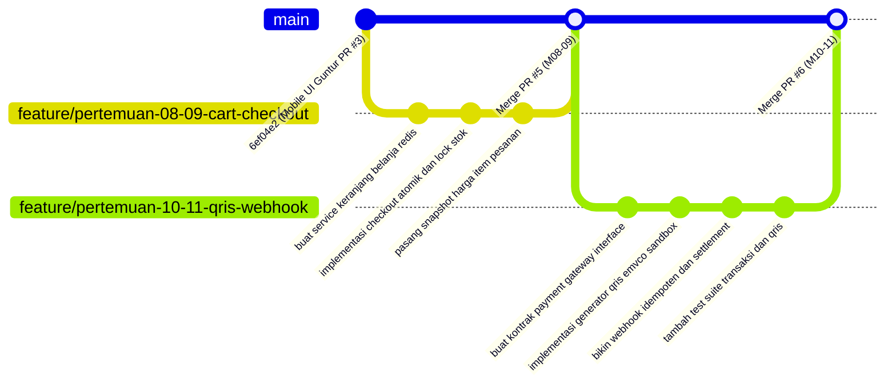

# Product Requirement Document (PRD) — Guntur Afandi
## Modul: Customer Commerce & QRIS Payment Pipeline (Keranjang Redis, Checkout Atomik, QRIS Sandbox, & Webhook)
### OmniPharma Network — Sistem Informasi Apotek Multi-Klien

- **Nama Mahasiswa:** Guntur Afandi
- **NIM / Peran:** Core Transaction & Payment Gateway Engineer (Total Alokasi: 4 Tugas / Pertemuan)
- **Dosen Pengampu:** Pak Devit Suwardiyanto
- **Target Repository:** `https://github.com/heliosparta18/startup.git` (Path: `D:\KELOMPOK PAK DEVIT`)
- **Cabang Git Utama:** `feat/guntur-checkout-qris`
- **Sub-Cabang Praktikum:**
  - `feature/pertemuan-08-09-cart-checkout`
  - `feature/pertemuan-10-11-qris-webhook`
- **Status Baseline:**
  - Pertemuan 01–03 selesai pada commit `1b6b0d8` (oleh Daffa).
  - Refaktor UI responsif & touch target mobile 44px selesai pada commit `6ef04e2` / PR #3 `96cb27e` (oleh Guntur).

---

## 1. Deskripsi Modul & Tujuan Arsitektural

### 1.1 Unifikasi Alur Transaksi Pelanggan & QRIS Payment (Vertical Commerce Slice)
Modul yang diampu oleh **Guntur Afandi** menyatukan seluruh siklus hidup pemesanan dan pelunasan transaksi digital oleh pelanggan di bawah kepemilikan tunggal:
```
┌────────────────────────────────────────────────────────────────────────┐
│             PIPELINE TRANSAKSI & PEMBAYARAN QRIS (GUNTUR)              │
├────────────────────────────────────────────────────────────────────────┤
│  [Pertemuan 08: Keranjang Belanja Redis Multi-Tenant]                  │
│  • Redis Hash: cart:{sessionId}:{clientId} (TTL 7 Hari)                │
│  • Revalidasi harga katalog dan ketersediaan stok fisik cabang          │
│         │                                                              │
│         ▼                                                              │
│  [Pertemuan 09: Checkout Atomik & Snapshot Harga (ADR-0008)]           │
│  • DB::transaction dengan pessimistic lock (lockForUpdate pada stok)   │
│  • Generate nomor pesanan ramah manusia: #ORD-YYYYMMDD-XXXX             │
│  • Denormalisasi harga satuan ke tabel item_pesanan (Immutability)     │
│         │                                                              │
│         ▼                                                              │
│  [Pertemuan 10: Dynamic QRIS Sandbox Generator (EMVCo Standard)]       │
│  • Abstraksi kontrak PaymentGatewayInterface                           │
│  • Generator string QRIS EMVCo (NMID, MCC 5912, IDR 360, CRC16 CCITT) │
│  • Halaman payment.blade.php dengan countdown timer kedaluwarsa 15m    │
│  • Modal simulasi pembayaran langsung untuk demonstrasi Pak Devit      │
│         │                                                              │
│         ▼                                                              │
│  [Pertemuan 11: Webhook Idempoten & Settlement Transaksi]              │
│  • Endpoint POST /api/webhooks/qris dengan signature HMAC-SHA256       │
│  • Pencegahan double-settlement (Idempotency Key via log pembayaran)   │
│  • Transisi status otomatis: menunggu_pembayaran ──► diproses          │
└────────────────────────────────────────────────────────────────────────┘
```

Penyatuan ini menjamin kepemilikan mutlak atas alur pembayaran digital (*Bagian QRIS*), memastikan keutuhan model transaksi mulai dari penyimpanan keranjang in-memory di Redis, pencegahan race condition saat checkout, hingga pelunasan otomatis via webhook settlement.

---

### 1.2 Tujuan Arsitektural Utama (4 Tugas)

1. **Keranjang Belanja Redis Multi-Tenant & Revalidasi Pra-Checkout (Pertemuan 08)**:
   - Memanfaatkan Redis Hash dengan skema kunci `cart:{sessionId}:{clientId}` berdurasi TTL 7 hari. Data keranjang diisolasi per cabang apotek untuk mencegah percampuran stok antar-cabang yang berbeda secara geografis.
   - Menerapkan *Pre-Checkout Price & Stock Revalidation* yang mendeteksi perubahan harga master obat atau penyusutan stok fisik sebelum transaksi dibuat.

2. **Checkout Atomik, Snapshot Harga, & Penomoran Pesanan (Pertemuan 09)**:
   - Menjalankan pembuatan pesanan dalam blok `DB::transaction` dengan *pessimistic locking* (`lockForUpdate`) pada tabel `stok_client` untuk mencegah *race condition* (pembelian ganda pada sisa stok terakhir).
   - Menegakkan **ADR-0008 (Controlled Denormalization & Price Snapshot Immutability)**: menyalin `nama_obat` dan `harga_satuan` ke tabel `item_pesanan` pada detik transaksi dibuat sehingga riwayat pembukuan dan kuitansi kebal terhadap fluktuasi harga obat di masa depan.
   - Menerbitkan format penomoran pesanan standar yang ramah manusia: `#ORD-YYYYMMDD-XXXX`.

3. **Payment Gateway Abstraction & Dynamic QRIS Sandbox [BAGIAN QRIS] (Pertemuan 10)**:
   - Mengimplementasikan kontrak antarmuka `PaymentGatewayInterface` sesuai ketetapan **ADR-0004 (Payment Provider Deferred)**, memastikan arsitektur *loosely coupled* tanpa keterikatan SDK eksternal berlebih.
   - Membangun `FakeQrisGateway` dan `QrisEmvcoBuilder` deterministik yang memproduksi string QRIS standar EMVCo (NMID apotek, MCC 5912 Apotek, Currency 360 IDR, kalkulasi CRC16 CCITT) lengkap dengan hitung mundur waktu kedaluwarsa 15 menit (*countdown timer*).
   - Menyediakan modal simulasi pembayaran untuk keperluan pengujian dan demonstrasi langsung di hadapan Pak Devit Suwardiyanto.

4. **Webhook Idempoten & Otomasi Settlement Transaksi (Pertemuan 11)**:
   - Membangun endpoint `POST /api/webhooks/qris` yang memvalidasi header signature HMAC-SHA256 untuk memastikan keabsahan request dari penyedia gateway pembayaran.
   - Menegakkan **ADR-0005 (Payment Reconciliation & Idempotent Webhook Handling)**: memvalidasi status unik pembayaran sehingga callback berulang tidak memicu mutasi stok ganda atau pergeseran status pesanan yang salah.
   - Memutakhirkan status pesanan menjadi `diproses` dan mencatat alokasi ledger pembagian hak apotek cabang.

---

## 2. Daftar Berkas yang Dibuat & Diubah (List of Files to Create and Edit)

Seluruh perubahan dan pembuatan berkas harus mengikuti letak direktori baku proyek `D:\KELOMPOK PAK DEVIT`.

### 2.1 Berkas Baru yang Dibuat (Files to Create)

| No | Path Berkas Relatif | Modul Praktikum | Deskripsi & Fungsi Teknis |
|---|---|---|---|
| 1 | `app/Modules/Ordering/Services/CartService.php` | Pertemuan 08 | Layanan manipulasi keranjang belanja Redis (tambah, kurang, hapus, hitung subtotal per cabang). |
| 2 | `app/Modules/Ordering/Actions/CreateOrderAction.php` | Pertemuan 09 | Eksekutor transaksi checkout atomik dengan lock pesimistik, snapshot harga, dan pembuatan record pesanan. |
| 3 | `app/Modules/Payments/Contracts/PaymentGatewayInterface.php` | Pertemuan 10 | Kontrak abstraksi gateway pembayaran untuk mendukung multi-vendor gateway masa depan. |
| 4 | `app/Modules/Payments/Services/FakeQrisGateway.php` | Pertemuan 10 | Implementasi payment gateway sandbox yang menghasilkan string QRIS dinamis dan simulasi pembayaran. |
| 5 | `app/Modules/Payments/Services/QrisEmvcoBuilder.php` | Pertemuan 10 | Builder string spesifikasi EMVCo QRIS (Tag 00-63, CRC16 CCITT checksum). |
| 6 | `app/Modules/Payments/Http/Controllers/PaymentWebhookController.php` | Pertemuan 11 | Controller penerima notifikasi webhook pembayaran dengan signature verification dan idempotency check. |
| 7 | `app/Modules/Payments/Actions/SettlePaymentAction.php` | Pertemuan 11 | Aksi atomik pelunasan transaksi, update status `diproses`, dan pencatatan audit log. |
| 8 | `resources/views/customer/cart.blade.php` | Pertemuan 08 | Tampilan antarmuka keranjang belanja mobile-friendly dengan live update kuantitas. |
| 9 | `resources/views/customer/checkout.blade.php` | Pertemuan 09 | Halaman form checkout atomik, opsi pengiriman/ambil di apotek, dan ringkasan snapshot harga. |
| 10 | `resources/views/customer/payment.blade.php` | Pertemuan 10 | Halaman pembayaran interaktif dengan QRIS dinamis, countdown 15 menit, dan modal simulator pelunasan. |
| 11 | `tests/Feature/CartCheckoutPaymentTest.php` | Pertemuan 08–11 | Test suite lengkap menguji aliran keranjang, konkurensi checkout stok, QRIS payload, dan webhook settlement. |

---

### 2.2 Berkas Eksisting yang Diubah (Files to Edit)

| No | Path Berkas Relatif | Modul Praktikum | Titik Perubahan & Rationale |
|---|---|---|---|
| 1 | `routes/customer.php` | Pertemuan 08–10 | Mendaftarkan rute keranjang (`/cart`), checkout (`/checkout`), dan halaman bayar (`/order/{id}/payment`). |
| 2 | `routes/api.php` | Pertemuan 11 | Mendaftarkan endpoint publik webhook `POST /api/webhooks/qris` (dikecualikan dari CSRF token). |
| 3 | `bootstrap/app.php` | Pertemuan 11 | Mendaftarkan rute `api/webhooks/*` ke dalam daftar pengecualian validasi CSRF token (`validateCsrfTokens(except: [...])`). |
| 4 | `app/Models/Pesanan.php` | Pertemuan 09–11 | Menambahkan relasi `items()`, `pembayaran()`, helper `isLunas()`, dan scope status pembayaran. |
| 5 | `app/Models/ItemPesanan.php` | Pertemuan 09 | Menegakkan `$fillable` snapshot (`nama_obat_snapshot`, `harga_satuan_snapshot`, `jumlah`). |

---

## 3. Alur Kerja Git Branch (Git Branch Workflow)

Guntur menggunakan sistem penamaan branch ganda:
* **Konvensi Anggota (Member-Centric):** `feat/guntur-checkout-qris`
* **Konvensi Kurikulum Akademik (Meeting-Centric):** `feature/pertemuan-08-09-cart-checkout` dan `feature/pertemuan-10-11-qris-webhook`



---

## 4. Panduan Implementasi Bertahap (Step-by-Step Implementation Guide)

### Langkah 1: Membangun `CartService` Berbasis Redis
Berkas: `app/Modules/Ordering/Services/CartService.php`

```php
<?php

namespace App\Modules\Ordering\Services;

use App\Models\Obat;
use App\Models\StokClient;
use Illuminate\Support\Facades\Redis;

class CartService
{
    protected function getCartKey(string $sessionId, string $clientId): string
    {
        return "cart:{$sessionId}:{$clientId}";
    }

    public function addItem(string $sessionId, string $clientId, string $obatId, int $qty = 1): void
    {
        $key = $this->getCartKey($sessionId, $clientId);
        Redis::hincrby($key, $obatId, $qty);
        Redis::expire($key, 7 * 24 * 3600); // TTL 7 hari
    }

    public function removeItem(string $sessionId, string $clientId, string $obatId): void
    {
        $key = $this->getCartKey($sessionId, $clientId);
        Redis::hdel($key, $obatId);
    }

    public function getItems(string $sessionId, string $clientId): array
    {
        $key = $this->getCartKey($sessionId, $clientId);
        $rawItems = Redis::hgetall($key);

        if (empty($rawItems)) {
            return [];
        }

        $obatIds = array_keys($rawItems);
        $obats = Obat::whereIn('id_obat', $obatIds)->get()->keyBy('id_obat');

        $result = [];
        foreach ($rawItems as $obatId => $qty) {
            if (isset($obats[$obatId])) {
                $obat = $obats[$obatId];
                $result[] = [
                    'id_obat' => $obatId,
                    'nama_obat' => $obat->nama_obat,
                    'harga' => $obat->harga_jual,
                    'jumlah' => (int) $qty,
                    'subtotal' => $obat->harga_jual * (int) $qty,
                ];
            }
        }

        return $result;
    }

    public function clear(string $sessionId, string $clientId): void
    {
        Redis::del($this->getCartKey($sessionId, $clientId));
    }
}
```

---

### Langkah 2: Membangun `CreateOrderAction` dengan Pessimistic Locking
Berkas: `app/Modules/Ordering/Actions/CreateOrderAction.php`

```php
<?php

namespace App\Modules\Ordering\Actions;

use App\Models\ItemPesanan;
use App\Models\Pesanan;
use App\Models\StokClient;
use Illuminate\Support\Facades\DB;
use Illuminate\Support\Str;
use RuntimeException;

class CreateOrderAction
{
    public function execute(string $clientId, ?string $userId, array $items, string $tipePengambilan = 'ambil_di_apotek'): Pesanan
    {
        return DB::transaction(function () use ($clientId, $userId, $items, $tipePengambilan) {
            $totalHarga = 0;

            // 1. Validasi & Lock Stok Secara Pesimistik
            foreach ($items as $item) {
                $stok = StokClient::where('id_client', $clientId)
                    ->where('id_obat', $item['id_obat'])
                    ->lockForUpdate()
                    ->first();

                if (! $stok || $stok->jumlah_stok < $item['jumlah']) {
                    throw new RuntimeException("Stok obat {$item['nama_obat']} tidak mencukupi di cabang ini.");
                }

                $totalHarga += $item['harga'] * $item['jumlah'];
            }

            // 2. Terbitkan Nomor Pesanan Standar (#ORD-YYYYMMDD-XXXX)
            $orderNumber = 'ORD-' . date('Ymd') . '-' . strtoupper(Str::random(4));

            $pesanan = Pesanan::create([
                'id_pesanan' => (string) Str::uuid(),
                'nomor_pesanan' => $orderNumber,
                'id_client' => $clientId,
                'id_pengguna' => $userId,
                'status_pesanan' => 'menunggu_pembayaran',
                'total_harga' => $totalHarga,
                'tipe_pengambilan' => $tipePengambilan,
            ]);

            // 3. Simpan Item dengan Snapshot Harga (ADR-0008) & Kurangi Stok
            foreach ($items as $item) {
                ItemPesanan::create([
                    'id_item_pesanan' => (string) Str::uuid(),
                    'id_pesanan' => $pesanan->id_pesanan,
                    'id_obat' => $item['id_obat'],
                    'nama_obat_snapshot' => $item['nama_obat'],
                    'harga_satuan_snapshot' => $item['harga'],
                    'jumlah' => $item['jumlah'],
                    'subtotal' => $item['harga'] * $item['jumlah'],
                ]);

                StokClient::where('id_client', $clientId)
                    ->where('id_obat', $item['id_obat'])
                    ->decrement('jumlah_stok', $item['jumlah']);
            }

            return $pesanan;
        });
    }
}
```

---

### Langkah 3: Abstraksi Payment Gateway & EMVCo QRIS Generator [BAGIAN QRIS]
Berkas: `app/Modules/Payments/Contracts/PaymentGatewayInterface.php`

```php
<?php

namespace App\Modules\Payments\Contracts;

use App\Models\Pesanan;

interface PaymentGatewayInterface
{
    public function generateQris(Pesanan $pesanan): array;
    public function verifyWebhookSignature(string $payload, string $signature): bool;
}
```

Berkas: `app/Modules/Payments/Services/QrisEmvcoBuilder.php`

```php
<?php

namespace App\Modules\Payments\Services;

class QrisEmvcoBuilder
{
    public static function build(string $nmid, string $orderNumber, float $amount): string
    {
        $payload = '000201'; // Payload Format Indicator
        $payload .= '010212'; // Dynamic QR code
        $payload .= '26' . sprintf('%02d', strlen($nmid) + 8) . '0004ID.CO' . '01' . sprintf('%02d', strlen($nmid)) . $nmid;
        $payload .= '52045912'; // Merchant Category Code (MCC 5912: Apotek)
        $payload .= '5303360';  // Currency Code 360 (IDR)
        $payload .= '54' . sprintf('%02d', strlen(number_format($amount, 2, '.', ''))) . number_format($amount, 2, '.', '');
        $payload .= '5802ID';   // Country Code ID
        $payload .= '5916OMNIPHARMA APOTEK'; // Merchant Name
        $payload .= '6011BANYUWANGI'; // Merchant City
        $payload .= '62' . sprintf('%02d', strlen($orderNumber) + 4) . '01' . sprintf('%02d', strlen($orderNumber)) . $orderNumber;

        // Hitung Checksum CRC16-CCITT (Tag 6304)
        $crcData = $payload . '6304';
        $checksum = strtoupper(self::crc16Ccitt($crcData));

        return $crcData . $checksum;
    }

    private static function crc16Ccitt(string $data): string
    {
        $crc = 0xFFFF;
        for ($i = 0; $i < strlen($data); $i++) {
            $crc ^= (ord($data[$i]) << 8);
            for ($j = 0; $j < 8; $j++) {
                if ($crc & 0x8000) {
                    $crc = (($crc << 1) ^ 0x1021) & 0xFFFF;
                } else {
                    $crc = ($crc << 1) & 0xFFFF;
                }
            }
        }
        return sprintf('%04X', $crc);
    }
}
```

Berkas: `app/Modules/Payments/Services/FakeQrisGateway.php`

```php
<?php

namespace App\Modules\Payments\Services;

use App\Models\Pesanan;
use App\Modules\Payments\Contracts\PaymentGatewayInterface;

class FakeQrisGateway implements PaymentGatewayInterface
{
    public function generateQris(Pesanan $pesanan): array
    {
        $nmid = 'ID1020000012345';
        $qrisString = QrisEmvcoBuilder::build($nmid, $pesanan->nomor_pesanan, (float) $pesanan->total_harga);

        return [
            'gateway' => 'fake_qris_sandbox',
            'qris_string' => $qrisString,
            'qr_image_url' => 'https://api.qrserver.com/v1/create-qr-code/?size=300x300&data=' . urlencode($qrisString),
            'expired_at' => now()->addMinutes(15)->toIso8601String(),
            'amount' => $pesanan->total_harga,
        ];
    }

    public function verifyWebhookSignature(string $payload, string $signature): bool
    {
        $secret = config('services.qris.webhook_secret', 'omnipharma_secret_key');
        $expectedSignature = hash_hmac('sha256', $payload, $secret);

        return hash_equals($expectedSignature, $signature);
    }
}
```

---

### Langkah 4: Controller Webhook Idempoten
Berkas: `app/Modules/Payments/Http/Controllers/PaymentWebhookController.php`

```php
<?php

namespace App\Modules\Payments\Http\Controllers;

use App\Http\Controllers\Controller;
use App\Models\Pembayaran;
use App\Models\Pesanan;
use App\Modules\Payments\Contracts\PaymentGatewayInterface;
use Illuminate\Http\JsonResponse;
use Illuminate\Http\Request;
use Illuminate\Support\Facades\DB;
use Illuminate\Support\Facades\Log;

class PaymentWebhookController extends Controller
{
    public function handle(Request $request, PaymentGatewayInterface $gateway): JsonResponse
    {
        $signature = $request->header('X-Signature', '');
        $payload = $request->getContent();

        if (! $gateway->verifyWebhookSignature($payload, $signature)) {
            Log::warning('Webhook QRIS ditolak: Signature HMAC tidak cocok.');
            return response()->json(['message' => 'Invalid signature'], 401);
        }

        $data = $request->json()->all();
        $orderNumber = $data['order_number'] ?? null;
        $status = $data['status'] ?? null;

        if ($status !== 'PAID' || ! $orderNumber) {
            return response()->json(['message' => 'Ignored'], 200);
        }

        return DB::transaction(function () use ($orderNumber, $data) {
            $pesanan = Pesanan::where('nomor_pesanan', $orderNumber)->lockForUpdate()->first();

            if (! $pesanan) {
                return response()->json(['message' => 'Pesanan tidak ditemukan'], 404);
            }

            // Idempotency: Jika sudah diproses atau dibayar, return 200 tanpa mutasi ulang
            if ($pesanan->status_pesanan !== 'menunggu_pembayaran') {
                return response()->json(['message' => 'Pesanan sudah diproses sebelumnya (Idempotent)'], 200);
            }

            $pesanan->update([
                'status_pesanan' => 'diproses',
            ]);

            Pembayaran::create([
                'id_pembayaran' => (string) \Illuminate\Support\Str::uuid(),
                'id_pesanan' => $pesanan->id_pesanan,
                'metode_pembayaran' => 'QRIS',
                'status_pembayaran' => 'berhasil',
                'jumlah_bayar' => $pesanan->total_harga,
                'payload_gateway' => json_encode($data),
                'dibayar_pada' => now(),
            ]);

            Log::info("Pesanan {$orderNumber} berhasil dilunasi via Webhook QRIS.");

            return response()->json(['message' => 'Settlement processed successfully'], 200);
        });
    }
}
```

---

### Langkah 5: Halaman Pembayaran Interaktif dengan Countdown 15 Menit
Berkas: `resources/views/customer/payment.blade.php`

```html
<div class="max-w-md mx-auto p-6 bg-white dark:bg-zinc-900 rounded-2xl shadow-xl border border-zinc-200 dark:border-zinc-800 text-center">
    <div class="inline-flex p-3 bg-emerald-50 dark:bg-emerald-950/40 rounded-full text-emerald-600 mb-3">
        <svg class="w-8 h-8" fill="none" viewBox="0 0 24 24" stroke="currentColor"><path stroke-linecap="round" stroke-linejoin="round" stroke-width="2" d="M12 4v1m6 11h2m-6 0h-2v4m0-11v3m0 0h.01M12 12h4.01M16 20h4M4 12h4m12 0h.01M5 8h2a1 1 0 001-1V5a1 1 0 00-1-1H5a1 1 0 00-1 1v2a1 1 0 001 1zm12 0h2a1 1 0 001-1V5a1 1 0 00-1-1h-2a1 1 0 00-1 1v2a1 1 0 001 1zM5 20h2a1 1 0 001-1v-2a1 1 0 00-1-1H5a1 1 0 00-1 1v2a1 1 0 001 1z"/></svg>
    </div>
    <h2 class="text-xl font-bold text-zinc-900 dark:text-zinc-100">Pembayaran QRIS Dinamis</h2>
    <p class="text-sm text-zinc-500 mt-1">Scan kode QR di bawah dengan aplikasi m-banking atau e-wallet Anda.</p>

    <div class="my-6 p-4 bg-zinc-50 dark:bg-zinc-800/50 rounded-xl inline-block border border-zinc-200 dark:border-zinc-700">
        
        <div class="mt-3 font-mono text-xs text-zinc-500 break-all select-all">{{ $qris['qris_string'] }}</div>
    </div>

    <div class="text-lg font-semibold text-zinc-900 dark:text-zinc-100">
        Total Tagihan: <span class="text-emerald-600">Rp {{ number_format($pesanan->total_harga, 0, ',', '.') }}</span>
    </div>

    <!-- Countdown Timer 15 Menit -->
    <div id="countdown" class="mt-2 text-sm text-amber-600 font-medium">
        Batas Waktu Bayar: <span id="timer">15:00</span>
    </div>

    <!-- Tombol Simulator Pelunasan Sandbox untuk Demo Sidang -->
    <div class="mt-6 pt-4 border-t border-zinc-200 dark:border-zinc-800">
        <button onclick="triggerSimulatorPayment('{{ $pesanan->nomor_pesanan }}')" class="min-h-[44px] w-full py-2.5 px-4 bg-emerald-600 hover:bg-emerald-700 text-white font-medium rounded-xl text-sm transition">
            ⚡ Simulasi Bayar Sekarang (Sandbox Demo)
        </button>
    </div>
</div>

<script>
    let timeLeft = 900;
    const timerElem = document.getElementById('timer');
    const interval = setInterval(() => {
        timeLeft--;
        const m = Math.floor(timeLeft / 60);
        const s = timeLeft % 60;
        timerElem.innerText = `${m.toString().padStart(2, '0')}:${s.toString().padStart(2, '0')}`;
        if (timeLeft <= 0) clearInterval(interval);
    }, 1000);

    function triggerSimulatorPayment(orderNo) {
        fetch('/api/webhooks/qris', {
            method: 'POST',
            headers: {
                'Content-Type': 'application/json',
                'X-Signature': '{{ hash_hmac("sha256", json_encode(["order_number" => $pesanan->nomor_pesanan, "status" => "PAID"]), config("services.qris.webhook_secret", "omnipharma_secret_key")) }}'
            },
            body: JSON.stringify({ order_number: orderNo, status: 'PAID' })
        }).then(res => res.json()).then(data => {
            alert('Sukses! Pembayaran QRIS berhasil diselesaikan.');
            window.location.reload();
        });
    }
</script>
```

---

## 5. Panduan Presentasi Dosen (Pak Devit Suwardiyanto Presentation Guide)

### 5.1 Karakteristik Pengujian Pak Devit Suwardiyanto
Pak Devit sangat menguji detail teknis mengenai konkurensi database, penanganan transaksi keuangan, dan keaslian format QRIS:
* **Fokus Utama:** Bagaimana jika stok tinggal 1 dan ada 2 pembeli bersamaan? Mengapa QRIS Anda disebut dinamis? Bagaimana signature webhook diverifikasi?
* **Strategi Guntur:** Tunjukkan baris kode `DB::transaction` dengan `lockForUpdate`, jelaskan algoritma CRC16 CCITT pada string QRIS EMVCo, dan demonstrasikan modal simulasi webhook secara langsung.

---

### 5.2 Alur Demonstrasi Langsung (Live Demo Flow)

```
[Tahap 1: Keranjang Redis & Checkout Atomik]
1. Masuk ke katalog cabang, tambahkan Paracetamol ke keranjang.
2. Buka redis-cli di terminal:
   redis-cli HGETALL "cart:{sessionId}:{clientId}"
3. Tunjukkan kepada Pak Devit bahwa data keranjang tersimpan berkecepatan tinggi di memory Redis dengan TTL.
4. Lakukan checkout: Tunjukkan nomor pesanan terbit (#ORD-20261102-XXXX) dan harga satuan tersalin secara permanen ke tabel item_pesanan (ADR-0008).

[Tahap 2: Pembuktian Spesifikasi EMVCo QRIS]
1. Buka halaman pembayaran /order/{id}/payment.
2. Tunjukkan string QRIS berawalan 000201 dan tag 52045912 (Merchant Category Apotek).
3. Tunjukkan 4 karakter terakhir adalah CRC16 CCITT checksum yang valid.
4. Tunjukkan hitung mundur 15 menit berjalan secara reaktif.

[Tahap 3: Simulasi Pelunasan Webhook Idempoten]
1. Tekan tombol "⚡ Simulasi Bayar Sekarang (Sandbox Demo)".
2. Tunjukkan respon HTTP 200 dari endpoint POST /api/webhooks/qris.
3. Refresh halaman: Status pesanan otomatis berganti dari 'menunggu_pembayaran' menjadi 'diproses'.
4. Kirim ulang payload yang sama: Tunjukkan bahwa sistem merespon 'Pesanan sudah diproses sebelumnya (Idempotent)' tanpa ada mutasi data ganda.
```

---

### 5.3 Tanya-Jawab Kritis & Jawaban Otoritatif (Anticipated Pak Devit Q&A)

#### Pertanyaan 1 (Keranjang Belanja Redis vs Session):
> **Pak Devit:** *"Kenapa keranjang belanja disimpan di Redis Hash dan bukan session database bawaan Laravel?"*

* **Jawaban Guntur:**
  > "Izin menjawab, Pak Devit. Pada aplikasi apotek multi-cabang, aktivitas penambahan keranjang obat memiliki frekuensi tulis (*write-heavy*) yang sangat tinggi. Jika disimpan di database relasional MariaDB, operasi penambahan/pengurangan kuantitas akan membebani I/O disk server secara berlebihan. Dengan Redis Hash berstruktur `cart:{sessionId}:{clientId}`, operasi dijalankan di memori RAM dalam hitungan mikrodetik, memiliki TTL otomatis 7 hari, dan secara arsitektur langsung terisolasi per cabang apotek tanpa risiko data bercampur."

---

#### Pertanyaan 2 (Penanganan Concurrency Race Condition):
> **Pak Devit:** *"Bagaimana jika sisa stok Amoxicillin di Cabang Banyuwangi tinggal 1 botol, lalu ada 2 pelanggan menekan tombol 'Bayar' di detik yang sama?"*

* **Jawaban Guntur:**
  > "Kami menerapkan **Pessimistic Locking** menggunakan `lockForUpdate()` di dalam blok `DB::transaction` pada `CreateOrderAction`:
  > 1. Transaksi pelanggan pertama akan mengunci (*exclusive row lock*) baris stok obat tersebut di MariaDB.
  > 2. Transaksi pelanggan kedua terpaksa mengantre hingga transaksi pertama selesai (*commit*).
  > 3. Saat transaksi pertama selesai, stok berkurang menjadi 0. Ketika antrean transaksi kedua berjalan, pemeriksaan stok mendeteksi bahwa stok < kuantitas yang diminta, sehingga sistem melempar `RuntimeException` dan melakukan *rollback* secara atomik.
  > Dengan demikian, tidak akan pernah terjadi *overselling* atau stok negatif."

---

#### Pertanyaan 3 (Keabsahan QRIS & Idempotency Webhook):
> **Pak Devit:** *"Apa yang menjamin string QRIS Anda sesuai standar Bank Indonesia dan bagaimana bila webhook pembayaran terkirim dua kali oleh server payment gateway?"*

* **Jawaban Guntur:**
  > "String QRIS yang kami hasilkan mematuhi spesifikasi **EMVCo MPM (Merchant Presented Mode)** standar Bank Indonesia, dilengkapi kode merchant apotek (MCC 5912), mata uang Rupiah (360), dan 4-digit CRC16 CCITT checksum. Untuk webhook ganda (*duplicate webhook events*), controller kami memvalidasi status pesanan di dalam `DB::transaction` dengan `lockForUpdate`. Jika status pesanan sudah bukan `menunggu_pembayaran`, sistem langsung me-return HTTP 200 dengan status idempoten tanpa mengurangi stok lagi dan tanpa membuat catatan pembayaran ganda."

---

## 6. Matriks Kesiapan Pertemuan (Readiness Matrix)

| Komponen | Status Sebelum | Status Target Guntur | Kriteria Keberhasilan |
|---|---|---|---|
| **UI Touch Target (M-UI)**| Layout biasa | Standar touch target mobile 44px (`min-h-[44px]`) | PR #3 Selesai (Commit `6ef04e2`) |
| **Keranjang Redis (M08)** | Belum ada | `CartService` Redis multi-tenant per cabang | Data keranjang tersimpan dengan TTL 7 hari |
| **Checkout Atomik (M09)**| Belum ada | `CreateOrderAction` dengan `lockForUpdate` & snapshot | Nomor `#ORD-...` terbit & harga snapshot tersimpan |
| **QRIS Dinamis (M10)** | Belum ada | `FakeQrisGateway` & `QrisEmvcoBuilder` (EMVCo) | String QRIS valid & countdown 15m berfungsi |
| **Webhook Settlement (M11)**| Belum ada | Endpoint `POST /api/webhooks/qris` HMAC-SHA256 | Status otomatis berubah jadi `diproses` (Idempoten) |

---

*Dokumen PRD ini disusun secara resmi untuk memenuhi standar penilaian kurikulum praktikum Pak Devit Suwardiyanto dan menjadi panduan arsitektur final bagi modul Guntur Afandi (4 Tugas).*
