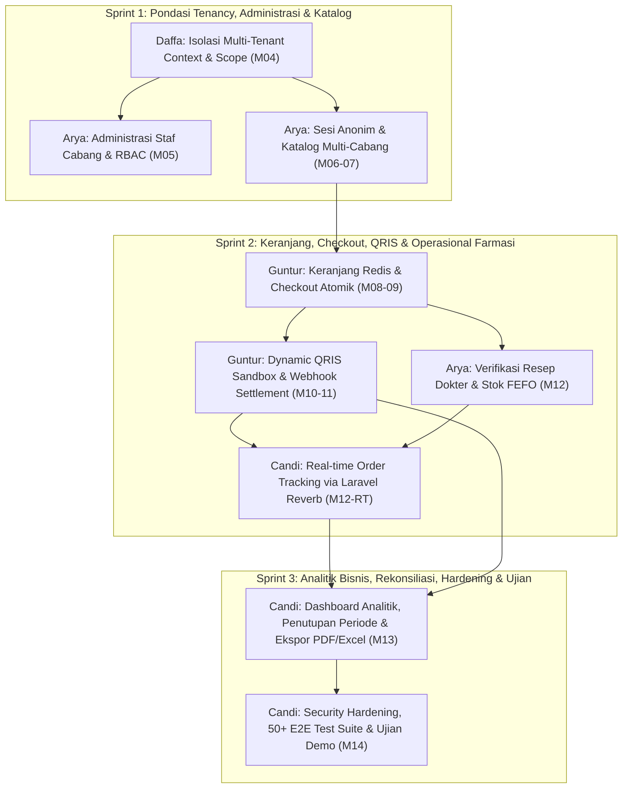

# Roadmap & Perencanaan Kerja Kelompok: Sistem Informasi Apotek Multi-Klien (OmniPharma Network)

**Mata Kuliah / Dosen Pengampu:** Proyek Praktikum Pengembangan Sistem Informasi — **Pak Devit Suwardiyanto**  
**Repository Utama:** `https://github.com/heliosparta18/startup.git`  
**Basis Teknologi:** Laravel 13.25, Livewire 4.1, Tailwind CSS v4, Laravel Reverb (WebSockets), MariaDB 11.4 / MySQL 8.4, Redis 7.2  
**Target Penilaian:** Kontribusi Git Rata (~25% per orang), Disiplin Pull Request, Dokumen Evidence Praktikum (Pertemuan 01–14), & Penguasaan Arsitektur Sistem saat Sidang.

---

## 1. Status Progres Terkini (Baseline Repository)

Proyek ini telah memiliki pondasi arsitektur modular yang solid dengan capaian awal sebagai berikut:

| Komponen / Pertemuan | Penanggung Jawab | Status | Bukti / Commit / PR | Deskripsi Deliverable |
|---|---|---|---|---|
| **Pertemuan 01 (Environment & Setup Toolchain)** | Muhammad Daffa Ariby | **SELESAI** | Commit `1b6b0d8` | Inisialisasi Laravel 13, MariaDB, Redis, Reverb, dan konfigurasi environment lengkap dengan artefak verifikasi di `evidence/pertemuan-01/`. |
| **Pertemuan 02 (Modular Monolith & Layout Core)** | Muhammad Daffa Ariby | **SELESAI** | Commit `1b6b0d8` | Registrasi 6 Service Provider di `app/Modules/` (`Admin`, `Catalog`, `Ordering`, `Payments`, `Prescription`, `Reporting`), registrasi portal routes (`PortalRoutes.php`), dan layout portal (`evidence/pertemuan-02/`). |
| **Pertemuan 03 (Database Schema & Seeder 30 Tabel)** | Muhammad Daffa Ariby | **SELESAI** | Commit `1b6b0d8` | Migrasi 16 tabel domain utama PDM revisi (Client, Pengguna, Obat, Stok, Pesanan, Resep, Pembayaran, Ringkasan Periode, dll.), deterministic seeder `DemoApotekSeeder.php`, dan test suite `ApotekFoundationTest.php` (`evidence/pertemuan-03/`). |
| **Refaktor UI & Mobile Responsiveness** | Guntur Afandi | **SELESAI** | Commit `6ef04e2` / PR #3 `96cb27e` | Standarisasi touch target 44px (`min-h-[44px]`), perbaikan grid katalog responsif (`grid-cols-1 md:grid-cols-12`), ikonografi SVG, dark-mode palette, dan badge klasifikasi obat keras/bebas. |
| **Pertemuan 04 s/d 14** | Seluruh Tim (Daffa, Guntur, Arya, Candi) | **SIAP DIKERJAKAN** | Feature Branches Terjadwal | Eksekusi fitur modular sesuai matriks pembagian tugas baru (Daffa 4, Guntur 4, Arya 4, Candi 3) di bawah ini. |

---

## 2. Matriks Pembagian Tugas 4 Anggota (Struktur Baru: 4 - 4 - 4 - 3)

### 2.1 Ringkasan Tanggung Jawab & Alokasi Modul

Sesuai arahan restrukturisasi beban kerja:
1. **Muhammad Daffa Ariby (4 Tugas):** Telah menyelesaikan 3 tugas fondasi (Pertemuan 01, 02, 03) dan menambah 1 modul penutup perannya yaitu Pertemuan 04 (Isolasi Multi-Tenant). Daffa **tidak lagi memegang Pertemuan 14**.
2. **Guntur Afandi (4 Tugas):** Memegang penuh jalur transaksi pesanan dan pembayaran digital, dengan fokus krusial pada **Dynamic QRIS Sandbox & Webhook Settlement** (Pertemuan 08, 09, 10, 11).
3. **Arya Dwi Mahendra (4 Tugas):** Memegang tata kelola apotek cabang, sesi tamu, katalog obat, serta verifikasi resep dan pengeluaran obat FEFO (Pertemuan 05, 06, 07, 12).
4. **Candia Purwa (3 Tugas):** Memegang infrastruktur WebSockets real-time, analitik finansial & pelaporan, serta pengerasan keamanan & pengujian end-to-end akhir (Pertemuan 12-RT, 13, 14).

```
┌─────────────────────────────────────────────────────────────────────────────────────────────┐
│                       MATRIKS PENUGASAN REKAYASA SISTEM APOTEK                              │
├──────────────────────┬──────────────────────────────────────────┬───────────────────────────┤
│ Anggota Tim          │ Alokasi Pertemuan / Tugas                │ Domain & Tanggung Jawab   │
├──────────────────────┼──────────────────────────────────────────┼───────────────────────────┤
│ MUHAMMAD DAFFA ARIBY │ Pertemuan 01 (Selesai - Commit 1b6b0d8)  │ Pondasi Arsitektur        │
│ (4 Tugas)            │ Pertemuan 02 (Selesai - Commit 1b6b0d8)  │ Modular Monolith,         │
│                      │ Pertemuan 03 (Selesai - Commit 1b6b0d8)  │ Skema Database UUID,      │
│                      │ Pertemuan 04 (Akan Dikerjakan)           │ & Isolasi Multi-Tenant    │
├──────────────────────┼──────────────────────────────────────────┼───────────────────────────┤
│ GUNTUR AFANDI        │ UI Refactor PR #3 (Selesai)              │ Keranjang Belanja Redis,  │
│ (4 Tugas)            │ Pertemuan 08 (Akan Dikerjakan)           │ Checkout Atomik,          │
│                      │ Pertemuan 09 (Akan Dikerjakan)           │ Dynamic QRIS Sandbox,     │
│                      │ Pertemuan 10 (Akan Dikerjakan - QRIS!)   │ & Webhook Settlement      │
│                      │ Pertemuan 11 (Akan Dikerjakan)           │                           │
├──────────────────────┼──────────────────────────────────────────┼───────────────────────────┤
│ ARYA DWI MAHENDRA    │ Pertemuan 05 (Akan Dikerjakan)           │ Administrasi Staf & APJ,  │
│ (4 Tugas)            │ Pertemuan 06 (Akan Dikerjakan)           │ Sesi Tamu Opaque Token,   │
│                      │ Pertemuan 07 (Akan Dikerjakan)           │ Katalog Obat Cabang,      │
│                      │ Pertemuan 12 (Akan Dikerjakan)           │ & Verifikasi Resep FEFO   │
├──────────────────────┼──────────────────────────────────────────┼───────────────────────────┤
│ CANDIA PURWA         │ Pertemuan 12-RT (Akan Dikerjakan)        │ Real-Time Order Reverb,   │
│ (3 Tugas)            │ Pertemuan 13 (Akan Dikerjakan)           │ Analitik & Rekonsiliasi,  │
│                      │ Pertemuan 14 (Akan Dikerjakan)           │ & Security Hardening E2E  │
└──────────────────────┴──────────────────────────────────────────┴───────────────────────────┘
```

---

### 2.2 Tabel Rincian Pertemuan-by-Pertemuan (Pertemuan 01 s/d 14)

| Pertemuan | Topik Kurikulum Praktikum | Penanggung Jawab | Status | Deliverable & Output Teknis |
|---|---|---|---|---|
| **M01** | Setup Environment, Laravel 13, MariaDB, Redis, Reverb | **Daffa** | SELESAI | Konfigurasi runtime, database connection, cache/queue Redis, dan web server. |
| **M02** | Modular Monolith Arsitektur & Antislop Layout Dasar | **Daffa** | SELESAI | 6 Service Provider modul (`app/Modules/*`), view components, dan portal routes. |
| **M03** | Skema Database Domain (16 Tabel Inti), Seeder & Model | **Daffa** | SELESAI | Relasi Eloquent, UUID primary keys, DemoApotekSeeder, dan integritas FK. |
| **M-UI** | Refaktor UI Katalog, Mobile Touch Target 44px, Badging | **Guntur** | SELESAI | Desain responsif, touch-friendly navigation, badge wajib resep vs bebas (PR #3). |
| **M04** | Isolasi Multi-Tenant: TenantContext, Scope & Policy | **Daffa** | TERJADWAL | `TenantContext.php`, `TenantScope.php`, `ResolveTenantContext.php`, TenantIsolationTest. |
| **M05** | Administrasi Staf Cabang, RBAC, & Hierarki Pengawas APJ | **Arya** | TERJADWAL | Manajemen akun staf cabang, role middleware, dan pemetaan `peta_pengawas_staf` (5NF). |
| **M06** | Sesi Pelanggan Anonim, Opaque Token, & Radius Cabang | **Arya** | TERJADWAL | Token tamu tanpa login (32 karakter cookie), penanda cabang terdekat, dan geo-fallback. |
| **M07** | Katalog Obat Multi-Cabang, Filter Sediaan, Livewire Search | **Arya** | TERJADWAL | Pencarian obat real-time, filter sediaan (tablet/sirup), badge klasifikasi, & live stock. |
| **M08** | Keranjang Belanja Redis Multi-Tenant & Revalidasi Stok | **Guntur** | SELESAI | Key Redis `cart:{sessionId}:{clientId}`, TTL keranjang 7 hari, dan validasi harga/stok. |
| **M09** | Checkout Atomik, Snapshot Harga Denormalisasi & Resep | **Guntur** | SELESAI | `DB::transaction` + `lockForUpdate`, generate `#ORD-...`, dan snapshot unit price (ADR-0008). |
| **M10** | Payment Gateway Interface & Dynamic QRIS Sandbox Generator | **Guntur** | SELESAI | `PaymentGatewayInterface`, `FakeQrisGateway`, QR string EMVCo, countdown timer 15m. |
| **M11** | Webhook Idempoten, Verifikasi Signature & Auto-Settlement | **Guntur** | SELESAI | Endpoint webhook `POST /api/webhooks/qris`, HMAC-SHA256 signature, log audit & settlement. |
| **M12** | Verifikasi Resep Dokter & Manajemen Stok FEFO | **Arya** | TERJADWAL | Form telaah resep (cek SIP dokter), reject/approve, dan urutan stok batch expired terdekat. |
| **M12-RT**| Real-Time Order Tracking via Laravel Reverb WebSockets | **Candi** | TERJADWAL | Event broadcasting `OrderStatusUpdated`, private channel auth, dan UI live stepper. |
| **M13** | Dashboard Analitik Penjualan, Rekonsiliasi & Ekspor Laporan| **Candi** | TERJADWAL | Aggregator omzet, penutupan periode `ringkasan_periode_penjualan`, ekspor PDF & Excel. |
| **M14** | Security Hardening, Sanitasi Input, 50+ E2E Test Suite | **Candi** | TERJADWAL | Proteksi XSS/SQLi/IDOR, audit keamanan seluruh rute, dan test regression suite demo. |

---

### 2.3 Rasionalisasi Penyesuaian Beban Kerja (Rebalancing Rationale)

1. **Pembebasan Muhammad Daffa Ariby dari Pertemuan 14:**
   * Daffa telah menyelesaikan tugas berbobot tinggi di awal proyek (M01, M02, M03) yang meletakkan pondasi seluruh arsitektur sistem. Dengan menambah **Pertemuan 04 (Kernel Isolasi Multi-Tenant)**, Daffa genap menyelesaikan 4 modul inti backend & infrastruktur.
   * Pertemuan 14 (Security Hardening & 50+ E2E Test Suite) dialihkan ke **Candia Purwa**, yang menjadi penanggung jawab integrasi akhir dan pengujian rilis sistem.

2. **Fokus Guntur Afandi pada Core Transaksi & Payment Gateway QRIS (M08, M09, M10, M11):**
   * Sesuai kebutuhan khusus *"ada bagian QRIS"*, Guntur memegang kendali penuh atas pipeline pembayaran dan transaksi:
     - **Pertemuan 08:** Keranjang Belanja Redis Multi-Tenant.
     - **Pertemuan 09:** Transaksi Checkout Atomik dengan Pesimistic Lock & Snapshot Harga.
     - **Pertemuan 10:** Abstraksi Payment Gateway & Emulator QRIS Dinamis Sandbox (EMVCo Standard).
     - **Pertemuan 11:** Webhook Idempoten, Verifikasi Signature HMAC-SHA256, dan Auto-Settlement.
   * Guntur menjadi pemilik tunggal (*single owner*) dari alur pembayaran QRIS yang sangat krusial saat demonstrasi sistem di hadapan Pak Devit.

3. **Perluasan Tanggung Jawab Arya Dwi Mahendra ke Katalog & Sesi Pelanggan (M05, M06, M07, M12):**
   * Arya memegang kendali atas modul operasional apotek cabang dari hulu ke hilir:
     - **Pertemuan 05:** Administrasi Akun Staf Cabang, RBAC, dan Hierarki Pengawasan Apoteker Penanggung Jawab (APJ) berderajat 5NF.
     - **Pertemuan 06:** Penanganan Sesi Tamu Anonim menggunakan Opaque Token berbasis cookie serta penentuan cabang apotek terdekat.
     - **Pertemuan 07:** Katalog Obat Multi-Cabang, Filter Sediaan Farmasi (tablet, sirup, salep), dan sinkronisasi stok master.
     - **Pertemuan 12:** Telaah Resep Dokter (validasi SIP dokter) dan algoritma pengeluaran obat FEFO (*First-Expired, First-Out*).
   * Keempat modul ini membentuk satu kesatuan logis (*domain cohesion*) seputar entitas Cabang, Obat, Staf Apoteker, dan Resep Medis.

4. **Candia Purwa sebagai Master Real-Time, Pelaporan Finansial, & Quality Gate Rilis (M12-RT, M13, M14):**
   * Candi mengemban 3 modul dengan bobot teknologi modern yang sangat tinggi:
     - **Pertemuan 12-RT:** Infrastruktur WebSockets real-time menggunakan Laravel Reverb & Echo untuk siaran pembaruan status pesanan tanpa jeda.
     - **Pertemuan 13:** Dashboard Analitik Penjualan Multi-Cabang, Rekonsiliasi Finansial, Penutupan Periode Kas Terkunci (ADR-0008), serta Streaming Ekspor PDF dan Excel anti formula injection.
     - **Pertemuan 14:** Security Hardening (sanitasi XSS/SQLi), mitigasi IDOR, throttle Redis, eksekusi 50+ Automated Test Suite, dan rehearsal demo presentasi akhir.

---

### 2.4 Unifikasi State Machine & Siklus Hidup Pesanan (Order Lifecycle State Machine)

Untuk menjamin kepatuhan regulasi kefarmasian (Permenkes 73/2016) dan sinkronisasi tanpa celah lintas modul (Arya M05–07 & M12, Guntur M08–11, Candi M12-RT–14, Daffa M01–04), seluruh transaksi apotek mematuhi mesin status (*state machine*) terpadu:

1. **Jalur Pesanan Tanpa Resep (Obat Bebas & Bebas Terbatas):**
   - Alur Utama: `menunggu_pembayaran` ➔ `diproses` ➔ `siap_diambil` ➔ `selesai`.
   - Alur Pengecualian: `menunggu_pembayaran` ➔ `kedaluwarsa` / `dibatalkan` (stok fisik di `stok_client` otomatis direstorasi).
   - Penjelasan: Pelanggan checkout atomik (Guntur M09), membayar QRIS via webhook settlement (Guntur M10–11), pesanan disiapkan staf apotek berdasarkan rotasi FEFO (Arya M12), status diperbarui secara real-time via WebSocket Reverb (Candi M12-RT), dan ditutup saat penyerahan obat.

2. **Jalur Pesanan Dengan Resep (Obat Keras / Wajib Resep):**
   - Alur Utama: `menunggu_verifikasi` ➔ `menunggu_pembayaran` ➔ `diproses` ➔ `siap_diambil` ➔ `selesai`.
   - Alur Penolakan Resep: `menunggu_verifikasi` ➔ `dibatalkan` (stok fisik cabang otomatis direstorasi, catatan penolakan dikirim via WebSocket Reverb).
   - Penjelasan: Pelanggan mengunggah foto resep dokter saat checkout. Apoteker cabang memeriksa keabsahan SIP dokter di antrean telaah (Arya M12). Setelah disetujui, tagihan QRIS dilunasi (Guntur M10–11), pesanan diproses dan dilacak real-time (Candi M12-RT), serta seluruh aliran diverifikasi oleh test suite (Candi M14).

---

## 3. Rincian Teknis Modul Per Anggota

### 3.1 🧑‍💻 Modul 1: MUHAMMAD DAFFA ARIBY (4 Tugas)
**Fokus Utama:** *System Architecture Foundation (M01-03) & Multi-Tenant Isolation Kernel (M04)*  
**Dokumen Referensi PRD:** `docs/PRD_DAFFA.md`

* **Pertemuan 01, 02, 03 (Selesai — Commit `1b6b0d8`):**
  * Inisialisasi stack Laravel 13, MariaDB 11.4, Redis 7.2, Reverb.
  * Modular Monolith 6 Bounded Contexts di `app/Modules/`.
  * Skema database 16 tabel domain utama PDM revisi dengan relasi UUID dan `DemoApotekSeeder.php`.
* **Pertemuan 04 — Isolasi Multi-Tenant (Akan Dikerjakan):**
  * Mengembangkan singleton `TenantContext` dalam Laravel Service Container untuk mengikat client aktif berdasarkan parameter URL `{client}` atau cookie sesi.
  * Membuat global scope `TenantScope` yang otomatis menyuntikkan klausa SQL `WHERE id_client = ?` pada seluruh model transaksi apotek (`pesanan`, `stok_client`, dll.).
  * Mengimplementasikan middleware `ResolveTenantContext` serta policy otorisasi (`ClientPolicy`, `PesananPolicy`) untuk mencegah kebocoran data antar cabang (IDOR defense).
* **Git Branching:**
  * `feat/daffa-tenant-context` atau `feature/pertemuan-04-multi-tenant`
* **File Utama yang Dibuat & Dimodifikasi:**
  * `app/Support/Tenant/TenantContext.php` (Create)
  * `app/Models/Scopes/TenantScope.php` (Create)
  * `app/Models/Traits/BelongsToTenant.php` (Create)
  * `app/Http/Middleware/ResolveTenantContext.php` (Create)
  * `app/Policies/ClientPolicy.php` & `app/Policies/PesananPolicy.php` (Create)
  * `bootstrap/app.php` (Edit: registrasi middleware tenant)
  * `tests/Feature/TenantIsolationTest.php` (Create)
* **Contoh Pesan Commit Natural:**
  * `bikin tenant context dan resolver dari parameter url`
  * `pasang tenant scope global di model transaksi apotek`
  * `buat trait belongs to tenant untuk auto inject client id`
  * `tambah test isolasi data antar cabang apotek`

---

### 3.2 🧑‍💻 Modul 2: GUNTUR AFANDI (4 Tugas)
**Fokus Utama:** *Redis Shopping Cart, Atomic Checkout Concurrency, Dynamic QRIS Sandbox, & Webhook Settlement*  
**Dokumen Referensi PRD:** `docs/PRD_GUNTUR.md`

* **Refaktor UI & Mobile Touch Target (Selesai — Commit `6ef04e2` / PR #3 `96cb27e`):**
  * Standarisasi touch target 44px (`min-h-[44px]`), perbaikan grid katalog responsif, dark-mode palette, dan badge klasifikasi obat keras/bebas.
* **Pertemuan 08 — Keranjang Belanja Redis Multi-Tenant & Revalidasi Stok:**
  * Penyimpanan keranjang belanja multi-tenant berkecepatan tinggi di Redis (`cart:{sessionId}:{clientId}`) dengan TTL 7 hari.
  * Validasi ketersediaan stok fisik dan harga katalog sebelum checkout (*pre-checkout revalidation*).
* **Pertemuan 09 — Checkout Atomik, Snapshot Harga Denormalisasi & Resep:**
  * Eksekusi transaksi checkout atomik (`DB::transaction` dengan `lockForUpdate`) untuk mencegah *overselling* saat persaingan transaksi tinggi.
  * Generate nomor pesanan ramah manusia `#ORD-YYYYMMDD-XXXX`.
  * Denormalisasi snapshot harga satuan ke tabel `item_pesanan` sesuai **ADR-0008**.
* **Pertemuan 10 — Payment Gateway Interface & Dynamic QRIS Sandbox Generator [BAGIAN QRIS]:**
  * Abstraksi kontrak `PaymentGatewayInterface` dan implementasi emulator deterministik `FakeQrisGateway` / `QrisSandboxGateway` (ADR-0004).
  * Generator string QRIS standar EMVCo (NMID, MCC 5912 Apotek, Currency 360 IDR, CRC16 CCITT).
  * Halaman pembayaran interaktif dengan QRIS dinamis dan hitung mundur kedaluwarsa 15 menit (`payment.blade.php`).
* **Pertemuan 11 — Webhook Idempoten, Verifikasi Signature & Auto-Settlement:**
  * Endpoint webhook `POST /api/webhooks/qris` dengan validasi signature HMAC-SHA256.
  * Penanganan idempoten (mencegah double-settlement) dan pencatatan audit log pembayaran.
  * Transisi status otomatis menjadi `diproses` dan pencatatan ledger split allocation.
* **Git Branching:**
  * `feat/guntur-cart-checkout` atau `feature/pertemuan-08-09-cart-checkout`
  * `feat/guntur-qris-webhook` atau `feature/pertemuan-10-11-qris-webhook`
* **File Utama yang Dibuat & Dimodifikasi:**
  * `app/Modules/Ordering/Services/CartService.php` (Create)
  * `app/Modules/Ordering/Actions/CreateOrderAction.php` (Create)
  * `app/Modules/Payments/Contracts/PaymentGatewayInterface.php` (Create)
  * `app/Modules/Payments/Services/FakeQrisGateway.php` (Create)
  * `app/Modules/Payments/Services/QrisEmvcoBuilder.php` (Create)
  * `app/Modules/Payments/Http/Controllers/PaymentWebhookController.php` (Create)
  * `resources/views/customer/cart.blade.php` (Create)
  * `resources/views/customer/checkout.blade.php` (Create)
  * `resources/views/customer/payment.blade.php` (Create)
  * `tests/Feature/CartCheckoutPaymentTest.php` (Create)
* **Contoh Pesan Commit Natural:**
  * `buat service keranjang belanja multi-tenant pakai redis`
  * `implementasi checkout atomik dan lock stok obat`
  * `integrasi generator qris dinamis sandbox dan halaman bayar`
  * `bikin webhook idempoten untuk otomatis ubah status lunas`

---

### 3.3 🧑‍💻 Modul 3: ARYA DWI MAHENDRA (4 Tugas)
**Fokus Utama:** *Branch Staff Administration, Guest Session Opaque Token, Branch Drug Catalog, Prescription Verification & FEFO Inventory*  
**Dokumen Referensi PRD:** `docs/PRD_ARYA.md`

* **Pertemuan 05 — Administrasi Cabang & Pengawasan Farmasi (APJ):**
  * Manajemen akun staf apotek cabang (`admin_client`, `peran_client_pengguna`).
  * Implementasi relasi hierarki pengawasan kefarmasian antara Apoteker Penanggung Jawab (APJ) dan asisten apoteker/staf pada tabel `peta_pengawas_staf` (derajat 5NF).
  * Penegakan hak akses berbasis peran pada portal cabang (`cabang/{client}`).
* **Pertemuan 06 — Sesi Pelanggan Anonim & Opaque Token:**
  * Pengelolaan sesi pelanggan anonim dengan token buram (*opaque token* 32-karakter) berbasis cookie (`omnipharma_customer_session`) untuk menyimpan preferensi cabang apotek terdekat tanpa mewajibkan login awal.
  * Fitur pencarian cabang terdekat berdasarkan geolocation browser dengan fallback manual.
* **Pertemuan 07 — Katalog Obat Multi-Cabang & Manajemen Stok:**
  * Tampilan katalog obat multi-cabang reaktif dengan filter kategori, sediaan (tablet, kapsul, sirup, salep), dan penandaan visual obat keras (`wajib_resep` badge).
  * Komponen pencarian instan Livewire dengan ketersediaan stok fisik per cabang secara real-time.
* **Pertemuan 12 — Verifikasi Resep Dokter & Manajemen Stok FEFO:**
  * Portal telaah resep dokter: verifikasi keabsahan nomor SIP dokter (contoh format legal: `503/SIP/2024`), pengecekan dosis pediatri/geriatri, serta aksi Setujui / Tolak dengan catatan wajib apoteker.
  * Pencatatan riwayat verifikasi ke tabel `log_audit`.
  * Algoritma pengeluaran stok obat berbasis tanggal kedaluwarsa terdekat (*First Expired First Out* / FEFO: `orderBy('expired', 'asc')`).
  * Sistem peringatan dini (*early warning*) untuk batch obat mendekati kedaluwarsa (indikator H-30 dan H-7 hari) pada dashboard apoteker.
* **Git Branching:**
  * `feat/arya-admin-session` atau `feature/pertemuan-05-06-admin-session`
  * `feat/arya-catalog-fefo` atau `feature/pertemuan-07-12-catalog-fefo`
* **File Utama yang Dibuat & Dimodifikasi:**
  * `app/Modules/Admin/Services/StaffManagementService.php` (Create)
  * `app/Modules/Admin/Http/Controllers/StaffController.php` (Create)
  * `app/Modules/Catalog/Services/CustomerSessionService.php` (Create)
  * `app/Modules/Catalog/Services/CatalogService.php` (Create)
  * `app/Modules/Prescription/Actions/VerifyPrescriptionAction.php` (Create)
  * `app/Modules/Catalog/Services/StockFefoService.php` (Create)
  * `resources/views/admin/staff-management.blade.php` (Create)
  * `resources/views/customer/catalog.blade.php` (Create)
  * `resources/views/tenant/verifikasi-resep.blade.php` (Create)
  * `resources/views/tenant/stok-fefo.blade.php` (Create)
  * `tests/Feature/GuestSessionAndCatalogTest.php` (Create)
  * `tests/Feature/PrescriptionVerificationTest.php` (Create)
  * `tests/Feature/FefoStockRotationTest.php` (Create)
* **Contoh Pesan Commit Natural:**
  * `tambah manajemen staf cabang dan pemetaan apoteker pengawas`
  * `bikin sesi pelanggan anonim dan penanda cabang terdekat`
  * `implementasi katalog obat reaktif livewire dan filter sediaan`
  * `fitur telaah resep dokter dan validasi nomor sip`
  * `bikin algoritma urutan stok fefo dan peringatan expired`

---

### 3.4 🧑‍💻 Modul 4: CANDIA PURWA (3 Tugas)
**Fokus Utama:** *Real-time WebSockets (Laravel Reverb), Executive Analytics & Reconciliation, Security Hardening & 50+ E2E Test Suite*  
**Dokumen Referensi PRD:** `docs/PRD_CANDI.md`

* **Pertemuan 12-RT — Real-Time Order Status Tracking (Laravel Reverb):**
  * Konfigurasi infrastruktur WebSockets Laravel Reverb pada port 8080.
  * Pembuatan event broadcasting `OrderStatusUpdated` (mengimplementasikan `ShouldBroadcastNow`) yang disiarkan ke private channel `private-order.{id_pesanan}` dan channel tenant `private-tenant.{id_client}`.
  * Otorisasi channel di `routes/channels.php` untuk memastikan pelanggan hanya bisa mendengar status pesanannya sendiri dan apoteker hanya mendengar pesanan cabangnya.
  * Komponen antarmuka pelacakan pesanan real-time (`order-track.blade.php`) menggunakan Laravel Echo untuk memajukan *order stepper* secara instan tanpa refresh halaman.
* **Pertemuan 13 — Dashboard Analitik Penjualan, Rekonsiliasi, & Ekspor Laporan:**
  * Dashboard eksekutif penjualan multi-cabang dengan filter rentang tanggal dinamis (`periode_mulai` s/d `periode_selesai`).
  * Fitur rekonsiliasi transaksi dan penutupan buku periode: mengunci data penjualan ke tabel `ringkasan_periode_penjualan` dengan flag `status_terkunci = true` dan constraint unik `UNIQUE(id_client, periode_mulai, periode_selesai)` untuk menjamin idempotensi penutupan buku (ADR-0008).
  * Layanan ekspor laporan penjualan ke format dokumen cetak PDF (Blade printable layout dengan styling CSS print ramah kertas) dan format spreadsheet Excel/CSV.
  * Penerapan sanitasi string formula injection (menambahkan apostrof `'` pada data berawalan `=`, `+`, `-`, atau `@`).
* **Pertemuan 14 — Security Hardening, Sanitasi Input, & 50+ E2E Automated Test Suite:**
  * Audit sanitasi input FormRequest terhadap ancaman XSS pada catatan resep dan SQL injection pada filter pencarian.
  * Penerapan Redis Rate Limiting cerdas pada endpoint upload resep dan autentikasi (maksimal 10 request/menit).
  * Penyusunan suite otomatis 50+ skenario pengujian (`tests/Feature/SecurityHardeningTest.php`, `EndToEndOrderFlowTest.php`, `ReleaseRehearsalTest.php`).
  * Koordinasi final integrasi sistem, review pull request seluruh anggota tim, dan gladi bersih presentasi demo untuk Pak Devit Suwardiyanto.
* **Git Branching:**
  * `feat/candi-reverb-tracking` atau `feature/pertemuan-12-reverb-realtime`
  * `feat/candi-sales-laporan` atau `feature/pertemuan-13-analitik-laporan`
  * `feat/candi-security-e2e` atau `feature/pertemuan-14-hardening-release`
* **File Utama yang Dibuat & Dimodifikasi:**
  * `app/Modules/Ordering/Events/OrderStatusUpdated.php` (Create)
  * `app/Modules/Ordering/Events/IncomingOrderPlaced.php` (Create)
  * `app/Modules/Reporting/Services/SalesReportService.php` (Create)
  * `app/Modules/Reporting/Services/SalesReportExportService.php` (Create)
  * `app/Modules/Reporting/Actions/CloseSalesPeriodAction.php` (Create)
  * `app/Http/Requests/Tenant/VerifikasiResepRequest.php` (Create)
  * `app/Http/Requests/Customer/UnggahResepRequest.php` (Create)
  * `resources/views/customer/order-track.blade.php` (Create: integrasi Reverb & Echo)
  * `resources/views/admin/laporan-penjualan.blade.php` (Create)
  * `resources/views/admin/pdf/laporan-penjualan-template.blade.php` (Create)
  * `tests/Feature/ReverbOrderStatusBroadcastTest.php` (Create)
  * `tests/Feature/SalesReportAndPeriodLockTest.php` (Create)
  * `tests/Feature/SecurityHardeningTest.php` (Create)
  * `tests/Feature/EndToEndOrderFlowTest.php` (Create)
* **Contoh Pesan Commit Natural:**
  * `setup event broadcast status order pakai laravel reverb`
  * `bikin halaman lacak pesanan realtime dengan laravel echo`
  * `buat dashboard eksekutif penjualan dan filter rentang tanggal`
  * `implementasi penutupan periode penjualan dan kunci snapshot`
  * `tambah fitur cetak laporan ke format pdf dan excel`
  * `sanitasi input request resep dan pasang rate limiter redis`
  * `selesaikan suite 50+ test e2e untuk persiapan sidang pak devit`

---

## 4. Standar Operasional Prosedur (SOP) Git & Aturan Kolaborasi

Untuk menjaga kredibilitas repositori di hadapan dosen penguji, seluruh anggota wajib mematuhi aturan berikut:

### 4.1 Aturan Wajib Kontribusi Mahasiswa
1. **Dilarang Keras Direct Push ke Branch `main`:**
   Semua pekerjaan wajib dibuat di branch fitur masing-masing, kemudian diajukan melalui Pull Request (PR) di GitHub.
2. **Pesan Commit Wajib Bernada Manusiawi (Bebas dari AI Boilerplate):**
   * ❌ **Dilarang:** Kalimat promosi panjang, jargon marketing (*"seamless cutting-edge implementation"*), atau tag otomatis (*"Co-authored-by: AI"*).
   * ✔️ **Wajib:** Menggunakan kalimat aktif bahasa Indonesia sederhana atau Conventional Commits ringkas (5–10 kata) yang menjelaskan perubahan secara jujur.
3. **Pemberian Nama Branch Konsisten:**
   Gunakan format developer: `feat/<nama>-<slug>` (contoh: `feat/guntur-checkout-qris`) atau format akademik: `feature/pertemuan-<XX>-<slug>` (contoh: `feature/pertemuan-10-11-qris`).
4. **Alur Resmi Integrasi Kode:**
   Buat Branch ➔ Implementasi Kode & Test ➔ Push ke Remote ➔ Ajukan Pull Request ➔ Review oleh Daffa/Rekan Tim ➔ Merge ke `main`.

---

## 5. Timeline Eksekusi, Sprint, & Dependensi Modul



### Breakdown Tahapan Kerja:

* **Sprint 1 (Pondasi Tenancy, Administrasi & Katalog):**
  * Daffa menyelesaikan `TenantContext`, `TenantScope`, dan `BelongsToTenant` (M04).
  * Arya menyelesaikan administrasi peran staf apotek dan hierarki pengawasan APJ (M05).
  * Arya mengimplementasikan sesi pelanggan anonim berbasis opaque token dan katalog obat multi-cabang (M06–07).
* **Sprint 2 (Transaksi Utuh, QRIS, Resep & Real-Time):**
  * Guntur menyelesaikan keranjang belanja Redis, transaksi checkout atomik, pembayaran QRIS dinamis sandbox, dan webhook auto-settlement (M08, M09, M10, M11).
  * Arya mengintegrasikan form telaah resep dokter dan pengurutan stok berdasarkan FEFO (M12).
  * Candi mengimplementasikan infrastruktur Reverb WebSocket untuk siaran langsung pembaruan status pesanan (M12-RT).
* **Sprint 3 (Pelaporan Finansial, Hardening, & Sidang Pak Devit):**
  * Candi menyelesaikan dashboard eksekutif penjualan, rekonsiliasi penutupan periode penjualan terkunci, dan fitur ekspor dokumen PDF/Excel (M13).
  * Candi melakukan security hardening komprehensif, eksekusi 50+ skenario pengujian otomatis E2E, dan memimpin gladi bersih demo presentasi untuk Pak Devit (M14).

---

## 6. Kisi-Kisi Pertanyaan Sidang & Ujian Praktikum Pak Devit Suwardiyanto

Setiap anggota tim wajib memahami secara mendalam arsitektur modul yang di-commit agar mampu menjawab pertanyaan teknis mendalam dari Pak Devit Suwardiyanto:

| Anggota Tim | Domain Tanggung Jawab | Prediksi Pertanyaan Kritis Pak Devit | Panduan Jawaban & Strategi Demo Berbasis Kode Nyata |
|---|---|---|---|
| **Muhammad Daffa Ariby** | Multi-Tenancy & Architecture Foundation | *"Bagaimana Anda membuktikan bahwa pengguna dari Cabang Banyuwangi Kota tidak bisa memodifikasi atau melihat data transaksi Cabang Rogojampi lewat manipulasi URL (IDOR)?"* | **Jawaban:** Tunjukkan implementasi `TenantScope` dan `ResolveTenantContext`. Jelaskan bahwa setiap query Eloquent pada model tenant secara otomatis menginjeksi klausul `WHERE id_client = ?`. Demonstrasikan unit test `TenantIsolationTest.php` di mana request dengan token Cabang A yang mencoba membaca ID Pesanan Cabang B langsung di-reject dengan HTTP 403 Forbidden. Jelaskan pula fondasi modular monolith 6 provider pada Pertemuan 01–03. |
| **Guntur Afandi** | Checkout Concurrency & Dynamic QRIS | *"Mengapa Anda menyimpan keranjang belanja di Redis bukan session database? Dan bagaimana mekanisme QRIS dinamis Anda memverifikasi pelunasan tanpa membebani server?"* | **Jawaban:** Jelaskan bahwa Redis menyediakan operasi in-memory berkecepatan tinggi dengan struktur data hash terisolasi per `cart:{sessionId}:{clientId}` dan TTL 7 hari tanpa membebani I/O database. Untuk QRIS, demonstrasikan pembuatan string QRIS standar EMVCo dengan kalkulasi CRC16 CCITT pada `FakeQrisGateway`. Saat pembeli membayar di sandbox, webhook controller memvalidasi signature HMAC-SHA256 secara idempoten dan mengupdate status pesanan secara atomik via `lockForUpdate`. |
| **Arya Dwi Mahendra** | Staff RBAC, Drug Catalog, & FEFO Expiry | *"Mengapa sistem apotek Anda menggunakan hierarki pengawasan 5NF pada staf? Dan bagaimana algoritma FEFO Anda mencegah penjualan obat kedaluwarsa?"* | **Jawaban:** Jelaskan bahwa sesuai Permenkes 73/2016, penyerahan obat wajib disupervisi Apoteker Penanggung Jawab (APJ). Tabel `peta_pengawas_staf` dimodelkan 5NF untuk mencegah anomali penugasan staf multi-cabang. Pada inventori, jelaskan bahwa query pengeluaran obat menggunakan `orderBy('expired', 'asc')` (FEFO). Tunjukkan pula fitur telaah resep di mana sistem memvalidasi nomor SIP dokter sebelum tombol persetujuan dapat ditekan. |
| **Candia Purwa** | Real-time Reverb, Reporting, & Hardening | *"Bagaimana WebSocket Reverb memastikan data pesanan tidak bocor antar pelanggan? Dan bagaimana Anda membuktikan sistem kebal terhadap SQLi, XSS, serta formula injection saat ekspor?"* | **Jawaban:** Jelaskan otorisasi private channel pada `routes/channels.php` (`private-order.{id}` hanya diizinkan untuk pemilik order). Tunjukkan penutupan periode akuntansi dengan flag `status_terkunci = true` dan constraint unik `(id_client, periode_mulai, periode_selesai)` pada `ringkasan_periode_penjualan`. Pada keamanan ekspor, tunjukkan sanitasi karakter berbahaya (`=`, `+`, `-`, `@`) untuk mencegah CSV Injection, serta jalankan 50+ automated test suite di terminal (`php artisan test`) yang mencakup uji penetrasi dan E2E flow. |

---

## 7. Rangkuman Target Dokumen & Penilaian Akhir

1. **Dokumen PRD Terpisah per Anggota di `docs/`:**
   * `docs/PRD_DAFFA.md` (Pertemuan 01–04: Fondasi & Isolasi Multi-Tenant)
   * `docs/PRD_GUNTUR.md` (Pertemuan 08–11: Keranjang, Checkout, QRIS Dinamis & Webhook)
   * `docs/PRD_ARYA.md` (Pertemuan 05, 06, 07, 12: Staf/APJ, Sesi Tamu, Katalog Obat & Resep FEFO)
   * `docs/PRD_CANDI.md` (Pertemuan 12-RT, 13, 14: Reverb Real-Time, Analitik Laporan & Hardening E2E)
2. **Dokumen Master Perencanaan:**
   * `docs/ROADMAP_DAN_PLANNING_PROYEK.md` (Dokumen Master Roadmap Distribusi 4-4-4-3)
3. **Standar Penilaian Akhir Mahasiswa:**
   * Distribusi kontribusi berbobot seimbang di GitHub.
   * Seluruh PR terintegrasi dengan kode bersih dan lulus uji pipeline.
   * Demonstrasi aplikasi lancar mencakup seluruh skenario transaksi apotek, pembayaran QRIS, telaah resep, siaran WebSocket real-time, dan penutupan buku kas.
