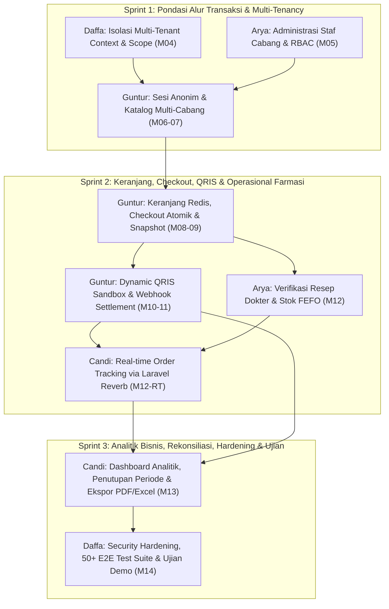

# Roadmap & Perencanaan Kerja Kelompok: Sistem Informasi Apotek Multi-Klien (OmniPharma Network)

**Mata Kuliah / Dosen Pengampu:** Proyek Praktikum Pengembangan Sistem Informasi — **Pak Devit Suwardiyanto**  
**Repository Utama:** `https://github.com/heliosparta18/startup.git`  
**Basis Teknologi:** Laravel 13.25, Livewire 4.1, Tailwind CSS v4, Laravel Reverb (WebSockets), MariaDB 11.4 / MySQL 8.4, Redis 7.2  
**Target Penilaian:** Kontribusi Git Rata (~25% per orang), Disiplin Pull Request, Dokumen Evidence Praktikum (Pertemuan 01–14), & Penguasaan Arsitektur Sistem saat Sidang.

---

## 1. Status Progres Terkini (Baseline Repository)

Proyek ini telah memiliki pondasi arsitektur modular yang solid dengan capaian awal sebagai berikut:

| Komponen / Pertemuan | Penanggung Jawab | Status | Bukti / Commit / PR | Deskripsi Deliverable |
|---|---|---|---|---|
| **Pertemuan 01 (Environment & Setup Toolchain)** | Muhammad Daffa Ariby | **SELESAI** | Commit `1b6b0d8` | Inisialisasi Laravel 13, MariaDB, Redis, Reverb, dan konfigurasi environment lengkap dengan artefak verifikasi di `evidence/pertemuan-01/`. |
| **Pertemuan 02 (Modular Monolith & Layout Core)** | Muhammad Daffa Ariby | **SELESAI** | Commit `1b6b0d8` | Registrasi 6 Service Provider di `app/Modules/` (`Admin`, `Catalog`, `Ordering`, `Payments`, `Prescription`, `Reporting`), registrasi portal routes (`PortalRoutes.php`), dan layout portal (`evidence/pertemuan-02/`). |
| **Pertemuan 03 (Database Schema & Seeder 30 Tabel)** | Muhammad Daffa Ariby | **SELESAI** | Commit `1b6b0d8` | Migrasi 16 tabel domain utama PDM revisi (Client, Pengguna, Obat, Stok, Pesanan, Resep, Pembayaran, Ringkasan Periode, dll.), deterministic seeder `DemoApotekSeeder.php`, dan test suite `ApotekFoundationTest.php` (`evidence/pertemuan-03/`). |
| **Refaktor UI & Mobile Responsiveness** | Guntur Afandi | **SELESAI** | Commit `6ef04e2` / PR #3 `96cb27e` | Standarisasi touch target 44px (`min-h-[44px]`), perbaikan grid katalog responsif (`grid-cols-1 md:grid-cols-12`), ikonografi SVG, dark-mode palette, dan badge klasifikasi obat keras/bebas. |
| **Pertemuan 04 s/d 14** | Seluruh Tim (Daffa, Guntur, Arya, Candi) | **SIAP DIKERJAKAN** | Feature Branches Terjadwal | Eksekusi fitur modular sesuai matriks pembagian tugas yang telah disinkronkan di bawah ini. |

---

## 2. Matriks Pembagian Tugas 4 Anggota (Pertemuan 01 – 14)

### 2.1 Ringkasan Tanggung Jawab & Pembagian Modul Domain

Untuk mencegah bentrok kode (*merge conflict*) dan menjamin kontribusi Git terbagi rata (~25% per mahasiswa), modul dibagi menggunakan prinsip *Vertical Slice Architecture* berdasarkan bounded context:

```
┌─────────────────────────────────────────────────────────────────────────────────────────────┐
│                       MATRIKS PENUGASAN REKAYASA SISTEM APOTEK                              │
├──────────────────────┬──────────────────────────────────────────┬───────────────────────────┤
│ Anggota Tim          │ Alokasi Pertemuan                        │ Domain & Tanggung Jawab   │
├──────────────────────┼──────────────────────────────────────────┼───────────────────────────┤
│ MUHAMMAD DAFFA ARIBY │ Pertemuan 01, 02, 03 (Baseline Selesai)  │ Pondasi Sistem, Isolasi   │
│                      │ Pertemuan 04 & 14 (Akan Dikerjakan)      │ Multi-Tenant & Hardening  │
├──────────────────────┼──────────────────────────────────────────┼───────────────────────────┤
│ GUNTUR AFANDI        │ UI Refactor PR #3 (Selesai)              │ Katalog Obat, Sesi Tamu,  │
│                      │ Pertemuan 06, 07, 08, 09, 10, & 11       │ Keranjang, Checkout, QRIS │
│                      │ (Akan Dikerjakan)                        │ Sandbox & Webhook         │
├──────────────────────┼──────────────────────────────────────────┼───────────────────────────┤
│ ARYA DWI MAHENDRA    │ Pertemuan 05 & 12 (Akan Dikerjakan)      │ Administrasi Staf/APJ,    │
│                      │                                          │ Verifikasi Resep & FEFO   │
├──────────────────────┼──────────────────────────────────────────┼───────────────────────────┤
│ CANDIA PURWA         │ Pertemuan 12-RT & 13 (Akan Dikerjakan)   │ Real-time Order Tracking  │
│                      │                                          │ (Reverb) & Laporan Bisnis │
└──────────────────────┴──────────────────────────────────────────┴───────────────────────────┘
```

---

### 2.2 Tabel Rincian Pertemuan-by-Pertemuan (Pertemuan 01 s/d 14)

| Pertemuan | Topik Kurikulum Praktikum | Penanggung Jawab | Status | Deliverable & Output Teknis |
|---|---|---|---|---|
| **M01** | Setup Environment, Laravel 13, MariaDB, Redis, Reverb | **Daffa** | SELESAI | Konfigurasi runtime, database connection, cache/queue Redis, dan web server. |
| **M02** | Modular Monolith Arsitektur & Antislop Layout Dasar | **Daffa** | SELESAI | 6 Service Provider modul (`app/Modules/*`), view components, dan portal routes. |
| **M03** | Skema Database Domain (16 Tabel Inti), Seeder & Model | **Daffa** | SELESAI | Relasi Eloquent, UUID primary keys, DemoApotekSeeder, dan integritas FK. |
| **M-UI** | Refaktor UI Katalog, Mobile Touch Target 44px, Badging | **Guntur** | SELESAI | Desain responsif, touch-friendly navigation, badge wajib resep vs bebas (PR #3). |
| **M04** | Isolasi Multi-Tenant: TenantContext, Scope & Policy | **Daffa** | TERJADWAL | `TenantContext.php`, `TenantScope.php`, `ResolveTenantContext.php`, TenantIsolationTest. |
| **M05** | Administrasi Staf Cabang, RBAC, & Hierarki Pengawas APJ | **Arya** | TERJADWAL | Manajemen akun staf cabang, role middleware, dan pemetaan `peta_pengawas_staf`. |
| **M06** | Sesi Pelanggan Anonim, Opaque Token, & Radius Cabang | **Guntur** | TERJADWAL | Token tamu tanpa login, cookie penanda cabang terdekat, dan geo-fallback. |
| **M07** | Katalog Obat Multi-Cabang, Filter Sediaan, Livewire Search | **Guntur** | TERJADWAL | Pencarian obat real-time, badge sediaan (tablet/sirup), dan live stock per cabang. |
| **M08** | Keranjang Belanja Redis Multi-Tenant & Revalidasi Stok | **Guntur** | TERJADWAL | Key Redis `cart:{sessionId}:{clientId}`, TTL keranjang, dan cek batas kuantitas. |
| **M09** | Checkout Atomik, Snapshot Harga Denormalisasi & Resep | **Guntur** | TERJADWAL | `DB::transaction` + `lockForUpdate`, generate `#ORD-...`, dan snapshot unit price. |
| **M10** | Payment Gateway Interface & Dynamic QRIS Sandbox Generator | **Guntur** | TERJADWAL | `PaymentGatewayInterface`, `FakeQrisGateway`, QR string generator, countdown 15m. |
| **M11** | Webhook Idempoten, Verifikasi Signature & Auto-Settlement | **Guntur** | TERJADWAL | Endpoint webhook `POST /api/webhooks/qris`, HMAC-SHA256 signature, log audit status. |
| **M12** | Verifikasi Resep Dokter & Manajemen Stok FEFO | **Arya** | TERJADWAL | Form telaah resep (cek SIP dokter), reject/approve, dan urutan stok batch expired terdekat. |
| **M12-RT**| Real-Time Order Tracking via Laravel Reverb WebSockets | **Candi** | TERJADWAL | Event broadcasting `OrderStatusUpdated`, private channel auth, dan UI live stepper. |
| **M13** | Dashboard Analitik Penjualan, Rekonsiliasi & Ekspor Laporan| **Candi** | TERJADWAL | Aggregator omzet, penutupan periode `ringkasan_periode_penjualan`, ekspor PDF & Excel. |
| **M14** | Security Hardening, Sanitasi Input, 50+ E2E Test Suite | **Daffa** | TERJADWAL | Proteksi XSS/SQLi/IDOR, audit keamanan seluruh rute, dan test regression suite. |

---

### 2.3 Rasionalisasi Penyesuaian Beban Kerja (Rebalancing Rationale)

1. **Penyatuan Jalur Transaksi Pelanggan secara Utuh pada Guntur Afandi (M10 & M11):**
   * *Masalah Sebelumnya:* Guntur hanya mengerjakan hingga checkout atomik (M09), lalu pembayaran QRIS (M10) dan webhook (M11) diserahkan ke Candi. Hal ini memotong satu alur transaksi di tengah jalan, meningkatkan potensi konflik integrasi data pesanan, dan menyulitkan pembagian tanggung jawab jika terjadi bug pada alur pembayaran.
   * *Solusi Baru:* Seluruh siklus transaksi pelanggan mulai dari **Katalog ➔ Sesi Tamu ➔ Keranjang Redis ➔ Checkout Atomik ➔ QRIS Sandbox ➔ Webhook Settlement** disatukan penuh di bawah Guntur Afandi. Guntur menjadi pemilik tunggal (*single owner*) dari pipeline transaksi pesanan, menghasilkan branch fitur yang padu dan kohesif.

2. **Fokus Candia Purwa pada Infrastruktur Real-Time & Pelaporan Eksekutif (M12-RT & M13):**
   * *Beban Baru Candi:* Candi tidak lagi dibebani integrasi payment gateway pihak ketiga, melainkan fokus mendalam pada:
     - Implementasi **WebSockets menggunakan Laravel Reverb dan Echo** untuk pelacakan status pesanan secara real-time (`private-order.{id_pesanan}` dan `private-tenant.{id_client}`).
     - Pembangunan **Dashboard Analitik Penjualan Multi-Cabang** untuk Super Admin dan Kepala Cabang.
     - Logika **Rekonsiliasi Transaksi & Penutupan Buku Periode** dengan flag `status_terkunci` pada tabel `ringkasan_periode_penjualan`.
     - Pipeline **Ekspor Laporan Keuangan ke format PDF & Excel/CSV** dengan proteksi formula injection.
   * *Dampak Positif:* Candi memiliki ranah keahlian spesifik (*Real-time Event Engine & Financial Reporting*) yang sangat berbobot dan siap didemonstrasikan di hadapan Pak Devit.

3. **Keseimbangan Beban Kerja (~25% per Mahasiswa):**
   * **Muhammad Daffa Ariby (25%):** Arsitektur Dasar & Setup (M01-M03 Selesai), Kernel Isolasi Multi-Tenant (M04), Security Hardening & 50+ E2E Test Suite (M14).
   * **Guntur Afandi (25%):** Refaktor UI Responsif (PR #3 Selesai), Katalog & Sesi Pelanggan (M06-07), Keranjang & Checkout (M08-09), QRIS Sandbox & Webhook (M10-11).
   * **Arya Dwi Mahendra (25%):** Administrasi Staf Cabang, RBAC & Pengawasan APJ (M05), Verifikasi Resep Dokter & Rotasi Stok FEFO (M12).
   * **Candia Purwa (25%):** Real-time Order Tracking WebSockets via Laravel Reverb (M12-RT), Dashboard Analitik Penjualan, Rekonsiliasi Akuntansi, & Ekspor Dokumen PDF/Excel (M13).

---

### 2.4 Unifikasi State Machine & Siklus Hidup Pesanan (Order Lifecycle State Machine)

Untuk menjamin kepatuhan regulasi kefarmasian (Permenkes 73/2016) dan sinkronisasi tanpa celah lintas modul (Guntur M08–11, Arya M12, Candi M12-RT, Daffa M14), seluruh transaksi apotek mematuhi mesin status (*state machine*) terpadu:

1. **Jalur Pesanan Tanpa Resep (Obat Bebas & Bebas Terbatas):**
   - Alur Utama: `menunggu_pembayaran` ➔ `diproses` ➔ `siap_diambil` ➔ `selesai`.
   - Alur Pengecualian: `menunggu_pembayaran` ➔ `kedaluwarsa` / `dibatalkan` (stok fisik di `stok_client` otomatis direstorasi).
   - Penjelasan: Pelanggan melakukan checkout atomik, membayar QRIS dinamis via webhook (status pembayaran `berhasil`), pesanan disiapkan staf apotek berdasarkan rotasi FEFO (`diproses`), ditandai apoteker `siap_diambil`, dan diakhiri `selesai` saat penyerahan obat ke pasien/kurir.

2. **Jalur Pesanan Dengan Resep (Obat Keras / Wajib Resep):**
   - Alur Utama: `menunggu_verifikasi` ➔ `menunggu_pembayaran` ➔ `diproses` ➔ `siap_diambil` ➔ `selesai`.
   - Alur Penolakan Resep: `menunggu_verifikasi` ➔ `dibatalkan` (stok fisik cabang otomatis direstorasi ke inventori, catatan penolakan dikirim via WebSocket Reverb).
   - Penjelasan: Pelanggan wajib mengunggah foto resep dokter saat checkout. Apoteker cabang memeriksa keabsahan SIP dokter dan dosis di antrean cabang (`VerifyPrescriptionAction`). Setelah disetujui, tagihan QRIS dapat dilunasi, pesanan masuk ke tahap penyiapan obat (`diproses`), dikemas (`siap_diambil`), dan diserahkan ke pasien (`selesai`).
   - *Penanganan Pembayaran Paralel:* Apabila QRIS dibayarkan mendahului telaah resep dokter, webhook settlement secara otomatis mengunci status pada `menunggu_verifikasi` (tidak melompat ke `diproses`) hingga telaah apoteker berstatus `disetujui`, mencegah obat keras diserahkan tanpa verifikasi klinis yang sah.

---

## 3. Rincian Teknis Modul Per Anggota

### 3.1 🧑‍💻 Modul 1: MUHAMMAD DAFFA ARIBY
**Fokus Utama:** *System Architecture, Multi-Tenant Isolation Kernel, & Security Hardening*  
**Dokumen Referensi PRD:** `docs/PRD_DAFFA.md`

* **Pertemuan 04 — Isolasi Multi-Tenant:**
  * Mengembangkan singleton `TenantContext` dalam Laravel Service Container untuk mengikat client aktif berdasarkan parameter URL `{client}` atau cookie sesi.
  * Membuat global scope `TenantScope` yang otomatis menyuntikkan klausa SQL `WHERE id_client = ?` pada seluruh model transaksi apotek (`pesanan`, `stok_client`, dll.).
  * Mengimplementasikan middleware `ResolveTenantContext` serta policy otorisasi (`ClientPolicy`, `PesananPolicy`) untuk mencegah kebocoran data antar cabang (IDOR defense).
* **Pertemuan 14 — Security Hardening & E2E Testing:**
  * Audit sanitasi input FormRequest terhadap ancaman XSS pada catatan resep dan SQL injection.
  * Penyusunan suite otomatis 50+ skenario pengujian (`tests/Feature/TenantIsolationTest.php`, `SecurityHardeningTest.php`, `EndToEndOrderFlowTest.php`).
  * Koordinasi final integrasi sistem dan review pull request seluruh anggota tim.
* **Git Branching:**
  * `feat/daffa-tenant-context` atau `feature/pertemuan-04-multi-tenant`
  * `feat/daffa-security-e2e` atau `feature/pertemuan-14-hardening`
* **File Utama yang Dibuat & Dimodifikasi:**
  * `app/Support/Tenant/TenantContext.php` (Create)
  * `app/Models/Scopes/TenantScope.php` (Create)
  * `app/Http/Middleware/ResolveTenantContext.php` (Create)
  * `app/Policies/ClientPolicy.php` & `app/Policies/PesananPolicy.php` (Create)
  * `bootstrap/app.php` (Edit: registrasi middleware tenant)
  * `tests/Feature/TenantIsolationTest.php` (Create)
  * `tests/Feature/SecurityHardeningTest.php` (Create)
  * `tests/Feature/EndToEndOrderFlowTest.php` (Create)
* **Contoh Pesan Commit Natural:**
  * `bikin tenant context dan resolver dari parameter url`
  * `pasang tenant scope global di model transaksi apotek`
  * `tambah test isolasi data antar cabang apotek`
  * `sanitasi input request dan cegah idor pada order`
  * `selesaikan suite e2e test untuk demo pak devit`

---

### 3.2 🧑‍💻 Modul 2: GUNTUR AFANDI
**Fokus Utama:** *Customer Portal, Redis Cart, Atomic Checkout, Dynamic QRIS Sandbox, & Webhook*  
**Dokumen Referensi PRD:** `docs/PRD_GUNTUR.md`

* **Pertemuan 06 & 07 — Sesi Pelanggan & Katalog Obat:**
  * Pengelolaan sesi pelanggan anonim dengan token buram (*opaque token*) berbasis cookie untuk menyimpan preferensi cabang apotek terdekat tanpa mewajibkan login awal.
  * Tampilan katalog obat multi-cabang reaktif dengan filter kategori, sediaan, dan penandaan visual obat keras (`wajib_resep` badge).
* **Pertemuan 08 & 09 — Keranjang Belanja Redis & Checkout Atomik:**
  * Penyimpanan keranjang belanja multi-tenant berkecepatan tinggi di Redis (`cart:{sessionId}:{clientId}`).
  * Validasi ketersediaan stok fisik dan harga katalog sebelum checkout (*pre-checkout revalidation*).
  * Eksekusi transaksi checkout atomik (`DB::transaction` dengan `lockForUpdate`) untuk mencegah *overselling* saat persaingan transaksi tinggi, generate nomor pesanan `#ORD-YYYYMMDD-XXXX`, serta denormalisasi snapshot harga satuan ke tabel `item_pesanan` (ADR-0008).
* **Pertemuan 10 & 11 — Payment Gateway QRIS Dinamis & Webhook Idempoten:**
  * Abstraksi kontrak `PaymentGatewayInterface` dan implementasi emulator deterministik `FakeQrisGateway` / `QrisSandboxGateway` (ADR-0004).
  * Halaman pembayaran interaktif dengan QRIS dinamis dan hitung mundur kedaluwarsa 15 menit (`payment.blade.php`).
  * Endpoint webhook `POST /api/webhooks/qris` dengan validasi signature HMAC-SHA256, penanganan idempoten (mencegah double-settlement), pencatatan audit log, dan transisi status pesanan menjadi `diproses`.
* **Git Branching:**
  * `feat/guntur-katalog-sesi` atau `feature/pertemuan-06-07-katalog`
  * `feat/guntur-keranjang-checkout` atau `feature/pertemuan-08-09-checkout`
  * `feat/guntur-qris-webhook` atau `feature/pertemuan-10-11-qris`
* **File Utama yang Dibuat & Dimodifikasi:**
  * `app/Modules/Catalog/Services/CatalogService.php` (Create)
  * `app/Modules/Ordering/Services/CartService.php` (Create)
  * `app/Modules/Ordering/Actions/CreateOrderAction.php` (Create)
  * `app/Modules/Payments/Contracts/PaymentGatewayInterface.php` (Create)
  * `app/Modules/Payments/Services/FakeQrisGateway.php` (Create)
  * `app/Modules/Payments/Http/Controllers/PaymentWebhookController.php` (Create)
  * `resources/views/customer/cart.blade.php` (Create)
  * `resources/views/customer/checkout.blade.php` (Create)
  * `resources/views/customer/payment.blade.php` (Create)
  * `tests/Feature/CartCheckoutPaymentTest.php` (Create)
* **Contoh Pesan Commit Natural:**
  * `bikin sesi pelanggan anonim dan filter apotek cabang terdekat`
  * `buat service keranjang belanja multi-tenant pakai redis`
  * `implementasi checkout atomik dan lock stok obat`
  * `integrasi generator qris dinamis sandbox dan halaman bayar`
  * `bikin webhook idempoten untuk otomatis ubah status lunas`

---

### 3.3 🧑‍💻 Modul 3: ARYA DWI MAHENDRA
**Fokus Utama:** *Branch Staff Administration, Role Hierarchy, Prescription Verification, & FEFO Inventory*  
**Dokumen Referensi PRD:** `docs/PRD_ARYA.md`

* **Pertemuan 05 — Administrasi Cabang & Pengawasan Farmasi (APJ):**
  * Manajemen akun staf apotek cabang (`admin_client`, `peran_client_pengguna`).
  * Implementasi relasi hierarki pengawasan kefarmasian antara Apoteker Penanggung Jawab (APJ) dan asisten apoteker/staf pada tabel `peta_pengawas_staf` (derajat 5NF).
  * Penegakan hak akses berbasis peran pada portal cabang (`cabang/{client}`).
* **Pertemuan 12 — Verifikasi Resep Dokter & Manajemen Stok FEFO:**
  * Portal telaah resep dokter: verifikasi keabsahan nomor SIP dokter (contoh format legal: `503/SIP/2024`), pengecekan dosis pediatri/geriatri, serta aksi Setujui / Tolak dengan catatan wajib apoteker.
  * Pencatatan riwayat verifikasi ke tabel `log_audit`.
  * Algoritma pengeluaran stok obat berbasis tanggal kedaluwarsa terdekat (*First Expired First Out* / FEFO: `orderBy('expired', 'asc')`).
  * Sistem peringatan dini (*early warning*) untuk batch obat mendekati kedaluwarsa (indikator H-30 dan H-7 hari) pada dashboard apoteker.
* **Git Branching:**
  * `feat/arya-admin-roles` atau `feature/pertemuan-05-admin-staf`
  * `feat/arya-verifikasi-fefo` atau `feature/pertemuan-12-verifikasi-fefo`
* **File Utama yang Dibuat & Dimodifikasi:**
  * `app/Modules/Admin/Services/StaffManagementService.php` (Create)
  * `app/Modules/Admin/Http/Controllers/StaffController.php` (Create)
  * `app/Modules/Prescription/Actions/VerifyPrescriptionAction.php` (Create)
  * `app/Modules/Catalog/Services/StockFefoService.php` (Create)
  * `resources/views/admin/staff-management.blade.php` (Create)
  * `resources/views/tenant/verifikasi-resep.blade.php` (Create)
  * `resources/views/tenant/stok-fefo.blade.php` (Create)
  * `tests/Feature/PrescriptionVerificationTest.php` (Create)
  * `tests/Feature/FefoStockRotationTest.php` (Create)
* **Contoh Pesan Commit Natural:**
  * `tambah manajemen staf cabang dan pemetaan apoteker pengawas`
  * `buat validasi hak akses kasir dan apoteker cabang`
  * `implementasi fitur telaah resep dokter dan cek sip`
  * `bikin algoritma urutan stok fefo berdasarkan tanggal expired`
  * `tambah notifikasi peringatan batch obat mendekati kedaluwarsa`

---

### 3.4 🧑‍💻 Modul 4: CANDIA PURWA
**Fokus Utama:** *Real-time Order WebSockets (Reverb), Sales Analytics Dashboard, Period Locking, & Report Exporting*  
**Dokumen Referensi PRD:** `docs/PRD_CANDI.md`

* **Pertemuan 12-RT — Real-Time Order Status Tracking (Laravel Reverb):**
  * Konfigurasi infrastruktur WebSockets Laravel Reverb pada port 8080.
  * Pembuatan event broadcasting `OrderStatusUpdated` (mengimplementasikan `ShouldBroadcastNow`) yang disiarkan ke private channel `private-order.{id_pesanan}` dan channel tenant `private-tenant.{id_client}`.
  * Otorisasi channel di `routes/channels.php` untuk memastikan pelanggan hanya bisa mendengar status pesanannya sendiri dan apoteker hanya mendengar pesanan cabangnya.
  * Komponen antarmuka pelacakan pesanan real-time (`order-track.blade.php`) menggunakan Laravel Echo untuk memajukan *order stepper* secara instan tanpa refresh halaman.
* **Pertemuan 13 — Dashboard Analitik Penjualan, Rekonsiliasi, & Ekspor Laporan:**
  * Dashboard eksekutif penjualan multi-cabang dengan filter rentang tanggal dinamis (`periode_mulai` s/d `periode_selesai`).
  * Fitur rekonsiliasi transaksi dan penutupan buku periode: mengunci data penjualan ke tabel `ringkasan_periode_penjualan` dengan flag `status_terkunci = true` dan constraint unik `UNIQUE(id_client, periode_mulai, periode_selesai)` untuk menjamin idempotensi penutupan buku.
  * Layanan ekspor laporan penjualan ke format dokumen cetak PDF (Blade printable layout dengan styling CSS print ramah kertas) dan format spreadsheet Excel/CSV.
  * Penerapan sanitasi string formula injection (menambahkan apostrof `'` pada data berawalan `=`, `+`, `-`, atau `@`).
* **Git Branching:**
  * `feat/candi-reverb-tracking` atau `feature/pertemuan-12-reverb-realtime`
  * `feat/candi-sales-laporan` atau `feature/pertemuan-13-analitik-laporan`
* **File Utama yang Dibuat & Dimodifikasi:**
  * `app/Modules/Ordering/Events/OrderStatusUpdated.php` (Create)
  * `app/Modules/Ordering/Events/IncomingOrderPlaced.php` (Create)
  * `app/Modules/Reporting/Services/SalesReportService.php` (Create)
  * `app/Modules/Reporting/Services/SalesReportExportService.php` (Create)
  * `app/Modules/Reporting/Actions/CloseSalesPeriodAction.php` (Create)
  * `resources/views/customer/order-track.blade.php` (Create: integrasi Reverb & Echo)
  * `resources/views/admin/laporan-penjualan.blade.php` (Create)
  * `resources/views/admin/pdf/laporan-penjualan-template.blade.php` (Create)
  * `tests/Feature/ReverbOrderStatusBroadcastTest.php` (Create)
  * `tests/Feature/SalesReportAndPeriodLockTest.php` (Create)
* **Contoh Pesan Commit Natural:**
  * `setup event broadcast status order pakai laravel reverb`
  * `bikin halaman lacak pesanan realtime dengan laravel echo`
  * `buat dashboard eksekutif penjualan dan filter rentang tanggal`
  * `implementasi penutupan periode penjualan dan kunci snapshot`
  * `tambah fitur cetak laporan ke format pdf dan excel`

---

## 4. Standar Operasional Prosedur (SOP) Git & Aturan Kolaborasi

Untuk menjaga kredibilitas repositori di hadapan dosen penguji, seluruh anggota wajib mematuhi aturan berikut:

### 4.1 Aturan Wajib Kontribusi Mahasiswa
1. **Dilarang Keras Direct Push ke Branch `main`:**
   Semua pekerjaan wajib dibuat di branch fitur masing-masing, kemudian diajukan melalui Pull Request (PR) di GitHub.
2. **Pesan Commit Wajib Bernada Manusiawi (Bebas dari AI Boilerplate):**
   * ❌ **Dilarang:** Kalimat promosi panjang, jargon marketing (*"seamless cutting-edge implementation"*), atau tag otomatis (*"Co-authored-by: AI"*).
   * ✔️ **Wajib:** Menggunakan kalimat aktif bahasa Indonesia sederhana atau Conventional Commits ringkas (5–10 kata) yang menjelaskan perubahan secara jujur.
3. **Pemberian Nama Branch Konsisten:**
   Gunakan format developer: `feat/<nama>-<slug>` (contoh: `feat/guntur-checkout-qris`) atau format akademik: `feature/pertemuan-<XX>-<slug>` (contoh: `feature/pertemuan-10-11-qris`).
4. **Alur Resmi Integrasi Kode:**
   Buat Branch ➔ Implementasi Kode & Test ➔ Push ke Remote ➔ Ajukan Pull Request ➔ Review oleh Daffa/Rekan Tim ➔ Merge ke `main`.

---

## 5. Timeline Eksekusi, Sprint, & Dependensi Modul



### Breakdown Tahapan Kerja:

* **Sprint 1 (Pondasi Tenancy & Katalog):**
  * Daffa menyelesaikan `TenantContext` dan `TenantScope` (M04).
  * Arya menyelesaikan administrasi peran dan hierarki pengawasan staf apotek (M05).
  * Guntur mengimplementasikan sesi pelanggan anonim dan pencarian katalog berbasis cabang (M06-07).
* **Sprint 2 (Transaksi Utuh, Resep, & Real-Time):**
  * Guntur menyelesaikan keranjang belanja Redis, transaksi checkout atomik, pembayaran QRIS dinamis sandbox, dan webhook auto-settlement (M08, M09, M10, M11).
  * Arya mengintegrasikan form telaah resep dokter dan pengurutan stok berdasarkan FEFO (M12).
  * Candi mengimplementasikan infrastruktur Reverb WebSocket untuk siaran langsung pembaruan status pesanan (M12-RT).
* **Sprint 3 (Pelaporan, Hardening, & Sidang Pak Devit):**
  * Candi menyelesaikan dashboard eksekutif penjualan, rekonsiliasi penutupan periode penjualan, dan fitur ekspor dokumen PDF/Excel (M13).
  * Daffa melakukan security hardening komprehensif, eksekusi 50+ skenario pengujian E2E, dan gladi bersih demo presentasi untuk Pak Devit (M14).

---

## 6. Kisi-Kisi Pertanyaan Sidang & Ujian Praktikum Pak Devit Suwardiyanto

Setiap anggota tim wajib memahami secara mendalam arsitektur modul yang di-commit agar mampu menjawab pertanyaan teknis mendalam dari Pak Devit Suwardiyanto:

| Anggota Tim | Domain Tanggung Jawab | Prediksi Pertanyaan Kritis Pak Devit | Panduan Jawaban & Strategi Demo Berbasis Kode Nyata |
|---|---|---|---|
| **Muhammad Daffa Ariby** | Multi-Tenancy & Security Kernel | *"Bagaimana Anda membuktikan bahwa pengguna dari Cabang Banyuwangi Kota tidak bisa memodifikasi atau melihat data transaksi Cabang Rogojampi lewat manipulasi URL (IDOR)?"* | **Jawaban:** Tunjukkan implementasi `TenantScope` dan `ResolveTenantContext`. Jelaskan bahwa setiap query Eloquent pada model tenant secara otomatis menginjeksi klausul `WHERE id_client = ?`. Demonstrasikan unit test `TenantIsolationTest.php` di mana request dengan token Cabang A yang mencoba membaca ID Pesanan Cabang B langsung di-reject dengan HTTP 403 Forbidden. |
| **Guntur Afandi** | Checkout Concurrency & QRIS Payment | *"Mengapa Anda menyimpan keranjang belanja di Redis bukan session file atau database? Dan bagaimana menangani jika 2 pembeli bersamaan checkout obat yang stok fisiknya tinggal 1?"* | **Jawaban:** Jelaskan bahwa Redis menyediakan operasi in-memory berkecepatan tinggi dengan TTL otomatis dan struktur data hash yang terisolasi per `cart:{sessionId}:{clientId}` tanpa membebani disk/database. Untuk konkurensi stok, demonstrasikan bahwa `CreateOrderAction` memakai `DB::transaction` dengan `lockForUpdate` pada baris `stok_client`. Pembeli pertama akan berhasil, sedangkan transaksi pembeli kedua akan mendeteksi stok kosong dan membatalkan pesanan secara atomik tanpa inkonsistensi data. Tunjukkan pula simulasi QRIS sandbox yang otomatis mengupdate status saat webhook menerima signature valid. |
| **Arya Dwi Mahendra** | Prescription Verification & FEFO Expiry | *"Mengapa sistem apotek Anda menggunakan metode FEFO dan bukan FIFO biasa? Bagaimana bila apoteker lalai dan menyetujui resep obat keras tanpa SIP dokter yang sah?"* | **Jawaban:** Jelaskan perbedaan fundamental: FIFO mengeluarkan barang berdasarkan urutan masuk gudang, sedangkan FEFO (*First Expired First Out*) memprioritaskan obat yang tanggal kedaluwarsanya paling dekat, terlepas kapan datangnya, sehingga mencegah kerugian finansial akibat obat expired di rak apotek. Pada telaah resep, tunjukkan form verifikasi di mana sistem mewajibkan input SIP dokter dan validasi dosis geriatri/pediatri; jika SIP tidak valid, tombol 'Setujui' terkunci dan apoteker wajib mengisi alasan penolakan yang dicatat permanen ke `log_audit`. |
| **Candia Purwa** | Real-time Reverb & Sales Reconciliation | *"Bagaimana arsitektur WebSocket Reverb menjaga status pesanan tetap real-time tanpa membebani server? Dan bagaimana cara membuktikan bahwa laporan penjualan yang diekspor ke PDF tidak bisa dimanipulasi setelah penutupan buku?"* | **Jawaban:** Jelaskan bahwa Laravel Reverb bekerja asinkron via event loop berbasis WebSocket RFC 6455 dengan otorisasi private channel (`routes/channels.php`). Saat status pesanan berubah, event `OrderStatusUpdated` disiarkan langsung ke koneksi pelanggan tanpa browser melakukan polling berulang. Untuk laporan penjualan, tunjukkan invarian tabel `ringkasan_periode_penjualan` dengan flag `status_terkunci = true` dan constraint unik `(id_client, periode_mulai, periode_selesai)`. Data omzet telah di-snapshot saat penutupan dan tidak lagi mengambil kalkulasi dinamis dari tabel transaksi, sehingga PDF/Excel yang diekspor 100% konsisten dengan data audit akuntansi. |

---

## 7. Rangkuman Target Dokumen & Penilaian Akhir

1. **Dokumen PRD Terpisah per Anggota di `docs/`:**
   * `docs/PRD_DAFFA.md` (Pertemuan 04 & 14)
   * `docs/PRD_GUNTUR.md` (Pertemuan 06–07, 08–09, 10–11)
   * `docs/PRD_ARYA.md` (Pertemuan 05 & 12)
   * `docs/PRD_CANDI.md` (Pertemuan 12-RT & 13)
2. **Dokumen Master Perencanaan:**
   * `docs/ROADMAP_DAN_PLANNING_PROYEK.md` (Dokumen ini — Matriks Master 14 Pertemuan)
3. **Standar Penilaian Akhir Mahasiswa:**
   * Distribusi commit rata di GitHub (~25% per orang).
   * Seluruh PR terintegrasi dengan kode bersih dan lulus uji pipeline.
   * Demonstrasi aplikasi lancar mencakup seluruh skenario transaksi, verifikasi resep dokter, pembayaran QRIS, pelacakan pesanan real-time, dan penutupan buku laporan keuangan.
